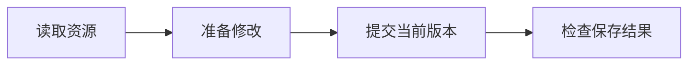

<!-- docs: {"componentSyntax":true,"group":"help","order":90,"title":"阅读步骤、示例与参数","lead":"了解文档中的操作步骤、提示、代码示例、参数和流程图。","evidence":["web/src/docs/rendering"],"related":["overview","sdk-quickstart"],"data":{"sample":"{\n  \"revision\": 2,\n  \"status\": \"saved\"\n}","states":{"headings":["阅读位置","可以做什么"],"rows":[["左侧导航","按功能查找文章"],["右侧目录","跳到当前文章的章节"],["代码示例","复制代码或切换语言"]]}}} -->

# 阅读步骤、示例与参数

<Lead>
文档会把操作顺序、输入输出和注意事项放在不同的展示块中。下面的例子展示这些内容的阅读方式；你可以直接尝试复制代码、缩放图表和跳转目录。
</Lead>

<Purpose title="找到需要的信息">
<PurposeItem title="按目标阅读" icon="knowledge">
第一次使用时从首页的阅读路径进入，再按步骤完成配置。
</PurposeItem>
<PurposeItem title="按操作查询" icon="tools">
已经知道要做什么时，使用搜索或模块目录定位接口与参数。
</PurposeItem>
</Purpose>

<Steps id="reading-steps" title="跟随操作步骤">
<Step title="确认前置条件">

检查文章要求的账号权限、工作空间和已有资源。

<Callout type="info" title="工作空间">
文章中的业务资源属于当前工作空间。复制示例后，使用你自己空间内的资源标识。
</Callout>
</Step>
<Step title="执行并检查结果">

按顺序执行操作，用结果示例确认返回内容。代码块右上角可以复制原文。

<DataCode source="sample" language="json" />
</Step>
</Steps>

<SectionGroup id="examples" title="比较输入和输出">
<Subsection id="paired-example" title="并排示例">
<Example title="一次文档编辑">
<ExamplePanel title="编辑前">

读取当前文档和版本，再准备本次修改。

</ExamplePanel>
<ExamplePanel title="编辑后">

读取返回的新版本，在网页中查看保存后的内容。

</ExamplePanel>
</Example>
</Subsection>
<Subsection id="input-output" title="内容转换示例">
<ChunkExample title="从段落到内容块">
<ChunkInput label="输入段落">

第一段介绍项目。第二段说明下一步。

</ChunkInput>
<ChunkOutput label="内容块" description="每个块保留独立内容">

- 第一段介绍项目。
- 第二段说明下一步。

</ChunkOutput>
</ChunkExample>
</Subsection>
</SectionGroup>

<Section id="parameters" title="阅读参数与提示">
<FieldGroup>
<Field name="revision" type="integer" required="true">

读取资源时返回的保存版本。提交编辑前使用当前版本。

</Field>
<Field name="timeout" type="number" defaultValue="30">

此处为参数展示示例。具体超时单位和默认值以对应接口说明为准。

</Field>
</FieldGroup>

<Callout type="tip" title="保留上下文">
通过右侧目录跳到章节后，可以复制浏览器地址分享这个位置。
</Callout>

<Callout type="warning" title="处理版本冲突">
遇到版本冲突时，先读取最新内容，再决定如何调整修改。
</Callout>

<DataTable source="states" />
</Section>

<Section id="diagrams" title="流程图与公式">

流程图支持缩放、复位与查看源码。手机上可在图表区域内滚动。

公式可以放在段落内，例如 $n + 1$，也可以单独展示。

<Formula source="r_{next} = r_{current} + 1" label="保存后的版本递增" />
</Section>

<Section id="screenshots" title="界面与关联文章">
<Screenshot src="/docs/files-library.jpg" title="文件库界面">

界面截图用于帮助定位控件；实际内容以当前工作空间为准。

</Screenshot>
<CardGroup>
<Card title="回到阅读路径" href="/docs.html?page=overview" icon="knowledge">
按你的目标选择下一篇文章。
</Card>
<Card title="开始自动化" href="/docs.html?page=sdk-quickstart" icon="tools">
安装 SDK，运行第一段工坊自动化。
</Card>
</CardGroup>
</Section>
