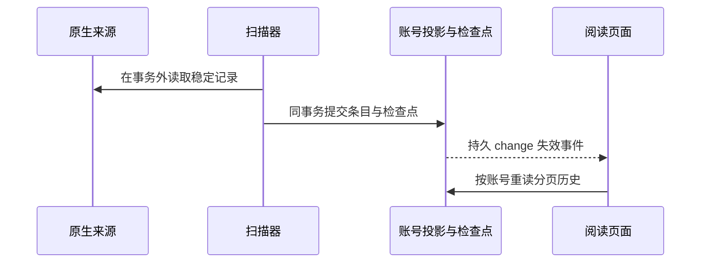

# Agent 工作台：原生会话、检查点与账号投影

Agent 工作台从管理员专属「云控」进入，入口为 `/agents`，读取已经存在的本机编程会话。原端继续维护会话，FPL 按账号保存可重建的阅读投影与检查点，再通过变化事件通知页面重读。来源绑定和附件范围是私人文件访问边界，原生记录的标题、项目路径和宿主证据则帮助用户判断当前正在阅读什么。

## 从来源到阅读副本，哪些状态由谁拥有

```fpl-canvas
agent-workbench
```

图例：左侧是明确绑定的原生记录，中间是只读适配与账号投影，右侧是页面；来源记录在原工具拥有的目录，投影与检查点在 FPL 的 SQLite。连线表示读取和已提交后的失效通知，不授予原工具控制权。

例如 Codex 的 sessions 与 archived_sessions 可以含压缩 JSONL，Claude Code 使用项目日志，OpenCode 可以来自只读 SQLite 快照或已经运行的本机 HTTP 实例。适配器将原生身份、消息、工具结果及时间归一化，业务层再决定当前账号可以保存哪些来源与会话。读取不会修改原端文件，也不为来源启动新 Agent。

## 一次完整记录如何变成可见消息



图例：实线是读取或提交，虚线是提交后的通知。事件只说明什么可能变化，页面重新读取数据库投影；半条 UTF-8 或未完成 JSON 不提前作为完整正文提交。

扫描器同时处理增量、文件重写、轮转和压缩帧。检查点不能先于条目提交，否则重启会越过尚未保存的内容；条目不能脱离检查点单独完成，否则重试会制造重复。原生身份参与去重，文本相同的不同条目仍分别保存。Pi 的祖先节点和分支路径独立解析，避免把互斥分支拼成一段聊天。外部文件读取与解压在数据库写事务外执行，提交阶段只负责已经准备好的确定性变更。

## APP、CLI 与来源待确认的证据

工作台只根据原生标记确认来源。Codex 的 originator/source 和 Claude 的 entrypoint 可以构成证据，存储位置本身不保证来自 APP 或 CLI。缺少依据时显示待确认，不能因为文件位于某个常见目录就给出确定宿主身份。多个文件描述同一原生会话时需要按身份合并；不同原生会话不能因为标题相同而合并。

OpenCode HTTP 来源必须是用户明确提供的回环地址，不接受 URL 凭据、外部主机、重定向和任意路径。SSE 仅触发快照补读，断开时回退周期校准；它不意味着 FPL 已取得对话提交、审批、取消或窗口控制能力。历史阅读也不依赖 Amadeus 的执行开关，登录状态及模型配置不会从阅读来源自动继承。

管理员降级或账号停用后，HTTP、事件流与后台采集停止访问；已有副本和检查点仍归原账号所有。独立服务装配保留在服务化分支，正式切换遵循其验收流程。

## 授权、分页与附件构成同一账号边界

候选发现与新来源绑定需要桌面私有传输和浏览器 Session。绑定时确认当前账号保存副本，并用 SQLite 写入串行化检查重叠根目录，防止其他账号认领同一私人来源。之后的列表、正文、全文索引、分支、事件和附件仍逐项校验 owner。跨账号 ID 按不存在处理，平台管理员没有额外的私人会话读取权。

历史按游标读取，前端保留上翻位置；新内容用失效提示引导返回底部。暂停跟随只暂停当前阅读视图，来源停用才停止采集。来源不可达时仍保留已有投影，解绑不删除原生日志。只有相关来源均停用，才能通过带 revision 的正式接口清除 FPL 阅读副本；恢复同步后可重新读取原端内容。

附件只允许已同步消息实际引用、且位于绑定根内的普通文件。目录描述符逐层打开，拒绝符号链接和根外文件，单文件限制 16 MiB。项目路径出现在消息里并不授权读取整个项目。SSE 还周期复核 Session，过期时关闭；事件游标超前或重放过多时返回 reset，由页面重读当前投影。

> [!WARNING]
> 阅读投影不是原生会话的恢复包。本批输入区禁用，不提交提示词、不安装 Hook、不修改个人工具配置，也不通过数据库修复检查点。正式升级使用登记迁移和停机备份，测试使用隔离来源与数据库。

## 相关阅读

- [绑定与持续同步](/apps/thought-workshop/official-knowledge-bases/agent-workbench/documents/workflow)
- [素材上传、引用与预览](/apps/thought-workshop/official-knowledge-bases/technical/documents/assets)

## 代码入口

1. `backend/studio/host/session_collection`
2. `backend/studio/apps/agent_workbench/sync/runner.py`
3. `web/src/features/agent-workbench/AgentWorkbenchPage.tsx`
