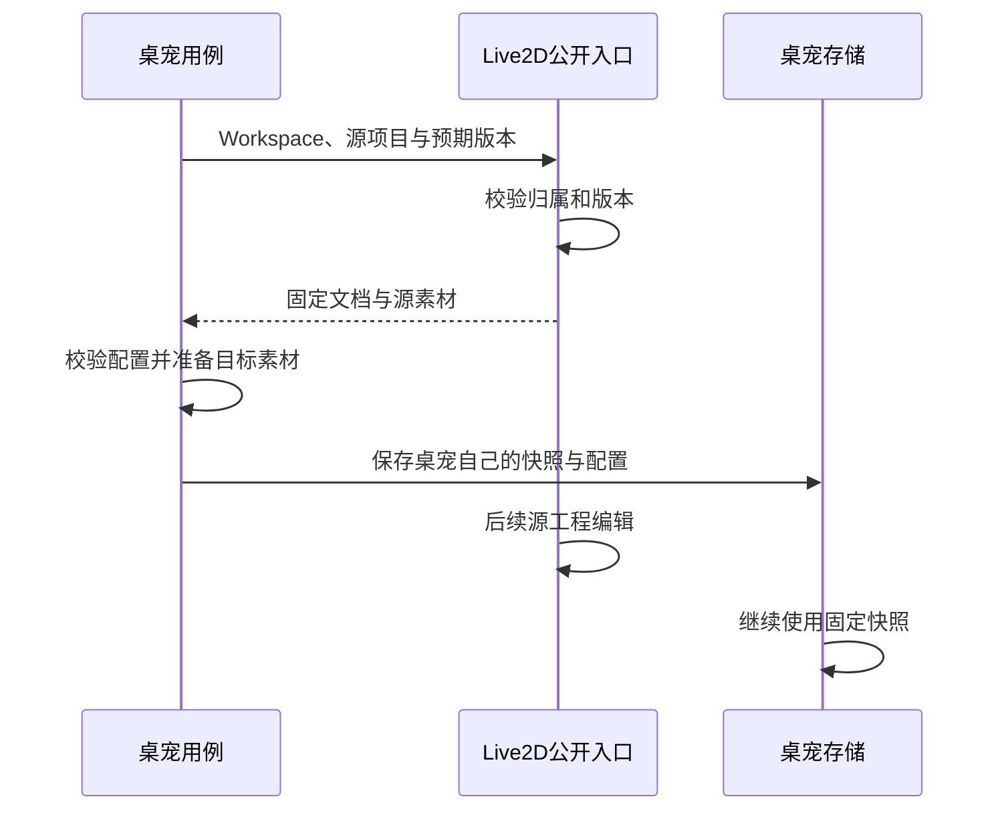

# 公共能力复用与应用交接

Galgame 和视频剪辑都能导出视频，是否应该让 Galgame 直接调用视频剪辑的项目代码？这会把一个应用的内部生命周期变成另一个应用的隐含依赖。共同需求由公共媒体能力承担；只有明确的跨应用交接才经过目标的公开入口。

本篇区分代码复用、运行调用和资源迁移，用三条登记的 App 依赖及 Galgame 的直接渲染解释边界。相同技术实现不等于相同业务所有权。

## 图一：公共能力与应用交接的不同路径

复用渲染和创建目标应用数据，为什么需要不同接口？

```fpl-canvas
app-handoffs
```

图例：箭头标注消费者到公开目标的调用。上、下排应用名称表示逻辑模块，不表示独立服务。桌宠到 Live2D 的箭头是请求方向，响应中的快照反向返回。

视频剪辑向视觉工坊交接片段、特效制作向视频剪辑交接成片、桌宠读取 Live2D 固定快照，是架构登记的 App 依赖。两种媒体交接使用公开入口；固定快照入口是只读的。公共媒体渲染没有项目管理职责，各应用继续拥有自己的默认文档、素材组装和任务记录。

## 图二：固定快照怎样跨越边界

源工程后来变化，为什么不应直接改变目标桌宠？



图例：实线表示调用或内部动作，虚线表示返回。后续源编辑没有指向目标存储的传播箭头；显式更新是另一个用例。

快照给目标一个明确的资源版本，素材复制给目标自己的文件生命周期。它不会持续共享 Live2D 的可变工程对象。读取入口验证 Workspace；桌宠自己的保存仍验证配置、素材和 revision，不因为来源合法就跳过目标规则。

## 三种复用应分别判断

公共能力复用依赖有契约的数据，如媒体时间线和素材解析器；共享 UI 复用展示或交互，不拥有跨应用项目；应用交接则需要明确来源、目标、权限和成果身份。把它们都叫“公用组件”，会掩盖究竟谁负责事务与错误恢复。

App 默认不相互导入。Web 已登记的交接从目标公共入口导入，后端桌宠只导入 Live2D public 模块。Galgame 直接导出依赖 media_rendering；显式视频编辑器交接是独立业务流程，不能把它推导成可任意导入另一个应用的内部包。

## 输出成片与交付工程的区别

将特效成片交给视频剪辑，需要目标可读取的素材和新工程数据；它不代表接收方获得全部关键帧。把一段视频片段交给视觉创作，需要可托管的输入，不是把当前播放器对象递给对方。原始工程、交换包和最终视频的可编辑性不同，接口应该表达实际成果。

源输出失败时不应创建一个声称可播放的完整成果；目标版本冲突时不能用新 revision 盲目覆盖。文件准备与数据库切换需要失败补偿，已保存来源应保持可用。不同交接用例的具体回滚规则分别核对，不声称跨应用或磁盘与数据库之间存在通用分布式事务。

## 边界如何验证

架构测试检查允许的依赖对和公开入口；业务测试检查跨空间读取失败、来源版本变化、目标素材缺失和写入冲突。渲染测试验证直接导出无需视频编辑器内部实现。这样的证据允许某个 App 重写自己的内部组件，而消费者继续使用同一个明确接口。

> [!NOTE]
> 箭头必须说明是请求、数据返回还是代码依赖。固定快照和公开入口不能被理解为实时共享工程。

## 相关阅读

- [时间线与媒体渲染](/apps/thought-workshop/official-knowledge-bases/technical/documents/rendering)
- [桌宠：固定角色快照与运行事件](/apps/thought-workshop/official-knowledge-bases/technical/documents/desktop-pet)
- [视觉创作工坊：节点图与生成任务](/apps/thought-workshop/official-knowledge-bases/technical/documents/visual-workshop)

## 代码入口

1. `tests/test_architecture.py`
2. `backend/app/apps/live2d_workshop/public.py`
3. `backend/app/capabilities/media_rendering/contracts.py`
