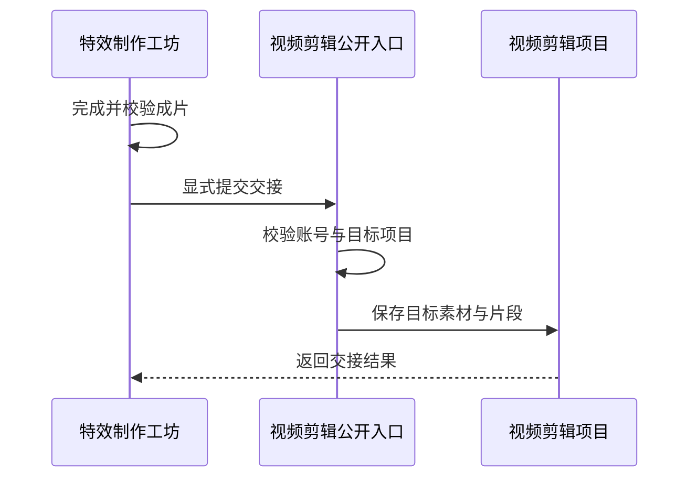

# 公共能力复用与应用交接

Galgame 和视频剪辑都能导出视频，共同的画面求值与编码需求由公共媒体能力承担；创建另一应用的项目或素材，则必须经过目标的公开入口。本篇用两条登记的 App 依赖解释复用和交接的边界。

## 图一：公共能力与应用交接的不同路径

复用渲染和创建目标应用数据，为什么需要不同接口？

```fpl-canvas
app-handoffs
```

图例：箭头从消费者指向调用目标；上排表示应用，下排表示公共媒体能力，不表示独立服务。视频剪辑向视觉工坊交接片段，特效制作向视频剪辑交接成片，是架构登记的两条 App 依赖。公共媒体渲染没有项目管理职责，各应用继续拥有自己的默认文档、素材组装和任务记录。

例如，Galgame 直接导出路线视频时消费 media_rendering，不需要加载视频剪辑的项目代码。只有用户显式选择视频编辑器交接时，才创建目标应用的数据。

## 图二：成片怎样跨越应用边界

特效镜头完成后，怎样让视频剪辑拥有自己的素材生命周期？



图例：实线表示调用或保存，虚线表示结果返回。源工程后续编辑没有自动传播到目标项目的箭头。验证交接后，应能在视频剪辑中找到对应素材和片段；源工程继续修改时，目标内容保持已交付版本。

## 三类边界

| 需求                     | 所属边界                  | 验证结果                                  |
| ------------------------ | ------------------------- | ----------------------------------------- |
| 多个应用求值与编码画面   | 公共 media_rendering 能力 | 输出可复现，调用方不依赖另一 App 内部实现 |
| 创建目标项目的素材与片段 | 目标 App 公开交接入口     | 目标归属、素材与 revision 校验通过        |
| 查看交接后的作品         | 目标 App 自己的读取用例   | 目标拥有独立的保存与恢复生命周期          |

App 默认不相互导入。Web 的交接从目标公共入口导入，`tests/test_architecture.py` 登记允许的依赖；增加新的交接必须同步解释目标所有权与失败恢复，不能把现有例外理解为可任意导入其他应用内部代码。

> [!NOTE]
> 公开交接入口负责创建目标应用的数据。跨应用调用仍需要分别验证账号、目标项目和素材，不能沿用源工程的可写状态。

## 验证与排查

1. 完成一个特效镜头，再显式交给视频剪辑，检查目标素材和片段是否出现。
2. 只修改源工程，确认目标已交付版本保持稳定。
3. 模拟交接失败，检查来源仍可编辑，目标没有不可读取的半成品。
4. 运行架构测试，确认跨应用导入只有已登记的两条路径。

## 失败与恢复边界

交接前的编码失败由来源应用处理，来源工程仍保留原始素材和编辑状态；交接时的权限、素材或版本校验失败由目标入口报告。两个阶段都不能通过复制数据库记录绕过校验。若网络在返回结果前中断，应先查询目标项目及已有任务状态，确认是否已经生成目标素材，再决定是否重新发起。来源只知道一次显式交接的结果，不持续持有目标应用的可变内部对象。

## 相关阅读

- [时间线与媒体渲染](/apps/thought-workshop/official-knowledge-bases/technical/documents/rendering)
- [组件契约与可替换边界](/apps/thought-workshop/official-knowledge-bases/technical/documents/component-contracts)
- [视觉创作工坊：节点图与生成任务](/apps/thought-workshop/official-knowledge-bases/technical/documents/visual-workshop)

## 代码入口

1. `tests/test_architecture.py`
2. `backend/studio/apps/media_rendering/local/inputs.py`
3. `web/src/features/motion-compositor/module.ts`
