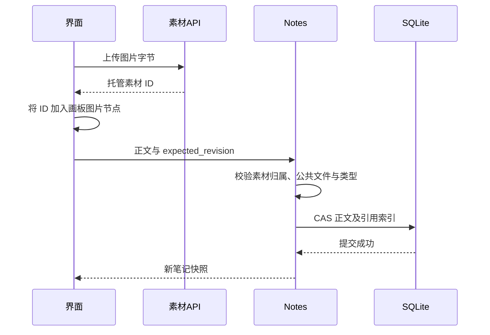

# 素材上传、引用与预览

给画板插入图片后，正文里保存的是图片字节、磁盘路径，还是浏览器显示的地址？当前笔记引用的是托管素材 ID。图片字节由素材能力另行保存，浏览器的 Blob URL 只负责这一轮显示。

这三个对象有不同生命周期。本文跟踪一张图片上传、加入画板、保存、重新预览与解除引用的过程；把整份内容搬到另一台电脑的路径见《导入、备份与导出》。

## 图一：从上传到授权预览的素材路径

什么时候获得长期素材身份，什么时候只获得临时显示地址？

```fpl-canvas
assets
```

图例：箭头表示素材身份或字节经过的处理。正文到引用索引经过功能校验；预览 URL 不反向写入正文，也不成为素材的永久身份。

正式上传验证并托管文件，返回当前账号中的素材身份。图片节点将 assetId 加入文档；Notes 保存时检查可引用的公共文件、图片类型和归属。读取字节仍需鉴权，前端据此创建可回收的对象 URL。记录和实际文件是并列持久数据，不能仅备份 SQLite 就认为图片也已保存。

## 图二：一次带图片的笔记保存

上传成功以后，为什么还需要在正文保存中检查素材？



图例：图中素材上传和正文提交是两个操作。Notes 表示所属功能而不是另一条特殊 API；响应由路由映射。图片上传成功不表示笔记保存成功。

正文写入可能因为版本冲突或素材条件变化而失败。上传得到一个可使用 ID，不能绕过后续引用检查。当前 Notes.validate_refs 对笔记引用要求公共文件，并确认图片节点引用 image 类型；项目内部素材不能只靠替换 ID 强行嵌入。

## 素材记录与磁盘文件的责任

素材元数据记录归属、媒体类型、文件名和大小等信息，AssetStorage 按受控路径保存字节。业务用例传 IncomingFile，路由才使用 UploadFile；项目路径及写入方法显式传 owner_user_id。调用方不能把客户端路径直接当作托管目录，也不能让后台任务借用一个全局“当前账号”。

界面上文件名称用于识别与展示，稳定 assetId 用于关联；临时供应商 URL 与 Blob URL 都不是磁盘文件身份。生成结果先通过下载和本地结算成为托管素材，才具备可再次引用的持久结果。

## 预览为什么需要取消和回收

useApiBlobUrl 统一管理鉴权读取、请求取消、异步竞态与 Object URL 回收。切换图片或组件关闭后，旧响应不能替代当前资源；释放对象 URL 避免大图片持续占用内存。需要自己维护缓存的播放器有独立生命周期，不能把这项例外推导成每个页面都复制预览实现。

读取失败应保留文档结构并提示素材问题，不把缺失图片替换成错误的跨账号 URL。预览看到图片只说明当前读请求可用，不能证明导出时已取得全部历史引用文件。

## 删除引用和删除文件不是同一件事

当前正文移除图片会改变引用索引，历史快照、模板或其他内容仍可能持有旧引用。删除文件要经过正式用例的引用检查，不直接删磁盘路径。完整备份还收集历史和模板使用的文件；迁移创建新身份并重写引用，不沿用来源账号 ID。

验证上传后重新打开笔记、引用非图片文件被拒绝、跨账号 ID 不可读、切换预览不展示旧响应，以及仍被历史引用的文件不能错误删除。对失败分别记录素材 ID、笔记 revision 与读请求错误，才能区分文件、引用和保存三个阶段。

> [!NOTE]
> assetId 用于持久引用，Blob URL 用于当前预览，供应商 URL 用于取回外部结果。这三者不能互换。

## 相关阅读

- [核心对象与数据归属](/apps/thought-workshop/official-knowledge-bases/technical/documents/data-model)
- [导入、备份与导出](/apps/thought-workshop/official-knowledge-bases/technical/documents/data-exchange)
- [账号与权限](/apps/thought-workshop/official-knowledge-bases/technical/documents/identity)

## 代码入口

1. `backend/studio/apps/asset_library/storage/file_paths.py`
2. `backend/studio/apps/thought_workshop/notes.py`
3. `web/src/platform/api/useApiBlobUrl.ts`
