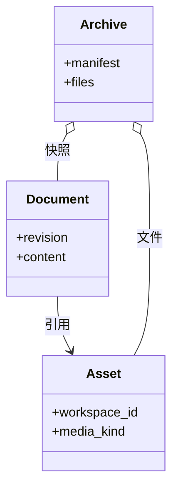

# 素材与导出：引用、快照和包有什么不同

## 先理解它解决什么问题

素材 ID 是受管理内容的引用，不是任意磁盘路径。编辑文档保存语义结构，素材系统保存二进制；完整备份把两者一起搬运，图片或视频导出则把结果固化为可阅读或可播放的成品。

**贯穿实例：** 画板中插入图片会保存素材 ID。完整备份导入时生成新的资源身份并重映射画板引用；导出 PNG 只得到像素，不能恢复每一个图形元素。

## 图一：完整备份将文档与素材一起搬运

```fpl-canvas
assets
```

图例：两张文件卡片分别代表语义数据与二进制。备份汇合它们，导入时重建对应关系。只导出一张 PNG 会失去元素结构，不能替代此路径。

## 图二：文档、素材与归档的概念类图



图例：箭头表示素材引用，空心菱形表示归档聚合内容。Archive 是可移植包的概念，不是数据库中的另一个活动项目；实际字段以对应应用导出清单为准。

## 实现与设计取舍

保存时提取正文、历史和画板中的素材引用，校验资源存在且属于当前空间。预览通过鉴权 Blob URL 管理取消与释放。Markdown 使用相对资源路径，导入完成后再换回新的素材 ID；不在文档里持久化临时 blob URL。

## 异常、验证与当前边界

损坏清单、目录穿越、引用缺失和不支持的媒体应在持久化前失败。删除可见节点不等于立即删除底层文件，历史或其他项目仍可能引用它。HTML 离线导出与完整备份用途不同，交付前应实际在断网环境打开结果。

## 代码入口与阅读顺序

1. `backend/app/capabilities/asset_store/storage.py`
2. `backend/app/apps/thought_workshop/portability.py`
3. `web/src/platform/api/useApiBlobUrl.ts`

阅读时先定位输入和校验，再跟踪持久化或执行入口，最后对照输出与错误分支。可以把上方图复制到个人知识库加入自己的注释；副本不会随官方文章自动更新。
