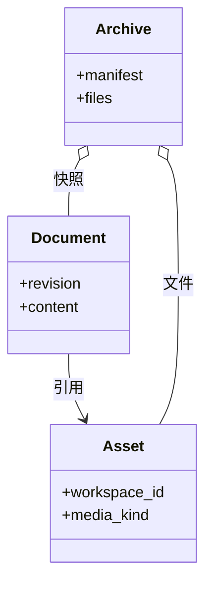

# 素材与导出：引用、快照和包有什么不同

把一篇含画板图片的笔记导出为 PNG，发给另一台电脑后还能拖动里面的节点吗？不能。PNG 保存显示结果，原生笔记保存元素、连线和图片引用；两者承载的信息不同。

要让接收方继续编辑，需要同时搬走文档结构和被引用的图片。本文跟踪一张含图片画板从保存、备份到重新导入的过程，解释为什么素材 ID、文件路径与临时预览 URL 不能互换。

## 完整备份将文档与素材一起搬运

一份可继续编辑的备份，到底要汇合哪些内容？

```fpl-canvas
assets
```

图例：两张文件卡片分别代表语义数据与二进制。备份汇合它们，导入时重建对应关系。只导出一张 PNG 会失去元素结构，不能替代此路径。

左上是笔记结构，左下是实际文件。备份包用清单把二者联系起来；导入先检查文件和引用，再创建新的资源身份并重写文档中的 ID。接收端不需要拥有原空间的 ID，也不应直接复用它们。

## 文档、素材与归档的概念类图

文档、素材和归档的关系，为什么不能简化成“把正文复制一遍”？



图例：箭头表示素材引用，空心菱形表示归档聚合内容。Archive 是可移植包的概念，不是数据库中的另一个活动项目；实际字段以对应应用导出清单为准。

文档持有引用，素材提供字节，归档同时携带二者。若历史快照仍引用旧图片，仅查看最新正文会漏掉需要保留的文件。相反，导出一份用于阅读的 HTML 可以固化图形，却不承担还原所有历史和编辑结构的责任。

## 素材 ID 不是可公开访问的 URL

图片元素保存托管素材 ID。读取时由 API 验证身份和空间，前端使用受管理的 Blob URL 显示；这个 URL 有生命周期，不能写回笔记作为长期来源。保存画板还会校验图片类型和归属。

跨库剪贴板与可移植包都要处理引用迁移。图片字节不存在时，不能假装迁移成功并把原 ID 塞进目标文档。迁移失败应留下原稿，给出明确错误；上传了部分文件也不代表整篇正文已经成功导入。

## 选格式前先确定交付目标

| 接收方要做什么         | 应保留的内容                 | 合适的出口       |
| ---------------------- | ---------------------------- | ---------------- |
| 继续编辑并保留历史     | 文档、目录、历史、引用文件   | 完整备份         |
| 与文本工具交换后再导入 | Markdown、图表源码、相对资源 | Markdown 包      |
| 离线阅读整篇           | 排版和可显示的图形、图片     | HTML 或 HTML ZIP |
| 放进报告或幻灯片       | 一幅图的视觉结果             | SVG / PNG        |

未知场景版本、包内路径穿越和缺失资源应在正式导入校验中处理。删除文档中的图片只解除当前引用，历史或其他内容仍引用时，底层文件可能必须保留。

> [!NOTE]
> fpl-canvas 代码块保存画板场景，通用 Markdown 阅读器通常只显示源码。需要让接收方直接看图时，选择 HTML 或图片；需要继续编辑时保留原生数据。

## 相关阅读

- [Workspace 与权限：资源为什么不能串空间](/apps/thought-workshop/official-knowledge-bases/technical/documents/identity)
- [思绪工坊：富文本、画板与知识库](/apps/thought-workshop/official-knowledge-bases/technical/documents/thought-workshop)
- [思绪工坊：导入导出与交付](/apps/thought-workshop/official-knowledge-bases/thought-workshop/documents/delivery)

## 代码入口

1. `backend/app/capabilities/asset_store/storage.py`
2. `backend/app/apps/thought_workshop/portability.py`
3. `web/src/platform/api/useApiBlobUrl.ts`
