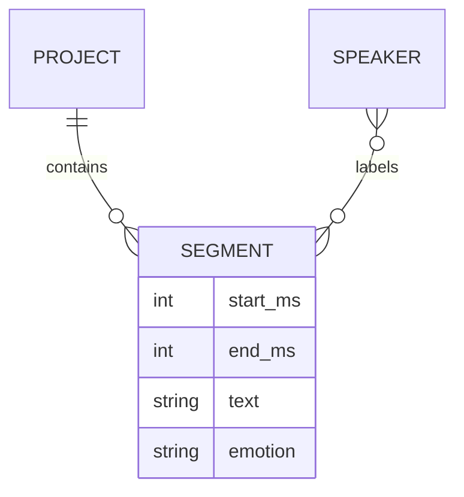

# 录音标注：时间片段、说话人与转写

一段录音里，甲的话还没结束，乙已经开始回答。只给这个区间写一句文本和一个名字，可能无法表达真实音频；转写模型给出的文字也不会自动证明片段边界正确。

录音标注将连续音频组织为带时间、文本与标签的片段。本文从这次说话人交接出发，说明波形、转写、多人关联与人工审核各自提供什么事实。

## 分段标注的三类信息汇入片段

一个片段需要汇合哪些信息，才能成为有用的标注？

```fpl-canvas
audio-annotation
```

图例：音频边界、转写文字、说话人标签是三个独立来源；中间片段将它们组合起来。任一来源变更后都要检查对应关系，单纯导出成功不能证明标签正确。

波形和试听定位起止时间，转写或人工输入提供文字，说话人及情绪提供标签。这三路需要相互核对：文字正确但时间偏移，导出的标签仍然对应错误音频；说话人名字相同也不代表其身份 ID 相同。

## 片段与说话人的概念关系

片段一定只能属于一个说话人吗？当前文档如何表达多人情况？



图例：双竖线表示一个，圆圈与叉脚表示零到多个。一个项目包含多个片段，片段与说话人可以多对多关联；字段展示起止毫秒和文本等核心信息，未展开多语言与按说话人记录的情绪。

片段可以没有说话人，也可以关联多个 speaker_ids，并保留按说话人区分的情绪。主 speaker_id 与列表第一项保持一致。图中的多对多关系因此比“每段恰好一人”更准确，但多人列表本身不会自动拆分或分离音频。

## 用毫秒与稳定 ID 保持对应关系

当前片段保存 start_ms、end_ms、文本、审核状态，以及可选语言和多语言文字。起止区间必须有效；说话人列表不能重复，主说话人与列表须一致，多语言条目也需要合法且明确的语言身份。

编辑边界时先试听换人位置，再决定分段或多人关联。将模型初稿直接标为已审核会混淆来源与确认状态：模型只提供候选文本，人工校对才确认这份标注是否符合目标。

## 转写、保存和导出是三个步骤

转写用例负责模型输入与结果适配；文档保存负责版本、结构与引用；导出模块转换为目标格式。模型失败不应清空已有人工标注，空转写也不一定意味着音频没有内容。

导出前检查关键边界、说话人 ID、情绪和语言字段，并确认目标格式能表达需要的结构。文件成功生成不证明片段和声音对齐；当前功能也不承诺自动完成所有说话人分离和语义理解。

> [!TIP]
> 对重叠语音先确定标注目标：是保留同一时间片段的多人标签，还是重新切出更细的可听区间。不要为了让表格整齐而改变真实音频边界。

## 片段编辑与转写结果怎样汇入项目

项目拥有音频身份、说话人、毫秒片段、文本与情绪；播放器当前进度和选中片段属于视图。CreateProject、DeleteProject 与 EditDocument 负责创建、删除和编辑规则，SavedAudio 通过快照、裁切与识别端口提供项目数据、字幕或片段交付。模型返回的文本仍需与明确音频区间关联，不能直接改变另一段正在编辑的草稿。

一次修改说话人应命中稳定 ID 并保留时间区间，保存时比较项目版本；导出消费确认内容。重叠语音允许多个关联，不能因为界面当前只选中一个人就删除另一标签。SRT 与项目 JSON 保留信息不同，导出字幕不等于迁移全部工程。

## 时间区间和识别失败分别验证

检查毫秒边界、片段结束晚于起点、重叠关系、删除说话人后的引用、保存冲突与未配置转写模型。识别失败保留已有标注，输入区间变化后重新确认采用哪个结果。重新打开项目与裁切实际音频对应，才能证明文本和源声音没有错位。

## 相关阅读

- [供应商适配与流式推理](/apps/thought-workshop/official-knowledge-bases/technical/documents/providers)
- [编辑、保存、历史与并发](/apps/thought-workshop/official-knowledge-bases/technical/documents/revision)
- [录音标注工坊：导入导出与交付](/apps/thought-workshop/official-knowledge-bases/audio-annotation/documents/delivery)
- [核心对象与数据归属](/apps/thought-workshop/official-knowledge-bases/technical/documents/data-model)

## 代码入口

1. `backend/studio/apps/audio_annotation/schemas/document.py`
2. `backend/studio/apps/audio_annotation/transcription.py`
3. `backend/studio/apps/audio_annotation/use_cases/saved_audio.py`
