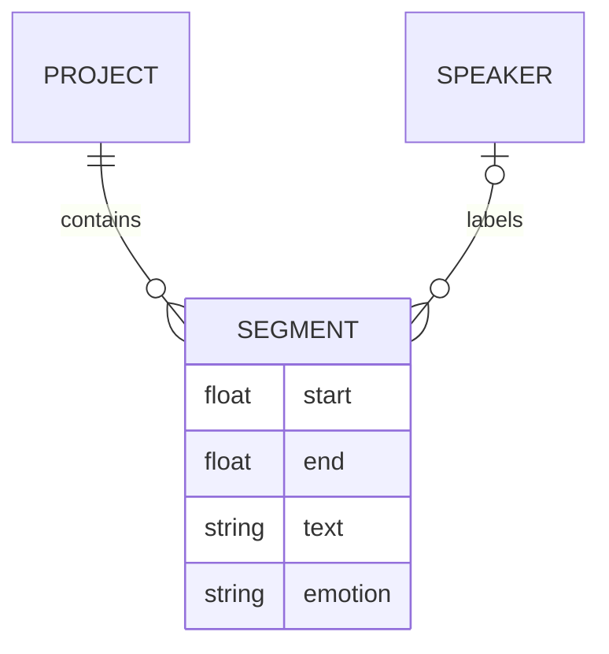

# 录音标注：时间片段、说话人与转写

## 先理解它解决什么问题

录音标注将连续音频分成可定位的片段，每段关联时间、文本、说话人与情绪等信息。波形帮助定位，转写模型提供初稿，人工校对决定最终标注含义；模型结果不等于已验证的真值。

**贯穿实例：** 一句话横跨两个说话人时，先在实际换人位置调整片段边界，再分别填写文本和说话人。仅修改文字而不检查音频区间会导致导出标签错位。

## 图一：分段标注的三类信息汇入片段

```fpl-canvas
audio-annotation
```

图例：音频边界、转写文字、说话人标签是三个独立来源；中间片段将它们组合起来。任一来源变更后都要检查对应关系，单纯导出成功不能证明标签正确。

## 图二：片段与说话人的概念关系



图例：双竖线表示一个，圆圈与叉脚表示多个。片段可以未指定说话人，因此该端使用可选关系；emotion 是理解标签的简化字段，实际文档还支持更丰富的说话人情绪结构。

## 实现与设计取舍

项目与文档 schema 约束片段结构，转写用例负责模型输入与结果适配，导出模块负责目标格式。分段试听关注时间区间，保存关注版本与引用。新增情绪或说话人时必须保持已有片段标签可解释，不能靠显示名称推断身份。

## 异常、验证与当前边界

验证起止时间合法、片段未越过音频长度、说话人与文本对应。空转写、模型失败与人工空白标注含义不同，应保留明确反馈。导出前试听关键边界，当前功能不是自动完成所有语音理解任务的承诺。

## 代码入口与阅读顺序

1. `backend/app/apps/audio_annotation/schemas/document.py`
2. `backend/app/apps/audio_annotation/transcription.py`
3. `backend/app/apps/audio_annotation/exports.py`

阅读时先定位输入和校验，再跟踪持久化或执行入口，最后对照输出与错误分支。可以把上方图复制到个人知识库加入自己的注释；副本不会随官方文章自动更新。
