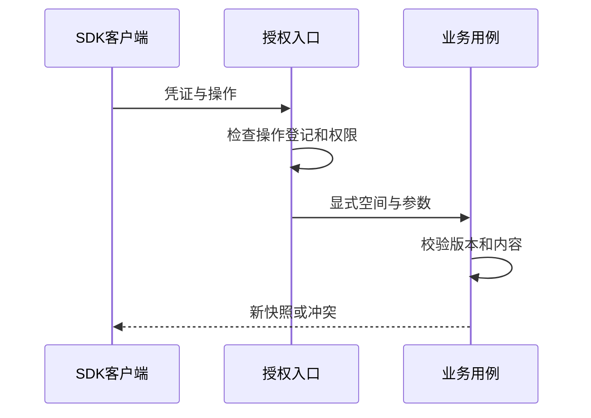

# 集成与 Agent/SDK：受控的自动化入口

## 先理解它解决什么问题

工具 API、MCP 和 Skill 表达外部能力，SDK 表达对本项目正式业务 API 的调用。自动化不是直接改数据库的后门；同样要携带身份、满足权限和版本前提。

**贯穿实例：** Agent 为演示文稿增加一页，应先读取当前文档和 revision，调用已公开的业务操作，再读取结果确认。桌面私有启动 token 不应暴露给脚本。

## 图一：两种客户端共用正式业务边界

```fpl-canvas
automation
```

图例：两个客户端入口共用业务规则，但凭证与传输方式不同。桌面通道额外按操作登记表放行，普通 HTTP SDK 仍遵循路由权限；均不能直接修改数据库文件。

## 图二：授权请求到业务结果



图例：授权入口先验证身份和权限，桌面通道再检查操作是否登记。业务用例校验内容与版本后返回新快照，冲突也是正式结果，客户端必须显式处理。

## 实现与设计取舍

桌面 Agent 通道只开放登记表中的操作，新 API 默认拒绝。独立 Python SDK 不依赖后端运行时。界面与 Agent 调用共用用例和 CAS 规则，具名方法存在不等于已验证完整业务闭环。思绪工坊 AI 写作通过 Agent/SDK 接入，应用内不增加写作入口。

## SDK 示例：为现有知识库创建可编辑画板

下面的函数接收已经完成认证的 `Client` 和调用者明确选择的知识库 ID。它先读取目录版本，再创建一篇包含画板的新笔记；不写本地数据库，也不把界面选中的 Workspace 当作隐含参数。

```python
from future_props_lab import Client


def create_diagram_note(client: Client, knowledge_base_id: str):
    library = client.thought.knowledge_base(project_id=knowledge_base_id)
    scene = {
        "sceneVersion": 1,
        "title": "请求入口",
        "elements": [{
            "id": "request",
            "kind": "rounded",
            "x": 40, "y": 40, "width": 220, "height": 100,
            "text": "输入经过校验后保存",
            "fill": "#eef5f3", "stroke": "#365f62",
        }],
        "edges": [],
    }
    created = client.thought.create_note(body={
        "knowledge_base_id": library.id,
        "expected_knowledge_revision": library.revision,
        "title": "我的架构说明",
        "schema_version": 2,
        "document": {
            "type": "doc",
            "content": [{"type": "canvas", "attrs": {"scene": scene}}],
        },
    })
    return client.thought.get_note(note_id=created.id)
```

连接参数与 API Key 由调用者安全提供，示例不保存凭证。`schema_version: 2` 是笔记格式，`sceneVersion: 1` 是画板格式，二者不能混用。修改已有笔记时先 `get_note`，保留其标题、目录归属、标签和标记，再携带 `expected_revision` 调用 `put_note`；不能用创建示例覆盖已有正文。

收到 409 应重新读取并让调用者决定下一步，不重放旧创建请求。连接断开导致创建结果不明时，应先查看目标库是否已有结果，避免创建重复笔记。完整的鉴权与连接方式见[SDK/API 使用指南](/apps/thought-workshop/official-knowledge-bases/general/documents/automation)。

## 异常、验证与当前边界

连接中断后先检查资源和任务结果，不能重复提交外部模型请求。API Key 的授权范围与浏览器当前选择空间不是同一个隐含变量。排查时核对权限、操作登记、参数及版本，避免把环境问题误当成业务成功。

## 代码入口与阅读顺序

1. `backend/app/console/governance/desktop_agent_operations.json`
2. `sdk/python`
3. `backend/app/integrations`

阅读时先定位输入和校验，再跟踪持久化或执行入口，最后对照输出与错误分支。可以把上方图复制到个人知识库加入自己的注释；副本不会随官方文章自动更新。
