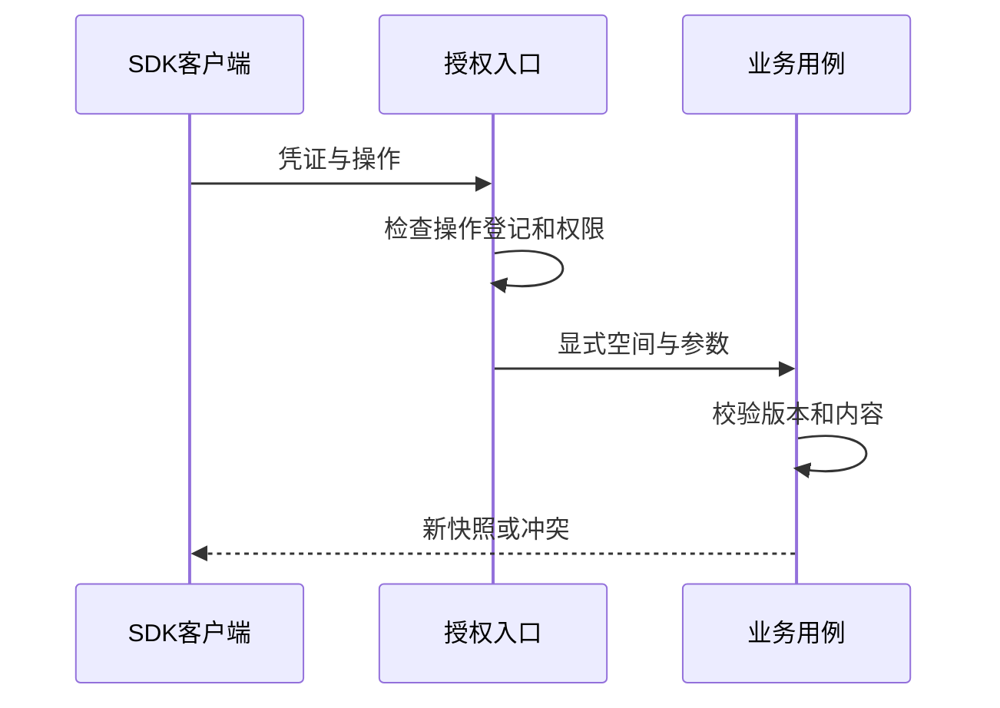

# 集成与 Agent/CLI/SDK

让 Agent 把架构图写进知识库，最关键的不是生成 JSON，而是明确写到哪一个库、使用哪个版本，以及失败后是否已经创建成功。

本文以创建一篇可编辑画板笔记为例。SDK 和网站 CLI/MCP 都调用正式业务能力：它们不会获得绕过权限、直接修改 SQLite 的特殊通道。外部工具、MCP 和 Skill 提供的是另一类集成能力，也不能代替本项目写入所需的身份与版本。

## 两种客户端共用正式业务边界

HTTP SDK 与 CLI/MCP 都能操作项目，为什么还要区分两条入口？

```fpl-canvas
automation
```

图例：两个客户端入口共用业务规则，但凭证与传输方式不同。CLI/MCP 额外按操作登记表放行，普通 HTTP SDK 仍遵循路由权限；均不能直接修改数据库文件。

普通 SDK 根据配置连接正式 API，授权范围由凭证决定。CLI/MCP 使用网站地址和 Management API Key，并额外限制可调用的操作集合。两者最终进入相同的业务校验；客户端密钥只通过受保护配置或进程环境提供。

## 授权请求到业务结果

一次自动化写入，在哪个环节可能被权限或版本拒绝？



图例：授权入口先验证身份和权限，桌面通道再检查操作是否登记。业务用例校验内容与版本后返回新快照，冲突也是正式结果，客户端必须显式处理。

入口先判断谁在请求、允许执行什么；业务用例再判断目标资源和内容是否有效、版本是否仍然匹配。返回新快照才是可继续操作的依据。仅仅“HTTP 请求已发出”或“SDK 方法存在”都不是成功证据。

## 把目标库和目录版本一起带入创建

下面的同步函数接收已认证的 `Client` 与调用者明确选择的知识库 ID。它读取目录版本，创建画板笔记，再读取结果确认。示例中的图形 ID 是场景内部身份，知识库和笔记 ID 则由服务端管理。

```python
from future_props_lab import Client


def create_diagram_note(client: Client, knowledge_base_id: str):
    library = client.thought.knowledge_base(project_id=knowledge_base_id)
    scene = {
        "sceneVersion": 1,
        "title": "请求入口",
        "elements": [{
            "id": "request",
            "kind": "rounded",
            "x": 40, "y": 40, "width": 220, "height": 100,
            "text": "输入经过校验后保存",
            "fill": "#eef5f3", "stroke": "#365f62",
        }],
        "edges": [],
    }
    created = client.thought.create_note(body={
        "knowledge_base_id": library.id,
        "expected_knowledge_revision": library.revision,
        "title": "我的架构说明",
        "schema_version": 2,
        "document": {
            "type": "doc",
            "content": [{"type": "canvas", "attrs": {"scene": scene}}],
        },
    })
    return client.thought.get_note(note_id=created.id)
```

`schema_version: 2` 描述笔记格式，`sceneVersion: 1` 描述画板格式。添加画板不需要把整篇笔记升级为另一个 schema。连接地址和 API Key 由调用者安全提供，函数不会保存凭证。

仓库还提供 `future_props_lab.canvas_example.thought_canvas_example` 异步示例，演示创建图形、可选托管图片以及导出 Markdown。它接收调用者提供的输出路径；不要把示例路径改成机器上的默认项目或正式数据目录。

## 修改与创建有不同的版本前提

创建新笔记需要知识库目录版本；修改已有笔记则先 `get_note`，保留其目录归属、标签和标记，携带当前 `expected_revision` 调用 `put_note`。不要把上面的创建示例改成不读取旧值的整篇覆盖。

收到 409 后，重新读取并让调用者决定下一步。连接断开导致创建结果不明时，应先在目标库核对是否已有结果，避免重复创建。外部模型提交还涉及供应商执行与费用，更不能自动重放。

思绪工坊的 AI 写作通过获授权 Agent/SDK 接入；应用内没有写作侧栏，也不因此开放任意系统命令或账号治理接口。

> [!TIP]
> 把“目标资源、读取到的版本、请求结果、新快照”作为自动化日志的四个关键字段。不要把密钥、Session 或桌面私有 token 写进笔记或日志。

## 认证、操作白名单与业务前提分别检查

独立 SDK 只消费正式 HTTP 契约，不导入后端 ORM。CLI/MCP 连接使用专用凭据和 Unix Socket，白名单操作是额外入口限制；私有启动 token 不交给 SDK。请求仍需要当前权限、目标归属与 expected_revision，不能因由本机脚本发起就自动获得全局权限。

创建笔记确认目标知识库与目录前提，修改笔记先读取当前快照；调用成功后重新获取或检查返回版本。请求结果不明时先确认目标是否已生成，避免把重试解释成无条件重复创建。

## 让样例证明可观察结果

画板样例说明调用入口、可替换项目参数、权限和预期元素，不只列 SDK 方法。生成任务样例说明提交后查询任务、读取结果的独立阶段；导出样例说明保存版本与交付格式。确定性工作流验证闭环，外部模型凭证缺失时保留明确限制，不借用日常账号真实数据作自动验收。

## 相关阅读

- [账号与权限](/apps/thought-workshop/official-knowledge-bases/technical/documents/identity)
- [编辑、保存、历史与并发](/apps/thought-workshop/official-knowledge-bases/technical/documents/revision)
- [SDK/API 使用指南](/apps/thought-workshop/official-knowledge-bases/general/documents/automation)
- [OpenAPI、Web 与 SDK 契约](/apps/thought-workshop/official-knowledge-bases/technical/documents/contracts)

## 代码入口

1. `sdk/python/src/future_props_lab/canvas_example.py`
2. `sdk/python/src/future_props_lab/generated/resources/thought.py`
3. `backend/app/console/governance/automation_operations.json`
