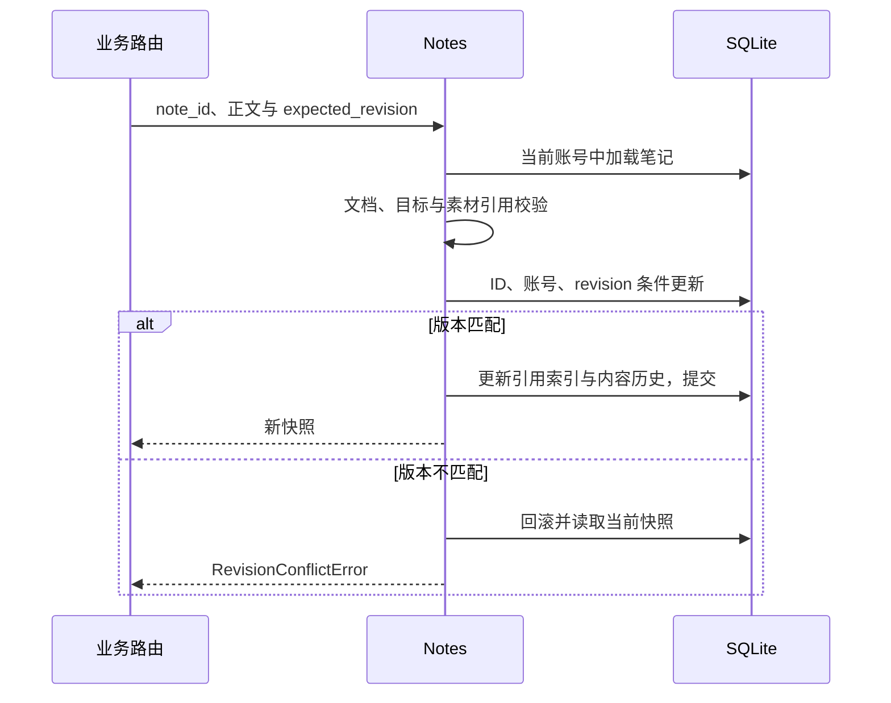

# 后端功能切片与用例边界

给画板保存接口补一项图片校验时，放在路由还是 Notes 用例？如果只在路由检查，历史恢复、导入或 SDK 的其他正式用例可能没有同一规则。边界应围绕业务所有权，而不是围绕文件中哪一行最容易修改。

本篇以 Notes.put 为例解释后端功能切片：路由适配协议，功能用例拥有规则与事务，公共能力提供明确的可复用接口，runtime 提供无业务语义原语。

## 图一：笔记保存的后端职责

哪个组件可以决定写入，哪个组件只负责适配协议？

```fpl-canvas
backend-design
```

图例：箭头表示调用或结果传递，数据库与素材是不同目标。权限原语与功能校验都参与请求，但不会让路由直接持有 ORM 事务。

路由从依赖得到会话与账号，调用 Notes 后将领域结果或错误映射为响应。Notes 了解笔记、目录归属、文档引用和历史；素材能力了解托管文件。文件内容与数据库行的生命周期不同，不能把外部网络或大文件复制放进已经开始写入的长事务。

## 图二：一次版本化正文更新

校验通过之后，如何防止并发窗口覆盖正文？



图例：时序图中的条件更新才是最终并发判定。提前读取 revision 有助于尽早发现冲突，但无法替代数据库 CAS。

Notes.put 先确认笔记存在且未删除，并禁止普通正文保存改变 knowledge_base_id 或 parent_id；目录移动有自己的用例。正文成功写入时同步维护素材引用、文档引用索引和搜索文本，内容变化或历史恢复再追加历史。事务把这些数据库状态放在同一一致性边界内。

## 功能切片为什么包含存取

apps 拥有各创作应用的项目、默认文档、快照和导出规则；console 拥有治理与库级用例；llm 拥有模型与推理；capabilities 提供身份、素材、媒体等有契约的能力。顶层装配注册接口与 ORM，但不是跨功能随意读表的业务入口。

路由不导入 SQLAlchemy、ORM 模型或迁移包，不自行查询和提交。业务用例可以在所属切片内拥有具体存取，不为统一命名而增设 services、domain 等通用层。共享原语能比较 revision，却不应决定每个应用的默认文档和历史政策。

## 请求身份与文件输入要显式传递

StudioPrincipal 是唯一租户来源，业务请求不接收客户端声明 owner_user_id。需要显式空间参数时使用 OwnerDep。功能处理文件接收 IncomingFile，UploadFile 留在路由；AssetStorage 写入显式传账号，后台执行从任务记录恢复空间。隐藏上下文会让离开 HTTP 的 SDK 与后台任务难以验证归属。

## 失败和验证如何落在同一边界

功能错误包含明确领域意义，路由映射为协议错误。跨账号资源返回不存在，CAS 冲突返回 409 和当前快照，缺少 revision 由请求校验拒绝。导入的外部文件准备与失败补偿由导入用例负责，不把“数据库回滚”当成自动清理磁盘的保证。

架构测试检查路由依赖方向和权限登记；笔记 API 测试验证归属、引用、并发与历史。将相同正文通过普通保存、历史还原和正式导入路径验证，才能证明规则属于功能所有者，而不是只覆盖某个按钮。

> [!NOTE]
> AsyncSession 属于单任务。多个并行分支不能共享同一个会话，短事务也不能包住供应商网络等待。

## 相关阅读

- [代码组织与依赖方向](/apps/thought-workshop/official-knowledge-bases/technical/documents/modules)
- [账号与权限](/apps/thought-workshop/official-knowledge-bases/technical/documents/identity)
- [SQLite、事务与迁移](/apps/thought-workshop/official-knowledge-bases/technical/documents/sqlite)

## 代码入口

1. `backend/studio/apps/thought_workshop/notes.py`
2. `backend/app/deps.py`
3. `backend/studio/runtime/database/project_records.py`
