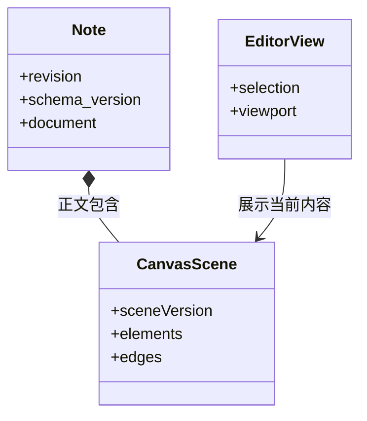

# 组件契约与生命周期

把 React Flow 换成另一个画板库，是否要改数据库、正文导出和所有应用？如果保存的是运行库的内部对象，就可能如此。当前画板保存独立 CanvasScene，交互实现通过场景契约与笔记保存协作。

组件契约不只是 TypeScript 参数类型，还包括状态归属、错误、生命周期和确认结果的含义。本篇用场景编辑和素材预览说明怎样让替换发生在组件边界内。

## 图一：场景契约与运行状态分离

阅读、编辑和导出应该共享哪些数据？

```fpl-canvas
component-contracts
```

图例：箭头表示数据消费关系。场景同时进入保存、阅读与导出，选中和视口只进入临时状态；图不要求三种消费者使用同一 UI 库。

CanvasScene 保留图形身份、几何、样式、连线和允许的图片引用。场景不包含 React Flow 的测量缓存与选中状态。正文拥有场景，笔记拥有 revision，编辑器拥有视图；这些所有者分别负责格式、并发和交互，不能用一个版本字段替代全部规则。

## 图二：格式与写入版本的不同责任

格式版本和 revision 为什么需要同时存在？



图例：实心菱形表示正文包含场景；EditorView 是概念交互状态，没有被画成笔记的持久化子对象。图不是完整 ORM schema。

schema_version 决定正文节点如何解释，sceneVersion 决定场景如何解析，revision 决定修改是否基于当前服务器状态。当前正文读取兼容旧版本并规范化为版本 3；CanvasScene 支持版本 1 和 2，版本 2 补充文字属性和连接锚点。格式适配不能自动解决并发冲突。

## 写清输入输出和可观察承诺

| 边界     | 输入                              | 输出与承诺                         |
| -------- | --------------------------------- | ---------------------------------- |
| 图形编辑 | 已验证场景及内容回调              | 合法语义变更，不持久化临时视图     |
| 笔记保存 | 草稿、资源 ID、预期 revision      | 新快照或明确错误，不静默覆盖       |
| 素材预览 | 已授权 API 资源及当前组件生命周期 | 可显示对象 URL，切换后不复用旧结果 |
| 静态导出 | 场景、已校验素材与导出格式        | 安全图形输出，不执行任意 HTML      |

这些承诺让调用方只了解接口，不需要伸进组件内部修改 ref、缓存或 ORM 对象。公开输入要足以重建行为；共享可变对象会让调用顺序隐含改变结果。

## 生命周期是契约的一部分

请求完成前关闭笔记，返回结果不能写进新打开的资源。预览取消后需要释放 Object URL；图形菜单打开只改变外围状态，不能重建图形实例或把缩放恢复为初始值。组件内部可以使用 ref 管理在途工作，但不能把内部 ref 交给另一个功能当共享状态。

复制官方图形时克隆场景，创建个人笔记并附来源链接；个人副本随后拥有自己的 revision，修改它不会写回官方 JSON。新增 props 或回调时，应保留图形代码块组件身份，避免无关父组件重渲染造成重新挂载。

## 用行为证明可以替换

验证旧格式解析、非法端点拒绝、选择缩放不保存、内容编辑进入保存、取消后的响应无效和图形菜单保持视口。静态 SVG 与浏览器预览还要核对连接布局和素材授权。相同输入的关键结果一致，才证明替换保持了契约；组件文件变短或目录层级变多本身不构成证据。

> [!NOTE]
> 场景格式版本表达解析规则，笔记 revision 表达写入前提，浏览器编辑代次表达本地输入顺序。

## 相关阅读

- [前端组件与状态分工](/apps/thought-workshop/official-knowledge-bases/technical/documents/frontend-design)
- [后端功能切片与用例边界](/apps/thought-workshop/official-knowledge-bases/technical/documents/backend-design)
- [思绪工坊：富文本、画板与知识库](/apps/thought-workshop/official-knowledge-bases/technical/documents/thought-workshop)

## 代码入口

1. `web/src/features/thought-workshop/diagrams/model.ts`
2. `backend/app/apps/thought_workshop/schemas/canvas.py`
3. `backend/app/apps/thought_workshop/canvas_export.py`
