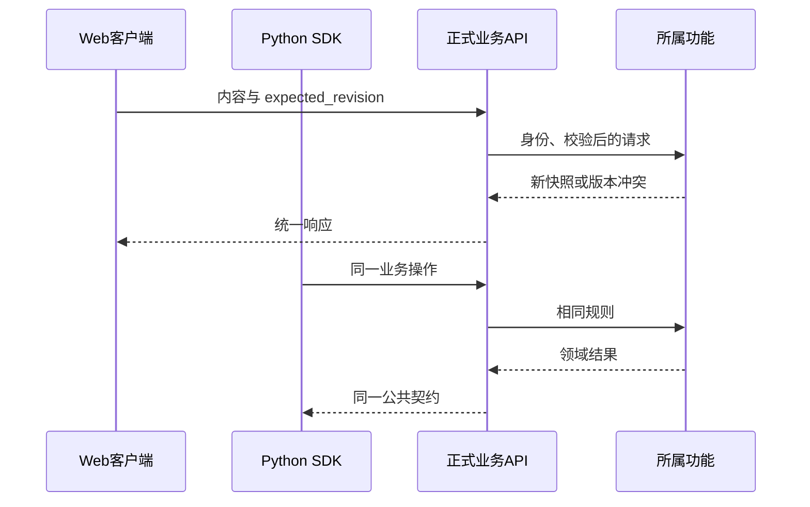

# OpenAPI、Web 与 SDK 契约

后端新增 expected_revision，Web 类型里却没有这个字段，SDK 仍能发送请求吗？可能能发送，但调用方已失去正确表达版本前提的契约。三个端的字段应从同一公共定义演进，同时通过真实行为检查。

本篇跟踪保存请求从后端 schema 到 OpenAPI、Web 和独立 Python SDK 的路径，解释“生成物最新”与“功能闭环正确”分别证明什么。

## 图一：同一接口的生成与消费链

哪些文件是源定义，哪些文件只应该由工具生成？

```fpl-canvas
contracts
```

图例：箭头表示构建期间的生成或验证依赖，不是浏览器的一次运行请求。SDK 方法映射决定可读方法名，OpenAPI 决定传输字段和响应。

schema 和路由形成可导出的接口，Web 从 OpenAPI 获得请求类型，Python SDK 结合 operations 映射生成资源方法。生成目录不是手工修复类型差异的地方。接口变更需要同时检查调用方的运行逻辑，例如收到 409 时如何保留草稿，而不是仅让编译器停止报错。

## 图二：传输契约进入正式业务规则

Web 和 SDK 怎样获得一致的写入与错误语义？



图例：两段请求表达不同客户端调用同一操作，并不要求按图中顺序发生。SDK 不直接访问后端 ORM，也不获得绕过权限的写入通道。

路由校验传输形状并映射领域错误；业务规则属于功能。客户端通过不同凭证边界接入，但 Workspace 权限、资源归属和 revision 前提都不能省略。桌面 Agent 还有明确操作白名单，普通 API 可调用不代表桌面通道自动允许。

## 接口变化需要哪些同步证据

修改公共 HTTP 或 SSE 时，同步后端 schema、路由、生成物、Web 消费逻辑、SDK 方法及公开参考。本文说明流程；本轮知识库重构没有修改 API，也不需要为文章新增接口。生成器检查只读当前产物，判断源码和已登记方法是否一致，不会证明每种错误分支处理正确。

SSE 的公共事件应表达供应商无关语义。前端依赖统一增量事件和结束结果，而不是某家供应商的原始事件字段。供应商差异在适配器消化，新增厂商不能要求每个页面复制一份特殊事件判断。

## 命令、样例与预期结果

| 检查               | 证明的内容                       | 仍需另外验证       |
| ------------------ | -------------------------------- | ------------------ |
| contracts:check    | OpenAPI、Web 与 SDK 生成物未过期 | 实际字段行为与权限 |
| sdk:check          | 方法映射和生成参考一致           | 业务操作能完成     |
| API / SSE 契约测试 | 请求、响应和错误形状             | 页面状态及焦点反馈 |
| SDK 工作流测试     | 正式操作形成预期资源             | 真供应商网络可用性 |

保存笔记的样例需要明确资源、版本前提、权限和结果确认。错误字段或缺少 revision 应返回可判断错误；有效请求成功后重新读取应匹配新内容。不能把覆盖的方法数量当成用户任务完成的数量。

## 保持参考与实现的责任清晰

API 参考精确列字段，技术文档解释字段为何存在及消费者怎样处理。生成失败先定位源定义、映射或环境，不手改 generated；类型检查通过仍需测试版本冲突、跨空间 ID 和流式中断。这样接口可以演进，调用方仍保持可靠反馈，独立 SDK 也无需导入后端运行时。

> [!NOTE]
> 自动生成保证形状一致，功能测试保证业务行为。两类证据都不能用真实供应商收费调用来替代确定性测试。

## 相关阅读

- [集成与 Agent/CLI/SDK](/apps/thought-workshop/official-knowledge-bases/technical/documents/automation)
- [测试与交付证据](/apps/thought-workshop/official-knowledge-bases/technical/documents/engineering)
- [后端功能切片与用例边界](/apps/thought-workshop/official-knowledge-bases/technical/documents/backend-design)

## 代码入口

1. `scripts/export_openapi.py`
2. `scripts/generate_sdk.py`
3. `sdk/python/operations.json`
