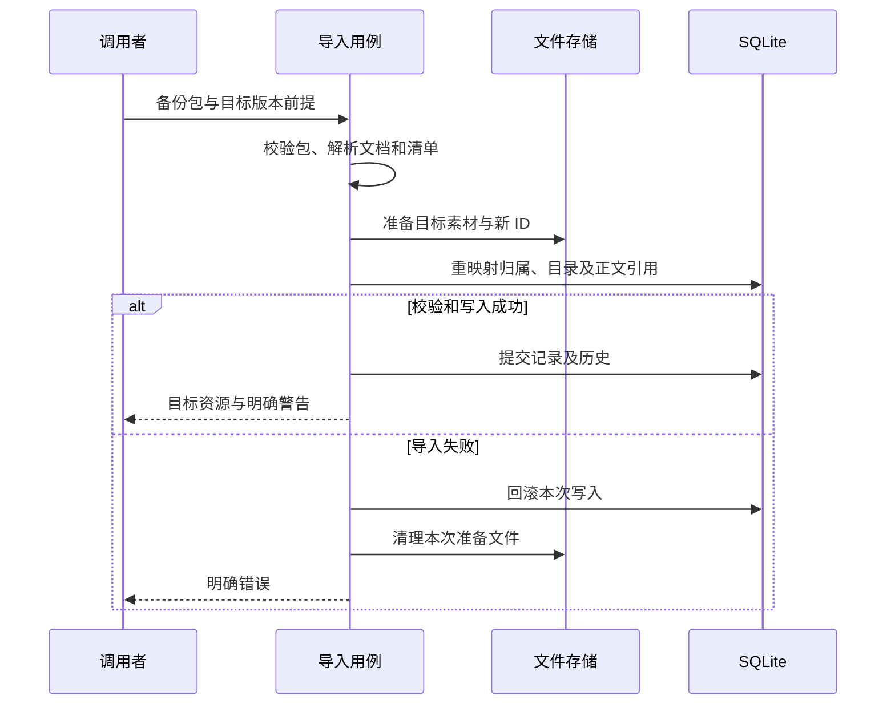

# 导入、备份与导出

把含图片笔记搬到另一台电脑继续编辑，与把视频发给别人观看，都是“导出”，但接收方需要的数据完全不同。前者必须保留结构与引用关系，后者需要可播放的成品。选择格式之前，应先确定交付目标。

本篇把素材上传文章中的引用生命周期继续向外延伸：解释知识库备份的身份重映射、导入失败补偿，以及视频输出如何固定工程与素材。

## 图一：可编辑迁移与成品输出

从同一份保存内容出发，为什么会形成不同交付路径？

```fpl-canvas
data-exchange
```

图例：上路表示可编辑包的生成与导入，下路表示面向阅读或播放的输出。箭头是数据变换，不能理解为一个 API 会自动生成全部格式。

备份把语义结构和素材字节汇总在清单里，目标端创建新身份并重写引用。渲染消费已确定的文档、素材和参数，输出画面或视频。成品不包含全部编辑结构；HTML、PNG、PPTX 和原生包的保真范围分别核对，不从相同文件扩展名推断完整历史也能恢复。

## 图二：文件准备与数据库提交

导入一半失败，如何避免留下可见的残缺知识库？



图例：文件和数据库是独立参与者。清理由用例显式执行，SQLite 回滚不会自动撤销磁盘操作；此图说明思绪工坊备份导入，不声称所有应用共用同一实现。

import_backup 先限制上传大小、检查归档路径和内容，再准备新的素材身份。向现有知识库导入需要该库 revision，普通新建导入则创建新的库身份。笔记父子顺序、首页、内部引用和图片 ID 均需要映射；外部无法搬运的引用按正式规则形成警告或拒绝，不能无提示地复用来源空间 ID。

## 可编辑包如何保持关联

备份清单描述库、笔记、历史与素材，文件携带实际字节。备份先读取记录并校验素材身份，再结束数据库读取事务、组装归档；整库 HTML 导出另有显式读取快照，不能从“导出”一词推断所有格式使用相同事务。导入阶段重新验证结构和受支持格式。Markdown 包适合文本交换，但第三方阅读器未必解释 fpl-canvas；HTML 固化阅读呈现，SVG 和 PNG 只交付图形结果。需要继续编辑时，原生备份和目标工具的交换格式各自承担不同责任。

目标写入仍执行所属功能规则，不能直接导入数据库文件修补运行数据。SQLite schema 升级属于迁移，导入项目内容属于业务 API；把二者混用会绕开账号、空间和版本检查。

## 视频输出怎样固定输入

视频剪辑预检检查时间线版本、素材是否 ready、区间与输出参数，并计算含素材信息的指纹。创建渲染任务比较预检结果后保存 snapshot_document 和执行参数，并以预检指纹核对素材信息。公共渲染按输出时刻求值画面和音频，编码形成结果；请求 ID 用于同一提交的识别，不能把新工程变化自动塞进旧任务。

成片验收检查首尾、接缝、速度映射和音画同步。只有文件存在不说明输入版本正确；中途失败的部分输出不代表完整成果。重新导出应明确采用哪个已保存版本，避免把预检后再次编辑的工程当成原来的验收对象。

## 迁移和输出的失败处理

对路径穿越、缺失素材和未知版本先拒绝或给出对应错误；导入冲突保留源包和原工程。文件准备失败只清理本次新增文件，不删除仍被旧数据引用的资源。验证含图笔记往返、同名新身份、目录内部引用、现有库冲突，以及视频输入指纹变化，才能证明交换边界可恢复。

> [!NOTE]
> 知识库备份是内容迁移；整机停机备份还需要数据库、配置及完整运行目录，不能用单篇文档导出替代。

## 相关阅读

- [素材上传、引用与预览](/apps/thought-workshop/official-knowledge-bases/technical/documents/assets)
- [编辑、保存、历史与并发](/apps/thought-workshop/official-knowledge-bases/technical/documents/revision)
- [时间线与媒体渲染](/apps/thought-workshop/official-knowledge-bases/technical/documents/rendering)

## 代码入口

1. `backend/app/apps/thought_workshop/portability.py`
2. `backend/app/apps/thought_workshop/knowledge_tools/export_snapshot.py`
3. `backend/app/apps/video_editor/rendering.py`
