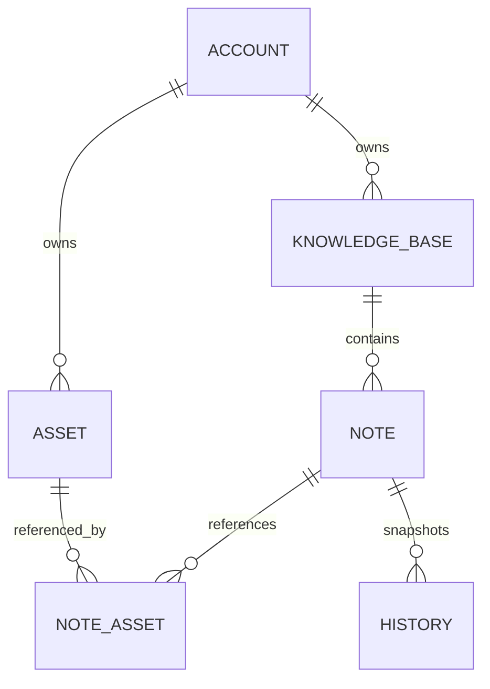

# 核心对象与数据归属

一个账号、一个知识库和一篇笔记各代表什么？它们可能在同一个页面同时显示，却不能用标题、路径或一个统一“项目 ID”互相替代。保存和备份的问题常常来自没有区分归属、内容和执行。

这里从一篇带图片笔记出发，再对照模型任务。图中是核心概念映射；每个应用拥有自己的 ORM 与 schema，不把概念图宣称为所有功能共用的一张项目表。

## 图一：归属、内容与执行三个维度

哪些关系决定谁能访问，哪些关系决定内容怎样组成？

```fpl-canvas
data-model
```

图例：箭头表达已标注的概念关系。账号提供身份和资源归属，正文引用素材，任务保存执行事实。图不是 HTTP 请求顺序。

账号直接拥有根资源，根项目保存 owner_user_id。知识库包含笔记，笔记正文可引用公共素材；素材身份对应受控文件元数据。任务另行记录输入和执行阶段，生成后返回结果素材。项目删除、内容编辑和任务完成具有不同生命周期，不能因为显示在同一卡片里就一起随意更新。

## 图二：知识库、笔记与素材的概念关系

笔记引用图片，是否意味着它拥有唯一一份文件？



图例：一对多符号表示概念数量关系，NOTE_ASSET 表达引用索引。图省略笔记目录、自定义偏好与多数实际字段；并不表示图片不能被历史快照或其他内容引用。

同一素材可以被多处引用。移除当前正文图片不等于文件马上可删除，因为历史与其他内容可能仍需要它。读取笔记时先验证根归属，再沿已校验资源读取子对象；仅有一个素材 ID 不能证明有权读取其字节。

## 分清稳定身份、格式与写入版本

| 数据                          | 作用                   | 不能代替什么             |
| ----------------------------- | ---------------------- | ------------------------ |
| 账号 ID                       | 识别主体及资源账号     | 有效权限                 |
| 笔记、节点与素材 ID           | 在变化中稳定定位对象   | 标题、显示顺序或预览 URL |
| revision                      | 保存时比较当前资源版本 | 内容格式说明             |
| schema_version / sceneVersion | 说明内容解析规则       | 并发写入前提             |
| 任务 ID 与供应商 ID           | 定位本地及外部执行     | 已落盘素材 ID            |

例如把笔记标题改掉，正文引用仍通过目标 ID 定位；移动目录由目录用例维护，正文 put 不直接修改归属。画板连线指向元素 ID，场景版本只说明连线属性如何解释。

## 哪些数据落在哪里

笔记 JSON、revision、搜索文本和历史属于数据库记录。图片、音频、附件和导出文件由托管目录保存；数据库元数据不包含全部文件字节。官方文档导入后进入同一账号知识库与笔记表；发布记录另保存官方标记、只读与角色授权。导入来源映射和持久化回执只用于旧链接解析及重试，不代替正文存储。账号阅读位置另行保存为个人偏好，既不推进笔记 revision，也不随知识库备份成为正文。

模型任务保存当前账号和输入，后台从记录恢复归属。任务执行期间修改原节点，不应改变已提交输入的含义。消费者拿到结果引用后还要通过正式 API 授权读取，临时供应商 URL 不能替代已托管成果。

## 从异常定位数据所有者

跨账号 ID 找不到先检查 Principal 与根资源归属；重命名后引用坏了检查稳定身份与索引；文档存在图片缺失检查素材元数据及磁盘；任务进度达到 100 却没有可下载文件检查结算阶段。测试分别验证这些对象的边界，比仅比较一个“项目保存成功”的提示更有定位价值。

> [!NOTE]
> ER 图用于解释已存在的数据关系。实际字段和外键以各功能 ORM、迁移及 API 契约为准。

## 相关阅读

- [账号与权限](/apps/thought-workshop/official-knowledge-bases/technical/documents/identity)
- [素材上传、引用与预览](/apps/thought-workshop/official-knowledge-bases/technical/documents/assets)
- [思绪工坊：富文本、画板与知识库](/apps/thought-workshop/official-knowledge-bases/technical/documents/thought-workshop)

## 代码入口

1. `backend/studio/apps/thought_workshop/storage/models.py`
2. `backend/studio/apps/thought_workshop/notes.py`
3. `backend/studio/apps/asset_library/storage/models.py`
