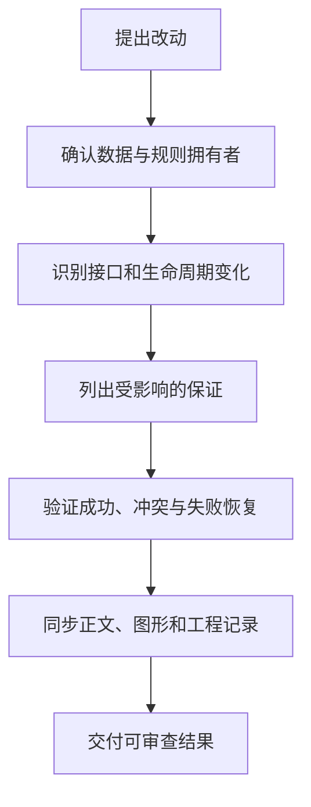

# 关键设计决策与当前限制

为什么采用单机 SQLite，又为什么必须保留 CAS 和权限？为什么同样能生成图片，不让各工坊各写一套重试？设计选择需要说明服务的目标、解决的问题以及留下的代价，读者才能判断后续改动会影响哪条保证。

本篇集中整理当前实现的关键取舍。它是阅读入口，细节仍回到各机制文章和仓库工程记录；未被工程记录证实的历史意图不当作作者当时的决定。

## 图一：设计选择与验证依据

一个选择的收益如何转换成可以检查的保证？

```fpl-canvas
decisions
```

图例：周围卡片是当前选择，下方中间卡片是验证入口。箭头标注该选择需要的证据，不是运行数据流，也不表示测试能够消除所有限制。

单机降低运行组件数量，但迁移和并发仍要验证；功能切片让业务规则集中，但需要依赖检查守住边界；CAS 拒绝静默覆盖，却需要用户处理冲突；任务驱动统一状态规则，却不能替外部供应商证明未知提交没有发生。收益与代价必须一起解释。

## 图二：从改动回到受影响的保证

修改公共能力时，如何确定该补哪些验证？



图例：箭头表示工程判断顺序。这个流程指导维护者组织证据，不是产品中的自动审批或执行入口。

先找规则拥有者能避免在多个页面修补同一症状。接口或持久化变化应得到明确测试，而无业务意义的文件拆分不一定改善替换能力。文档记录当前结果，工程 Note 保留真实考虑过的备选和代价，两者互相链接而不复制整篇正文。

## 当前选择解决什么、留下什么

| 选择                 | 解决的问题                   | 代价与边界                             |
| -------------------- | ---------------------------- | -------------------------------------- |
| 单机进程与 SQLite    | 本机部署和数据管理复杂度     | 单写者竞争，本机资源上限，无多实例保证 |
| 功能切片与公开能力   | 同一业务规则散落在多个入口   | 所有者要明确，跨应用交接需单独设计     |
| 显式账号与资源归属   | 请求或后台工作串空间         | 每条路径都要传递、验证身份             |
| revision CAS         | 两份旧草稿静默覆盖           | 冲突必须保留并由调用方处理             |
| 独立 CanvasScene     | 编辑库运行状态污染持久数据   | 前后端校验与导出布局需同步             |
| GenerationTaskDriver | 工坊对中断和重试采用不同策略 | 外部提交不确定时只能安全失败           |
| 素材身份与受控文件   | 临时 URL 和跨账号引用失效    | 需要引用追踪、文件准备和补偿           |

这些是当前架构可观察的结果，不是对所有技术方案的优劣排名。比如 WAL 改善读写协作，不能让多个长写事务无代价运行；共享原语减少重复，但不能合并应用的业务规则。

## 区分当前限制与未来设想

源码已支持的路径写成现状，尚未实现的能力明确写出边界。当前系统不提供分布式渲染、多实例部署、实时共同编辑或画板与 Mermaid 自动互转。外部模型调用还受网络、供应商语义和模型能力限制。不要为了让结构图完整而增加虚构服务。

## 让取舍保持可追溯

维护时先检查 AGENTS、目录索引、实现及测试是否一致，涉及非机械规则变化再记录 Note。迁移只追加并登记，真实运行数据的管理经正式业务 API，不能在诊断脚本里修改持久数据库。验证报告区分确定性测试、实际产物检查与未执行的外部调用，保留异常阶段和输入版本，才便于未来判断一个决定是否仍成立。

> [!NOTE]
> 当前设计的解释以代码、测试和既有工程记录为证据。合理推断应标为分析，不能伪造历史决策或声称规划已实现。

## 相关阅读

- [项目定位与系统边界](/apps/thought-workshop/official-knowledge-bases/technical/documents/scope)
- [代码组织与依赖方向](/apps/thought-workshop/official-knowledge-bases/technical/documents/modules)
- [后台任务与恢复](/apps/thought-workshop/official-knowledge-bases/technical/documents/tasks)

## 代码入口

1. `AGENTS.md`
2. `tests/test_architecture.py`
3. `docs/operations/agent-notes.md`
