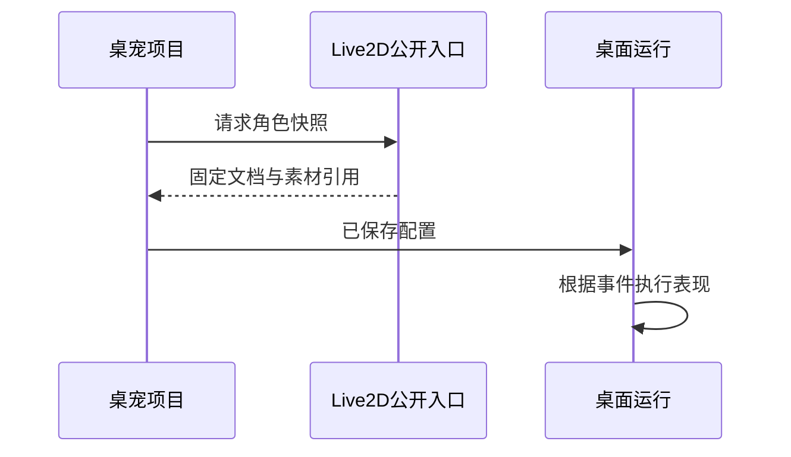

# 桌宠：固定角色快照与运行事件

## 先理解它解决什么问题

桌宠项目将角色、皮肤与事件响应组织成可运行配置。角色使用从 Live2D 工坊取得的固定只读快照，源工程后续变化不会悄悄改动已配置的桌宠。桌面运行与私人文字聊天是不同的交互通道。

**贯穿实例：** 把一个角色配置为桌宠后，修改原始 Live2D 工程的网格并不会立即改变桌宠；需要明确更新快照后再验证动作和显示。

## 图一：固定快照隔离源工程的后续变化

```fpl-canvas
desktop-pet
```

图例：上排是取得快照的方向，下排说明源工程变更不自动传播。运行卡片消费已保存桌宠配置；刷新角色需要显式操作并重新验证，而不是监听源工程可变状态。

## 图二：角色快照交接时序



图例：实线为请求，虚线为响应。Live2D 公开入口返回固定文档与素材引用，桌宠拥有自己的保存与运行周期，不能跨模块直接修改 Live2D 内部数据。

## 实现与设计取舍

桌宠应用拥有自己的项目生命周期，通过明确允许的公开入口读取 Live2D 快照，不直接依赖其内部 ORM。运行时只使用保存的角色与响应配置。私人文字聊天的会话与权限由对应功能处理，不能把桌宠事件解释成任意系统自动化。

## 异常、验证与当前边界

检查角色资源是否完整、默认动作是否存在，以及显示和交互是否符合桌面环境。关闭运行窗口不等于删除项目。桌宠不是实时语音 Bot，模型调用的网络与费用仍需要独立判断。

## 代码入口与阅读顺序

1. `backend/app/apps/desktop_pet/projects.py`
2. `backend/app/apps/live2d_workshop`
3. `web/src/features/desktop-pet`

阅读时先定位输入和校验，再跟踪持久化或执行入口，最后对照输出与错误分支。可以把上方图复制到个人知识库加入自己的注释；副本不会随官方文章自动更新。
