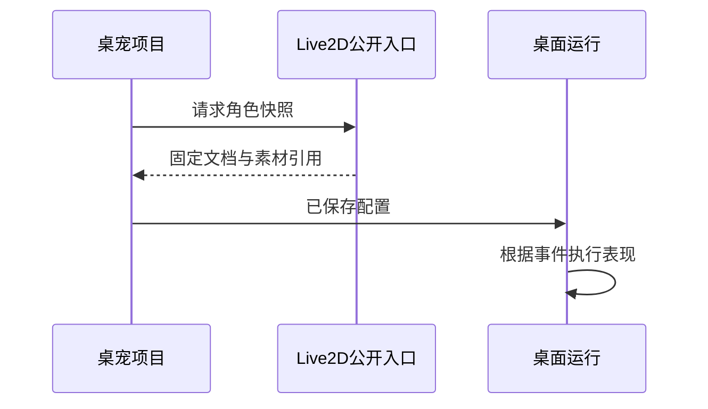

# 桌宠：固定角色快照与运行事件

修改 Live2D 工程后，正在使用的桌宠为什么没有立即换成新形态？这是固定快照的预期行为：桌宠使用某个已确认版本的角色与素材，源工程后续编辑不会悄悄改变它。

以调整角色网格为例，源工程保存只改变源项目。要让桌宠采用新形态，还需要显式同步来源版本，并检查现有皮肤替换、动作和配置是否仍适用。

## 固定快照隔离源工程的后续变化

源工程、角色快照与桌宠项目之间，哪一条关系会随源编辑自动变化？

```fpl-canvas
desktop-pet
```

图例：上排是取得快照的方向，下排说明源工程变更不自动传播。运行卡片经读取箭头消费已保存桌宠配置；刷新角色需要显式操作并重新验证，而不是监听源工程可变状态。

图中只有显式取得快照的路径，没有持续监听源工程的箭头。桌宠记录来源项目和版本，保存固定角色文档并复制所需源素材。这个选择换来运行可重复性：编辑源工程时不会让已经配置好的桌宠突然失效。

## 角色快照交接时序

取得角色时，为什么必须经过 Live2D 的公开只读入口？



图例：实线为请求，虚线为响应。Live2D 公开入口返回固定文档与素材引用，桌宠拥有自己的保存与运行周期，不能跨模块直接修改 Live2D 内部数据。

公开入口验证来源和版本，返回角色快照及对应素材。桌宠应用不需要依赖 Live2D 的内部 ORM，也不会持有对方可变文档的共享引用。随后桌面运行消费的是桌宠自己的已保存配置。

完整序列的收步与转向可按实际已绘来源帧登记独立分支。读取端验证全部来源帧覆盖和各分支的原画首尾，播放器与素材加载消费同一直接选择规则；开始播放新目标时不会先把目标当成已显示画面。打断中间过渡也需要对应实际片段的直接资源，缺失时保留已有画面并反馈。退出过渡已经绘制与待机首帧完全相同的原画和注册点时，立即重播可以从该待机姿势进入新动作，无需等待终点保持时间结束；仍先加载并检查新过渡资源，未绘制的中间姿势不能采用此规则。该契约只允许复用经过校验的完整原帧，不会自动生成自然动作或绕过支撑点与容量检查。

多段过渡可以共享一个计时片段，各分支选择其中的左闭右开区间。播放器只推进选中区间的时钟，保留原片段索引作为实际已绘来源；加载端按该区间和目标选择图集，不把无关前后缀预加载。被部分区间引用的片段属于过渡容器，不能作为待机或普通动作直接播放。共享原帧不放宽比例、首尾锚点、支撑交接与包容量校验，也不能代替未制作的连续姿势。

多个片段还可通过可选的 `cels` 字典引用同一完整帧登记。包校验检查所有声明及每套服饰的实际图集，包括未使用的声明；读取时逐次展开为独立帧，避免修改一处锚点影响其他片段。保存保留上传的引用形式，播放器仍消费原来的帧索引和时钟，按选中区间解码。声明数与帧使用次数共同计入原有帧预算，模型 JSON 与图片预算不变；这只减少重复登记，不生成新姿势或证明动画自然。

桌面边界使用当前已绘画面的可见范围和资源接触点，不能按透明窗口外框判断。每个角色实例复用自己的采样面，但逐次清空并读取当前原画，不保留上一动作的透明轮廓。角色镜像时，作者的左右接触点与支持边一起映射到屏幕方向；缺少某边的作者点只回退该屏幕边的可见范围，不覆盖另一边的真实接触，也不把回退点当作已有攀爬姿势。

已停用的版本 1 人物分件只加载保留部件实际引用的纹理：站姿、坐姿或服饰共用的贴图与全部五官仍加载，只有永久隐藏部件独占的贴图被跳过。资源包导入和更新仍校验全部声明、PNG 与素材引用，不能利用运行时不加载绕过校验。这项减少贴图输入的优化不恢复旧运动姿势，也不能单独证明 Chromium 渲染内存警告的原因。

基础人物渲染器加载成功后，由初始化器持有资源，直到完整帧包装成功才移交。包装画布构造失败时先释放基础渲染器再反馈原异常，避免失败重开遗漏清理；成功包装和迟到初始化仍按原实例生命周期释放。显式释放验证不等于实际显存测量，也不归因 Chromium tile 警告。

完整原帧真正绘制并成为可见画面后，包装器释放已隐藏的基础人物 GL、脸部和画布表面，保留已校验的配色、图片缓存和选择代次。加载等待或首次绘制失败时，原站姿继续显示；后续换装仍校验素材，但不会为了隐藏的基础画面重新上传 GL 纹理。独立旧包保留原站姿、坐姿、表情和换装；将来确需基础绘制时用新画布恢复，不能复用已经丢失的 GL 上下文。这项释放不减少全部 CPU 图片缓存，也不代替真实显存测量或新动作视觉验收。

## 同步新来源是受校验的项目修改

同步需要明确的来源版本，并检查桌宠当前配置是否适配新角色。皮肤替换引用的源素材也要重新核对；若对应关系或尺寸不再符合要求，不能简单把旧配置套在新角色上。

更新过程中复制新的源素材并执行版本化项目更新。若发生冲突或来源已经变化，应处理当前状态后再决定是否同步，不在后台无条件覆盖。关闭桌宠运行窗口也不等于删除桌宠项目。

## 事件表现与聊天不是任意自动化

运行事件根据保存的配置触发动作或显示表现。私人文字聊天有自己的会话、权限与模型调用路径，不能把两者理解为拥有系统命令权限的常驻 Agent。

本篇重点描述 Live2D 来源；分层资源包来源有独立限制，不能把所有桌宠都当作可同步的 Live2D 项目。验证时检查默认动作、角色资源、皮肤以及桌面显示，模型聊天则另查网络与费用。

> [!NOTE]
> “源工程已保存”与“桌宠已同步来源”是两次操作。排查角色版本时同时核对 sourceProjectId 与 sourceRevision，避免只凭相同的角色名称判断。

## 保存配置、联动草稿和运动窗口分开管理

桌宠项目保存角色来源、皮肤、事件与配置 revision。Live2D 来源消费固定快照，分层资源包则经过独立 ZIP 与骨架校验；两种来源不能混用同步规则。资源更新先验证新包、准备新 ID 素材，再 CAS 切换；失败仅清理本次文件，保留旧项目与私人聊天。

编辑器联动通过有界展示草稿和租约覆盖运行显示，基于已授权快照验证 revision、素材与序号；退出或租约失效回到基线，不把草稿写成正式配置。locomotion 管轨迹和手势，Electron 校验窗口来源、运动代次与显示器可用区；视图移动不应直接改动画引擎内部共享状态。

离开未保存工程仍需确认；用户已选择放弃时，编辑器先同步解除自身导航拦截，再执行已确认的返回，避免旧草稿状态在同一调用中再次拦截。取消确认保留草稿，确认离开不调用保存 API；重新进入仍读取已保存基线。

窗口启动与持久保存有不同的输入和输出：启动只让运行页重新读取已保存快照，重启先结束联动再关闭并重开窗口；只有显式“保存”提交当前草稿和基础 revision，成功后通知运行页刷新基线。打开或重启失败不清理草稿，也不自动重试 CAS。

预览能力按渲染器实际消费的动作模式校验，不能只检查菜单名称或同名片段。旧人物分件停用、整帧资源缺少动作首尾或独立表情时，菜单和舞台显示原因，收件端也拒绝缺失的运动演示。格式合法与可播放不证明人体姿势自然；视觉验收仍独立进行。

运动入口按渲染器协议区分缺少资源与无效姿态，并单独记录通信失败。已知缺少动作或过渡时保留当前画面、暂停轨迹，运行界面提示“动作资源未齐”；支撑冲突、登记不一致、缺少确认位移和未知失败仍作为错误停止。提示不写入项目，重新抓取可取消旧播放，有效新播放与配置切换重新等待活动间隔，不恢复已取消轨迹。

事件和聊天反应在进入动画物理前检查当前资源能力。被拒绝的动作通过公开接口保留最后已绘画面和实际根位置，不启动旧跳跃，也不请求同名但不符合当前播放模式的图集；时间、可用表情和完整事件返回待机仍正常推进。手动拎起、放置交接和松手恢复优先于这个位置保留，恢复后以实际已绘位置为准。资源解码或支撑错误仍优先反馈，不能被缺少动作的提示遮住；下一次有效反应只清除本次拒绝状态，不清除真正的素材错误。

正常拖动松手时，最终放置仍等待宿主确认。等待期间渲染器以最后已绘位置和实际窗口屏幕原点保持画面登记；确认后，等新的非拎起帧被绘制流程消费，再交接到放下恢复。补偿使用桌面逻辑像素，不随人物模型比例再次缩放，也不重复扣除旧的预计位移。重新抓取、取消、聊天或联动暂停、资源版本变化及窗口卸载都会结束旧交接，迟到回执不能提交新交接。缺少确认或可见范围时停止并显示原因。这项位置登记不能代替动作素材与系统合成画面的视觉验收。

完整序列的物理行走和攀爬同时消费宿主确认位移、步相与当前显示比例。停留在同一原帧时，播放器平移整张画面，使已登记的支撑手脚保持在世界位置；换帧前核对原画的支点移动距离，并要求先建立新支点再释放旧支点。计时入口、停步和转角在窗口等待期间也检查支点；中间缺少支点不能靠首尾相同绕过。正常停止保留最后确认位移，退出桥绘制完成后释放支撑；合法离地仅允许已匹配桥的空中终点释放。登记不一致时保留已绘帧并报告失败，不能通过拉长肢体或缩放人物隐藏问题。取消和尺寸变化结束旧周期。原画中的实际手脚、动作衔接及稀疏帧造成的躯干跳动仍需视觉检查；登记点稳定不证明人体自然。

完整序列的异步图集读取错误由序列渲染器持有，通过独立的只读错误接口交给共用 React 渲染入口显示；能力缺失和世界支撑失败仍使用运动反馈，不混为贴图错误。失败后保留可见站姿或最后已绘完整帧，取消轨迹和自动待机不清除失败而隐式重发请求。明确重播、合法效果选择或换装允许重试，错误文案保留到实际成功绘制；旧请求的迟到回调不得污染新选择。这个临时错误状态不进入草稿配置或保存接口。

运动控制器在读取失败后继续检查渲染器的已提交画面反馈。明确重试期间，解码结束但尚未绘制仍保留原错误；成功提交后才清除旧异常，或显示当前仍缺少的动作资源。恢复结束旧轨迹，并重新等待活动间隔；通信错误仍使用原来的明确恢复入口，不能用素材恢复替代。

完整帧拎起分别消费本次固定抓取锚点与外层缓动点。固定锚点来自按住时最后实际已绘画面，包含已有平移；内层只将原帧抓点登记到该点，外层完成被按位置到腰点的平滑转移。重抓重新读取当前画面；松手保留内层平移，继续等待宿主确认放置。这个入口登记不缩放源图、不推断被遮挡的解剖点，也不能代替不同腰点退出原画的衔接验收。

完整原帧的显示方向由原画决定，左右运动选择对应片段，不使用外层鼠标追随的压窄、翻面效果。私有 `groupFacing` 只接受确切的 ±1 显示基准，并与请求运动方向分开；完整帧固定为 +1，已停用旧运动的版本 1 人物也保持其现有正面视图。未声明该能力的旧 figure 沿用原有行为。缺少左／右片段仍反馈资源不足，这项比例修复不会生成转身原画或恢复已停用动作。

完整帧的位图绘制与播放状态分别更新。同一已解码图片、裁切、原生画布尺寸和配色不变时复用已绘像素，仍提交当前抓点、位置、接触几何、时间和过渡反馈；换图或裁切才重新绘制。等待和失败保留原画及错误，成功安装画面后才恢复；释放实例和淘汰图集同时解除位图引用。减少重复绘制不代表缺失动作已经补齐，也不能单凭绘制次数判断显存警告的原因。

播放器的采样状态与画面安装使用同一个同步提交边界。Canvas 绘制或 DOM 安装抛错时，恢复此次采样前的时钟、支撑、抓点与过渡状态，让下一次较短的正常帧仍能重绘；原异常继续上报，不自动取消动作或重试网络。正常的资源等待和支撑拒绝保持原语义。已经清空或部分绘制的像素不能撤销，位图认证失效后需要下一次成功绘制；安装成功后的隐藏基础表面释放失败也不能倒退已经显示的帧。这项恢复不放宽确认位移、时间顺序或支撑误差校验。

## 私人聊天有独立数据与结束语义

聊天按账号、账号和桌宠项目隔离，设置与消息流不复用模型测试会话。prepare_send 用 request_id 防重放并保存待回答消息，公共文字模型调用在准备事务之后执行，结算在独立事务记录 completed 或 interrupted。气泡和对话呈现消费同一消息，不经动作 IPC 重复发送聊天文字。

## 运行与恢复的验证入口

检查来源同步、包替换冲突、皮肤缺失、联动退出恢复、运动取消与可用区限制；聊天检查连续流、断开结算、重复 request_id 拒绝与账号隔离。桌宠动作成功不证明模型聊天成功，聊天记录存在也不说明资源包已更新。项目、聊天用例和私有桌面协议分别拥有这些生命周期。

## 相关阅读

- [Live2D：参数绑定、网格与动作](/apps/thought-workshop/official-knowledge-bases/technical/documents/live2d-workshop)
- [桌面启动、更新与打包](/apps/thought-workshop/official-knowledge-bases/technical/documents/desktop)
- [桌宠工坊：主要操作流程](/apps/thought-workshop/official-knowledge-bases/desktop-pet/documents/workflow)
- [公共能力复用与应用交接](/apps/thought-workshop/official-knowledge-bases/technical/documents/app-handoffs)

## 代码入口

1. `backend/app/apps/desktop_pet/projects.py`
2. `backend/app/apps/live2d_workshop`
3. `web/src/features/desktop-pet`
