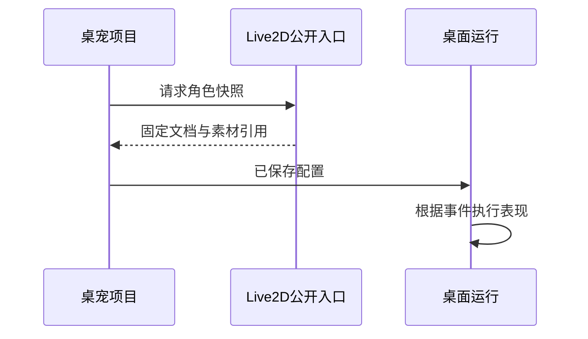

# 桌宠：固定角色快照与运行事件

修改 Live2D 工程后，正在使用的桌宠为什么没有立即换成新形态？这是固定快照的预期行为：桌宠使用某个已确认版本的角色与素材，源工程后续编辑不会悄悄改变它。

以调整角色网格为例，源工程保存只改变源项目。要让桌宠采用新形态，还需要显式同步来源版本，并检查现有皮肤替换、动作和配置是否仍适用。

## 固定快照隔离源工程的后续变化

源工程、角色快照与桌宠项目之间，哪一条关系会随源编辑自动变化？

```fpl-canvas
desktop-pet
```

图例：上排是取得快照的方向，下排说明源工程变更不自动传播。运行卡片消费已保存桌宠配置；刷新角色需要显式操作并重新验证，而不是监听源工程可变状态。

图中只有显式取得快照的路径，没有持续监听源工程的箭头。桌宠记录来源项目和版本，保存固定角色文档并复制所需源素材。这个选择换来运行可重复性：编辑源工程时不会让已经配置好的桌宠突然失效。

## 角色快照交接时序

取得角色时，为什么必须经过 Live2D 的公开只读入口？



图例：实线为请求，虚线为响应。Live2D 公开入口返回固定文档与素材引用，桌宠拥有自己的保存与运行周期，不能跨模块直接修改 Live2D 内部数据。

公开入口验证来源和版本，返回角色快照及对应素材。桌宠应用不需要依赖 Live2D 的内部 ORM，也不会持有对方可变文档的共享引用。随后桌面运行消费的是桌宠自己的已保存配置。

## 同步新来源是受校验的项目修改

同步需要明确的来源版本，并检查桌宠当前配置是否适配新角色。皮肤替换引用的源素材也要重新核对；若对应关系或尺寸不再符合要求，不能简单把旧配置套在新角色上。

更新过程中复制新的源素材并执行版本化项目更新。若发生冲突或来源已经变化，应处理当前状态后再决定是否同步，不在后台无条件覆盖。关闭桌宠运行窗口也不等于删除桌宠项目。

## 事件表现与聊天不是任意自动化

运行事件根据保存的配置触发动作或显示表现。私人文字聊天有自己的会话、权限与模型调用路径，不能把两者理解为拥有系统命令权限的常驻 Agent。

本篇重点描述 Live2D 来源；其他内置角色来源有独立限制，不能把所有桌宠都当作可同步的 Live2D 项目。验证时检查默认动作、角色资源、皮肤以及桌面显示，模型聊天则另查网络与费用。

> [!NOTE]
> “源工程已保存”与“桌宠已同步来源”是两次操作。排查角色版本时同时核对 sourceProjectId 与 sourceRevision，避免只凭相同的角色名称判断。

## 相关阅读

- [Live2D：参数绑定、网格与动作](/apps/thought-workshop/official-knowledge-bases/technical/documents/live2d-workshop)
- [Electron 桌面：本机服务与私有边界](/apps/thought-workshop/official-knowledge-bases/technical/documents/desktop)
- [桌宠工坊：主要操作流程](/apps/thought-workshop/official-knowledge-bases/desktop-pet/documents/workflow)

## 代码入口

1. `backend/app/apps/desktop_pet/projects.py`
2. `backend/app/apps/live2d_workshop`
3. `web/src/features/desktop-pet`
