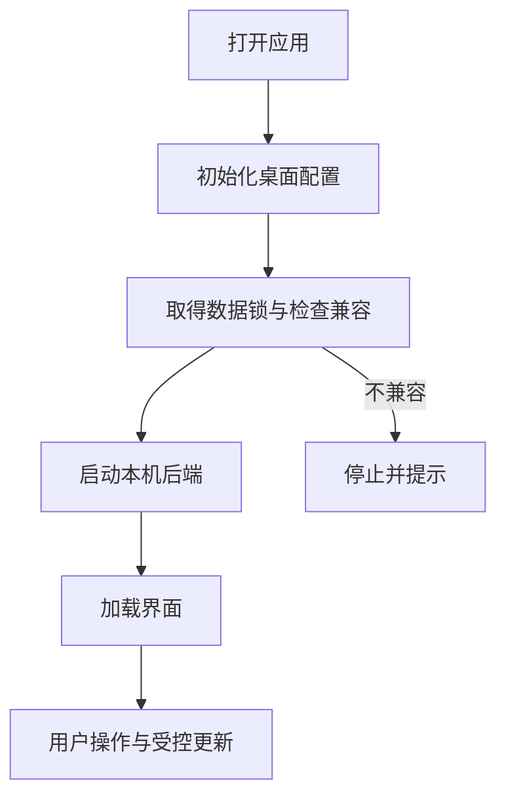

# Electron 桌面：本机服务与私有边界

桌面应用里的官方指南能断网阅读，模型测试却可能失败；前端热更新已经出现，后端代码又可能尚未应用。这些差异来自桌面窗口背后不同组件的生命周期。

Electron 负责窗口与服务启动，Web 页面负责交互，本机后端处理业务。内置文档随安装包提供，项目与素材则保存在独立的用户数据目录。理解这些位置，才能判断重启、更新和离线操作究竟影响什么。

## 桌面进程、页面与数据的职责

窗口、指南和项目都在本机，哪些属于安装包，哪些属于用户数据？

```fpl-canvas
desktop
```

图例：左侧主进程负责生命周期，上排是页面和静态资源，下排是后端和用户数据。静态指南随包更新，用户数据独立保存；页面的业务请求仍通过本机后端完成。

上排的页面与静态资源跟随应用版本，下排的数据由本机后端通过正式业务规则读写。替换静态文章不需要创建一个 Workspace 项目，也不应该复制数据库；用户项目不会因为官方指南更新而被重建。

## 受控桌面启动过程

为什么启动顺序必须先处理配置与数据状态，再让窗口加载业务界面？



图例：方框表示启动阶段，分支表示兼容性检查结果。图省略开发与正式打包的专用细节；正式数据开发流程还有停机备份与迁移阻止条件，不能跳过检查直接启动另一后端。

数据库模块导入前就需要确定桌面配置与数据根。受控启动还要处理锁、兼容性及后端就绪状态，否则两个不同进程可能错误地使用同一份正式数据，或者界面连接到尚未准备好的服务。

## 正式数据开发与隔离开发

默认桌面开发入口使用正式 App 数据；隔离入口使用独立开发目录。前者由启动器持有数据锁，首次进入正式数据开发流程时执行停机备份和完整性核验，后续配置变化也需要受控快照。自动测试始终使用临时数据目录。

前端热更新不等于后端或 Electron 已更新。应用后端更新需要经过开发桥的受控交接，不能跳过未保存保护；新增或漂移迁移会阻止正式数据热加载流程继续。

开发网关维持同一窗口生命周期的稳定来源，只转发到固定的前后端并校验私有凭据。正式安装包不启用开发桥或开发网关，也不使用仓库运行目录拼装用户数据。

## 离线可以阅读，网络操作仍有边界

官方 Markdown、图形和渲染器随 Web/桌面打包，因此无需外部文档服务。模型调用、远程集成等能力仍取决于相应网络与授权。页面导航的 HTML 回退也不应吞掉未知 API 或缺失资源的 404，否则真实加载错误会被伪装成页面。

启动失败时先看配置、锁和迁移诊断，保留原数据与备份。不要用删除数据库、复制另一目录或篡改迁移状态来让窗口强行打开。

> [!WARNING]
> 正式数据开发与隔离开发不是两个可以随意合并的缓存目录。测试和排查应使用明确的隔离入口，避免将临时状态写入日常项目。

## 相关阅读

- [SQLite 与迁移：单机数据如何可靠演进](/apps/thought-workshop/official-knowledge-bases/technical/documents/sqlite)
- [集成与 Agent/SDK：受控的自动化入口](/apps/thought-workshop/official-knowledge-bases/technical/documents/automation)
- [桌面、Amadeus 与本地 Agent](/apps/thought-workshop/official-knowledge-bases/general/documents/desktop)

## 代码入口

1. `desktop/src/main.ts`
2. `desktop/src/development-gateway.ts`
3. `desktop/backend/entry.py`
