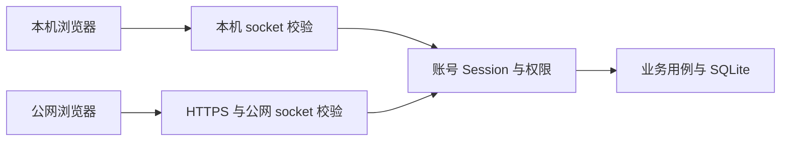

# 网站进程、访问入口与数据

网站由浏览器、一个 Mac 后端和同一 SQLite 组成。后台服务独立于浏览器窗口，公网通过 HTTPS 网关和受限 SSH 转发使用同一进程。

## 入口与数据职责

```fpl-canvas
desktop
```

图例：服务管理器启动唯一后端；本机与公网 socket 分别完成来源校验，再使用同一业务层。云端静态资源仅包含程序，账号数据、素材和密钥均保存在 Mac 项目内。

## 启动与停机

配置从 `backend/config.toml` 加载，必须早于数据库模块导入。正式入口持有 `.runtime/website.lock` 并检查迁移状态；迁入后同时锁住保留的原桌面目录，避免旧客户端误启动。迁移未定稿或 checksum 漂移时停止，不在服务重启中执行正式修复。

本机默认 9000，公网回环默认 28081。第二监听器关闭 lifespan，所以数据库和 Runner 不会初始化两次。本机管理员可控制公网，公网管理员没有主机配置权限；判断来自实际监听 socket，而不是转发头。

## 一次请求的权限边界



图例：两个 socket 共用账号与业务规则，本机管理还要求本机入口和有效浏览器 Session。图省略静态文件缓存；公网管理员也不能从这条业务链路获得主机控制权限。

## 数据迁移与恢复

桌面正式来源是 `~/Library/Application Support/Future Props Lab/`。停机后制作完整快照，将 runtime 迁入项目 `.runtime/`，本地模型迁至 `.runtime/local-models/`，原配置及密钥迁入 backend。项目旧开发数据单独保存，不能混入正式账号。

迁移验证逐文件清单、SHA256、SQLite 完整性和外键，不直接写 SQL。复制或配置发布失败时保留原目录并恢复目标；回滚需同时恢复代码、配置及完整运行快照。自动化验收使用隔离目录。

## 可验证结果

- 本机和公网登录同一账号可看到相同作品；跨账号资源返回不存在。
- 公网伪造本机 Host、私有头或转发头仍不能绑定主机目录或控制隧道。
- 关闭浏览器后后台任务继续；重新打开可读取最新状态。
- 未知 API 和缺失资源返回 404，不能变成成功的 HTML。

## 相关阅读

- [网站与 Amadeus](/apps/thought-workshop/official-knowledge-bases/general/documents/desktop)
- [自动化接口](/apps/thought-workshop/official-knowledge-bases/technical/documents/automation)

- [系统全景](/apps/thought-workshop/official-knowledge-bases/technical/documents/system)

## 代码入口

1. `scripts/website/serve.py`
2. `backend/studio/runtime/http/website.py`
3. `scripts/website/data_transfer.py`

> [!NOTE]
> 公网与本机共用业务进程，但主机配置授权独立检查。配置来源和数据锁在数据库导入前就必须确定；不能靠页面隐藏或伪造请求头代替后端校验。

- [SQLite 与迁移](/apps/thought-workshop/official-knowledge-bases/technical/documents/sqlite)
- [项目边界](/apps/thought-workshop/official-knowledge-bases/technical/documents/scope)

本地语音迁入后若环境引用旧绝对路径，使用模型详情的「修复运行环境」。该操作通过正式模型管理 API 执行，保留权重、暂停共享推理并在失败时恢复旧环境，不手工改安装记录或数据库。
