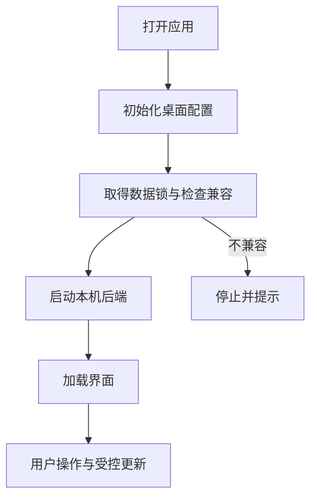

# 桌面启动、更新与打包

桌面应用里的官方指南能断网阅读，模型测试却可能失败；前端热更新已经出现，后端代码又可能尚未应用。这些差异来自桌面窗口背后不同组件的生命周期。

Electron 负责窗口与服务启动，Web 页面负责交互，本机后端处理业务。内置文档随安装包提供，项目与素材则保存在独立的用户数据目录。理解这些位置，才能判断重启、更新和离线操作究竟影响什么。

## 桌面进程、页面与数据的职责

窗口、指南和项目都在本机，哪些属于安装包，哪些属于用户数据？

```fpl-canvas
desktop
```

图例：左侧主进程负责生命周期，上排是页面和静态资源，下排是后端和用户数据。导入包随应用分发，导入后的笔记独立保存；页面的业务请求仍通过本机后端完成。

上排的页面与静态资源跟随应用版本，下排的数据由本机后端通过正式业务规则读写。升级可更新导入包，但不自动创建或改写账号项目；已有官方笔记由管理员在普通编辑入口维护。

## 受控桌面启动过程

为什么启动顺序必须先处理配置与数据状态，再让窗口加载业务界面？



图例：方框表示启动阶段，分支表示兼容性检查结果。图省略开发与正式打包的专用细节；正式数据开发流程还有停机备份与迁移阻止条件，不能跳过检查直接启动另一后端。

数据库模块导入前就需要确定桌面配置与数据根。受控启动还要处理锁、兼容性及后端就绪状态，否则两个不同进程可能错误地使用同一份正式数据，或者界面连接到尚未准备好的服务。

## 正式数据开发与隔离开发

默认桌面开发入口使用正式 App 数据；隔离入口使用独立开发目录。前者由启动器持有数据锁，首次进入正式数据开发流程时执行停机备份和完整性核验，后续配置变化也需要受控快照。自动测试始终使用临时数据目录。

前端热更新不等于后端或 Electron 已更新。应用后端更新需要经过开发桥的受控交接，不能跳过未保存保护；新增或漂移迁移会阻止正式数据热加载流程继续。

开发网关维持同一窗口生命周期的稳定来源，只转发到固定的前后端并校验私有凭据。正式安装包不启用开发桥或开发网关，也不使用仓库运行目录拼装用户数据。

## 按需开启本地与公网访问

桌面管理员从头像菜单开启本地 Web，监听器仅绑定 `127.0.0.1`；公网入口另由专用 SSH 密钥转发回同一监听器。附加监听器复用正在运行的 ASGI 应用并关闭自身 lifespan，因此不会再初始化 SQLite、任务恢复或后台执行器。运行开关只在内存，每次 App 启动默认关闭。

配置先通过近期密码验证和版本检查，原生宿主处理所有窗口的未保存内容，再停机持锁备份完整 runtime 与 backend、核验并原子发布 TOML。私钥通过原生选择器导入受限目录，前端只获得文件标识与 SSH 指纹；SSH 严格核对已导入的可信主机记录，不自动接受未知主机。公网、Management API Key 和 Agent 通道不能调用这些桌面私有控制接口。

程序静态资源可随版本发布到云网关，清单、SHA256 与构建标识必须一致；数据库、素材、配置和密钥不上传。哈希资源长期缓存，HTML 重新验证，API 与私人文件不进入共享缓存。开启公网前检查云端构建是否匹配，防止页面与本机接口混用不同版本。静态页面可在 Mac 离线时继续打开，业务请求明确提示离线。

停止 Web 不取消已提交任务，不自动重放模型请求；明确退出 App 清理监听器及所属 SSH 进程。关闭窗口允许后台继续运行，旧 LaunchAgent 接管时必须停用自动启动并保留恢复资料。

## 离线可以阅读，网络操作仍有边界

官方 Markdown、图形和渲染器随 Web/桌面打包，因此无需外部文档服务。模型调用、远程集成等能力仍取决于相应网络与授权。页面导航的 HTML 回退也不应吞掉未知 API 或缺失资源的 404，否则真实加载错误会被伪装成页面。

启动失败时先看配置、锁和迁移诊断，保留原数据与备份。不要用删除数据库、复制另一目录或篡改迁移状态来让窗口强行打开。

> [!WARNING]
> 正式数据开发与隔离开发不是两个可以随意合并的缓存目录。测试和排查应使用明确的隔离入口，避免将临时状态写入日常项目。

## 窗口与服务更新不改变数据所有权

Electron 主进程负责窗口和后端生命周期，preload 只开放受限桥接，业务写入继续通过正式 API。主窗口与 Amadeus 窗口有不同显示状态；宿主私有 IPC 不应变成通用系统命令入口。桌面 Agent 连接也需要独立授权与操作登记。

安装包静态资源与用户数据根分开：runtime 保存数据库与素材，backend/config.toml 保存配置。开发启动器的锁覆盖后端和 Electron 更新交接，新增迁移阻止正式数据热更新；自动测试选择隔离目录。升级仅更新可选导入包，已导入的官方笔记和个人副本仍由已有记录管理。

## 离线与更新验收需要真实产物

构建前检查导入包与 Markdown、CanvasScene 和相关阅读一致，确认 seed.json 进入后端包；在隔离环境导入并发布后阻断外网阅读数据库笔记。检查未知 /v1、缺失资源仍返回 404，页面导航可以回退。后端更新前处理未保存内容，失败时保留原数据和停机快照；不把 Vite 页面已变化当成全部进程已更新。

## 相关阅读

- [SQLite、事务与迁移](/apps/thought-workshop/official-knowledge-bases/technical/documents/sqlite)
- [集成与 Agent/CLI/SDK](/apps/thought-workshop/official-knowledge-bases/technical/documents/automation)
- [桌面、Amadeus 与本地 Agent](/apps/thought-workshop/official-knowledge-bases/general/documents/desktop)
- [项目定位与系统边界](/apps/thought-workshop/official-knowledge-bases/technical/documents/scope)

## 代码入口

1. `desktop/src/main.ts`
2. `desktop/src/development-gateway.ts`
3. `desktop/backend/entry.py`
