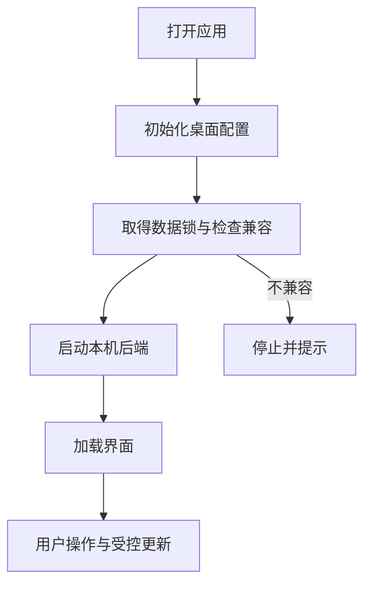

# Electron 桌面：本机服务与私有边界

## 先理解它解决什么问题

桌面壳将 Web 界面与本机后端组合起来，同时管理启动、数据目录和私有连接。界面看起来像网页，数据生命周期却属于当前安装的应用，不应复制仓库运行目录来拼装正式数据。

**贯穿实例：** 开发模式使用正式 App 数据时，启动器先持有数据锁并执行受控备份，再启动服务。前端热更新不会自动允许后端迁移或覆盖未保存内容。

## 图一：桌面进程、页面与数据的职责

```fpl-canvas
desktop
```

图例：左侧主进程负责生命周期，上排是页面和静态资源，下排是后端和用户数据。静态指南随包更新，用户数据独立保存；页面的业务请求仍通过本机后端完成。

## 图二：受控桌面启动过程



图例：方框表示启动阶段，分支表示兼容性检查结果。图省略开发与正式打包的专用细节；正式数据开发流程还有停机备份与迁移阻止条件，不能跳过检查直接启动另一后端。

## 实现与设计取舍

配置初始化先于数据库模块导入。静态 HTML 回退仅用于页面导航，未知 API 与缺失资源保留 404。开发网关维持同一窗口中的稳定来源，并校验私有凭据；正式包不启用开发桥。桌面 Agent 业务通道按操作登记表授权，不开放账号治理、密钥管理或系统命令。Amadeus 的能力范围另由其工具配置与授权控制，不能将二者混为一个入口。

## 异常、验证与当前边界

正式数据与隔离开发目录严格区分，自动测试只用临时数据。离线官方指南依赖随包的本机资源，不需要外部文档服务；模型请求仍可能需要联网。服务启动失败时不能通过删库或伪造迁移状态恢复。

## 代码入口与阅读顺序

1. `desktop`
2. `backend/app/main.py`
3. `web/src/features/thought-workshop/official/content.ts`

阅读时先定位输入和校验，再跟踪持久化或执行入口，最后对照输出与错误分支。可以把上方图复制到个人知识库加入自己的注释；副本不会随官方文章自动更新。
