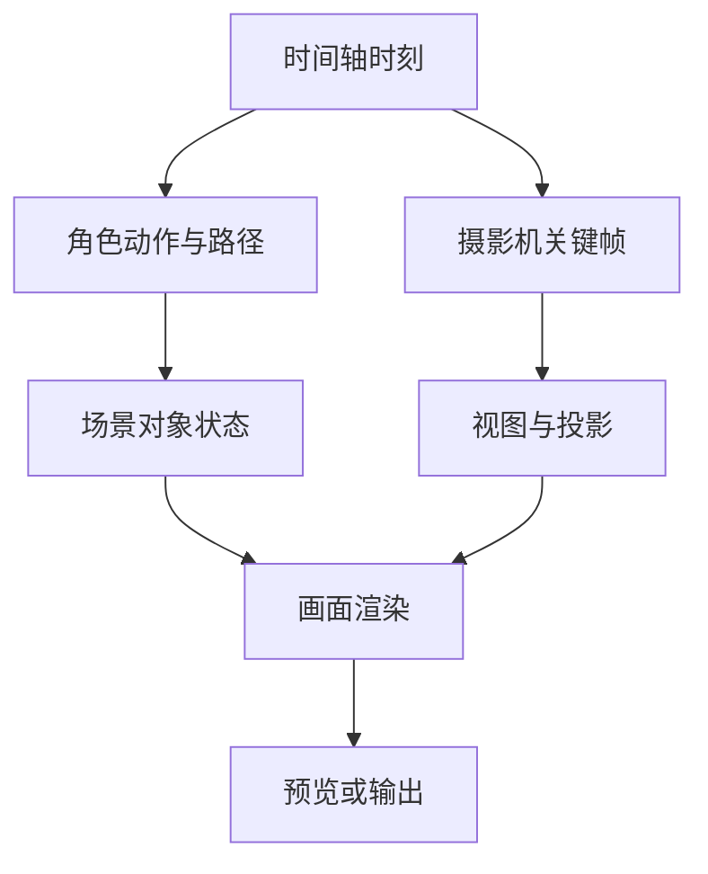

# 导演台：场景图、动作与摄影机

## 先理解它解决什么问题

导演台用三维场景组织演员、场景物件和摄影机，在时间轴上安排走位与动作，得到可检查的预演。对象变换、动画求值、镜头构图和最终画面是连续但不同的步骤。

**贯穿实例：** 演员沿路径走向桌边时，需要检查动作速度与路径距离是否匹配，再检查脚底接触和摄影机遮挡。看起来在移动不等于运动轨迹和镜头已正确。

## 图一：场景求值与镜头求值汇合成预演

```fpl-canvas
director-desk
```

图例：上下两路在同一时刻采样，分别得到被观察的场景和观察它的摄影机。画面由二者共同决定，演员走位正确而镜头遮挡仍会产生错误预演。

## 图二：对象和视图的双路求值



图例：T 是当前时间，各分支消费同一个时刻；汇合箭头表示场景状态与相机投影都参与渲染。图示是逻辑数据依赖，不代表后台已启动独立并行渲染任务。

## 实现与设计取舍

前端场景编辑与动画模块负责当前时刻的表现，后端项目用例负责工程结构与资源生命周期。外部 Agent 的场景操作需要已打开并加载的编辑器接收；它不能在没有场景运行时的情况下假装完成修改。

## 异常、验证与当前边界

检查外部模型和贴图缺失、角色动作兼容、对象可见性与镜头范围。隐藏对象会影响拍摄结果，不仅是列表操作。工程包保存可编辑状态，输出视频保存观察结果；当前定位为三维预演，不是最终离线美术渲染器。

## 代码入口与阅读顺序

1. `backend/app/apps/director_desk/projects.py`
2. `web/src/features/director-desk/editor/animation`
3. `web/src/features/director-desk/editor/automation`

阅读时先定位输入和校验，再跟踪持久化或执行入口，最后对照输出与错误分支。可以把上方图复制到个人知识库加入自己的注释；副本不会随官方文章自动更新。
