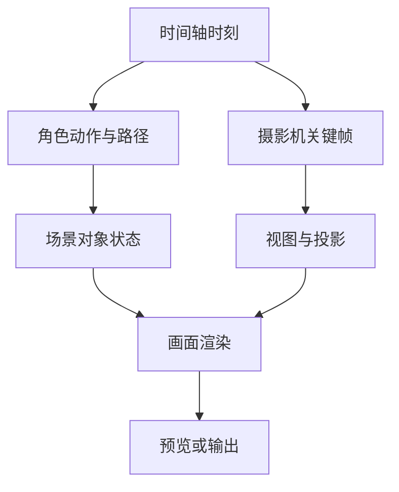

# 导演台：场景图、动作与摄影机

演员沿路径走到桌边，预览里却出现脚底滑动或被摄影机挡住。单看“角色确实在移动”，无法判断这次预演是否正确：路径决定位置，动作决定姿态，摄影机决定看到什么。

导演台把场景对象、角色动作和镜头安排在同一时间轴中求值。本篇用这次走位说明，哪些状态来自工程描述，哪些是当前时刻计算出来的，以及为什么保存工程和输出视频是两种交付。

## 场景求值与镜头求值汇合成预演

同一个时间点，场景状态和摄影机状态为什么需要分别求值？

```fpl-canvas
director-desk
```

图例：上下两路在同一时刻采样，分别得到被观察的场景和观察它的摄影机。画面由二者共同决定，演员走位正确而镜头遮挡仍会产生错误预演。

上路取得对象与角色的世界状态，下路取得观察位置和投影。最终画面需要两者：演员走位正确但镜头目标错误，或者镜头正确但角色被隐藏，都可能让画面看起来像动画没有运行。

## 对象和视图的双路求值

动作、路径与相机关键帧怎样在画面里汇合？



图例：T 是当前时间，各分支消费同一个时刻；汇合箭头表示场景状态与相机投影都参与渲染。图示是逻辑数据依赖，不代表后台已启动独立并行渲染任务。

所有分支消费同一个时间轴时刻，再把对象状态与视图交给渲染。图表示数据依赖，不表示启动了多个独立后台任务。排查时可以先固定镜头检查动作，再固定角色检查镜头，减少相互遮掩的问题。

## 编辑的是描述，预览的是采样结果

工程保存场景对象、资源引用、时间安排与相机设置；动画模块在当前时刻计算动作、路径和变换。看过一个时刻不代表其他时刻也有效，尤其需要检查动作进入退出、走位转弯与镜头切换。

前端编辑器拥有运行中的场景与显示对象，后端项目用例负责保存、结构和资源生命周期。外部 Agent 的场景操作需要已打开并加载的编辑器接收；只有后端项目记录并不能替代前端场景运行时执行编辑。

## 把问题分成资源、运动和观察三层

先确认模型、贴图和动作资源没有缺失；再检查路径距离、动作速度与接触；最后检查对象可见性、摄影机范围和构图。隐藏场景对象会影响输出，不只是让资源列表更整齐。

若预演与输出不一致，保留工程并对照同一时刻、同一镜头及同一资源版本。原生工程供继续编辑，视频供观看和沟通，两者不能互相恢复。当前定位是三维预演，并不保证最终离线美术渲染器级别的表现。

> [!TIP]
> 为演员走到桌边的例子保留三个检查时刻：开始迈步、到达桌边、停止后。分别看脚底接触与镜头遮挡，比只播放整段更容易找出问题。

## 场景描述和当前预演状态如何分工

工程保存对象、资源、动作路径、摄影机与时间描述；当前选中对象、视角操作和播放时刻是视图状态。前端按某一时刻计算演员与镜头，projects 用例拥有保存与归属。让演员走到桌边修改的是路径与时间，播放预演只是消费这些输入，不另存一份共享的实时世界对象。

一个输出时刻先求对象状态，再求摄影机观察关系，资源决定对象如何呈现。工程 JSON 保留后续编辑信息，屏幕预演说明特定时间和视角的结果。具体输出能力以实际导出入口为准，不能从三维预览推导存在任意视频或外部模型生成。

## 场景组件替换的验收依据

检查路径起止、动作交接、摄影机目标和丢失资源，再核对保存后重新打开状态一致。演员状态正确但画面看不到时先检查摄影机，轨迹跳变检查时间和路径；版本冲突保留工程草稿。测试需要固定时刻与输入，比较关键状态而非只保存一张随机截图。

## 相关阅读

- [时间线与媒体渲染](/apps/thought-workshop/official-knowledge-bases/technical/documents/rendering)
- [集成与 Agent/CLI/SDK](/apps/thought-workshop/official-knowledge-bases/technical/documents/automation)
- [导演台：保存与素材管理](/apps/thought-workshop/official-knowledge-bases/director-desk/documents/storage)
- [前端组件与状态分工](/apps/thought-workshop/official-knowledge-bases/technical/documents/frontend-design)

## 代码入口

1. `backend/app/apps/director_desk/projects.py`
2. `web/src/features/director-desk/editor/animation`
3. `web/src/features/director-desk/editor/automation`
