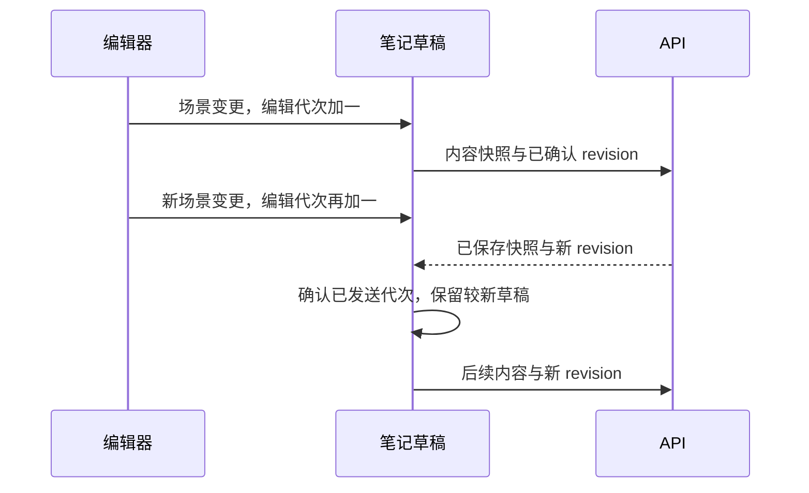

# 前端组件与状态分工

拖动画板节点时界面立即变化，列表缓存却可能还显示旧更新时间；放大图表又不应触发保存。这不是一份“全局状态”更新慢，而是编辑草稿、服务器缓存和临时视图承担了不同职责。

本篇沿思绪工坊的保存链解释前端组件化。目标是让画板编辑器可以替换交互实现，而页面仍能复用笔记的保存、冲突、历史与权限规则。

## 图一：画板编辑的四类前端状态

同一画面里的数据分别由谁拥有？

```fpl-canvas
frontend-design
```

图例：箭头表示组件装配和状态传递。草稿、临时视图与查询缓存是不同所有者；图没有把缓存画成编辑器的即时内部状态。

页面决定当前资源和入口；编辑器通过回调产出语义场景；useNoteDraft 拥有笔记草稿与保存协调；API 客户端消费生成契约。列表和服务器快照进入 Query 缓存，选中框、平移和缩放留在图形交互内部。共享 UI 可以显示按钮，却不应决定哪篇笔记允许覆盖。

## 图二：在途保存与后续输入

一次请求发出以后继续输入，成功响应是否应该覆盖新草稿？



图例：实线是调用，虚线是返回。编辑代次仅用于客户端辨认输入顺序，revision 是服务器并发前提；两者不是同一版本号。

useNoteDraft 用在途 Promise 串行协调 flush，用 generation 和 savedGeneration 区分已发送输入与后来编辑。响应推进已确认版本，只有代次追平才显示 saved；后续草稿仍是 dirty。服务器返回快照供外部消费者更新，不意味着用旧发送内容替换当前输入。

## 五个前端目录如何协作

app 装配路由、应用壳与会话；features 拥有业务页面、用例和专属状态；platform 提供请求、认证与同步基础设施；shared 提供无业务归属 UI；generated 保存 OpenAPI 类型。platform 和 shared 不导入 features，features 不反向依赖 app。依赖方向与运行时 HTTP 流量分开理解。

Models、思绪工坊等功能的查询键由各自 key factory 拥有。其他消费者导入拥有者的键，不能复制一段同名数组后各自失效。查询缓存用于共享服务器事实，不能代替未保存保护或笔记的 CAS 队列。

## 本机草稿、错误与资源切换

草稿存储按账号、Workspace、笔记和标签页区分；它是恢复辅助，不是服务器真源，也不保存密码或 Session 明文。恢复候选需要先处理，不能在加载过程中直接自动提交旧正文。输入法组合期间延后保存，避免把尚未完成的文字写成已确认内容。

409 会阻断继续保存并保留服务器冲突快照；网络错误保留草稿供确认状态。鉴权文件预览使用 useApiBlobUrl 处理取消、竞态和 Object URL 回收；对象 URL 只用于显示，不进入笔记。组件关闭、账号切换和 Workspace 切换都要让旧异步结果失去更新新页面的机会。

## 替换编辑器应验证哪些行为

让新编辑器输出相同 CanvasScene、相同内容变更回调，并保留焦点与无障碍语义。检查缩放不触发正文写入、连续输入不被旧响应覆盖、409 保留草稿、重新打开恢复服务器内容。能通过这些场景才说明组件边界保持有效；仅让页面外观看起来相同无法证明保存行为一致。

> [!NOTE]
> 临时视图、待保存草稿、本机恢复副本和服务器快照有不同生命周期，不能合成一个共享可变对象。

## 正文编排与访问适配

`document-layout/` 拥有卡片、卡片组、动态目录、代码工具和共用正文样式。导入包把 Markdown、图形和首页转换为标准 JSON 块；导入后的官方文章直接使用普通阅读组件，访问适配器区分 Workspace 与社区权限。父子文档树统一呈现目录，不使用专用分组侧栏。

卡片只保存引用标识和展示配置，目标标题与简介经 DocumentAccess 按当前账号解析；动态目录绑定当前知识库。社区的访问适配器只读取当前发布记录的可见目录。新节点进入原 Notes 校验、CAS、历史、引用索引和备份，不需要 SQL schema 变更，CanvasScene 契约不变。失效目标不渲染标题或链接；HTML 与 Markdown 导出也按当前可见目标投影。

## 相关阅读

- [组件契约与生命周期](/apps/thought-workshop/official-knowledge-bases/technical/documents/component-contracts)
- [编辑、保存、历史与并发](/apps/thought-workshop/official-knowledge-bases/technical/documents/revision)
- [思绪工坊：富文本、画板与知识库](/apps/thought-workshop/official-knowledge-bases/technical/documents/thought-workshop)

## 代码入口

1. `web/src/features/thought-workshop/useNoteDraft.ts`
2. `web/src/features/thought-workshop/queryKeys.ts`
3. `web/src/platform/api/useApiBlobUrl.ts`
