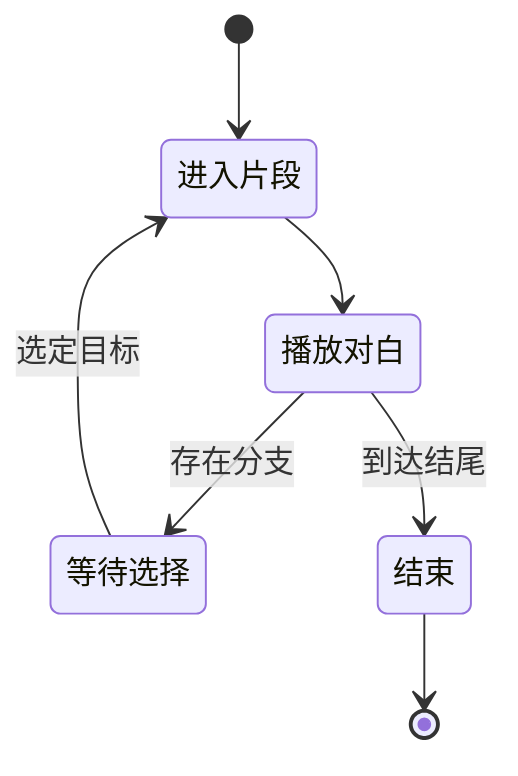

# Galgame 工坊：故事图与路线求值

## 先理解它解决什么问题

故事同时包含角色、素材、片段、时间和分支。结构正确并不意味着每条路线可播放，因此校验既检查身份和引用，也检查流程、时间轴及表现层规则。试玩是在这份故事描述上运行状态机。

**贯穿实例：** 一段对话结束后出现选择，玩家选定分支进入另一片段。导出路线视频时必须明确选中的路线，不能把交互选择原样当作线性影片。

## 图一：同一故事的交互与线性输出

```fpl-canvas
galgame-workshop
```

图例：菱形表示结构与流程校验，右侧分成试玩和视频两种消费。视频不能保留等待玩家选择的交互语义，所以导出前需要确定路线。

## 图二：试玩过程的概念状态机



图例：黑圆点是起点或终点，箭头表示推进条件。等待选择期间不会自动确定分支；图只显示最小对白流程，真实故事还包含变量、条件和更多表现节点。

## 实现与设计取舍

Story 入口负责格式适配，纯校验按身份角色、素材、国际化、时间轴、流程与表现分层。修改故事通过正式操作表达，输出消费已明确的路线。直接视频导出依赖公共媒体渲染能力，只有显式工程交接才进入视频剪辑应用。

## 异常、验证与当前边界

失效角色 ID、不可达片段和缺失素材不能以跳过校验解决。可玩的分支作品与线性视频是不同输出，预览与导出需检查所选路线、字幕和声音。旧格式由迁移适配处理，不能直接替换故事内部字段假装升级。

## 代码入口与阅读顺序

1. `backend/app/apps/galgame_workshop/schemas/story_validation.py`
2. `backend/app/apps/galgame_workshop/story/story_flow.py`
3. `backend/app/apps/galgame_workshop/story/operations.py`

阅读时先定位输入和校验，再跟踪持久化或执行入口，最后对照输出与错误分支。可以把上方图复制到个人知识库加入自己的注释；副本不会随官方文章自动更新。
