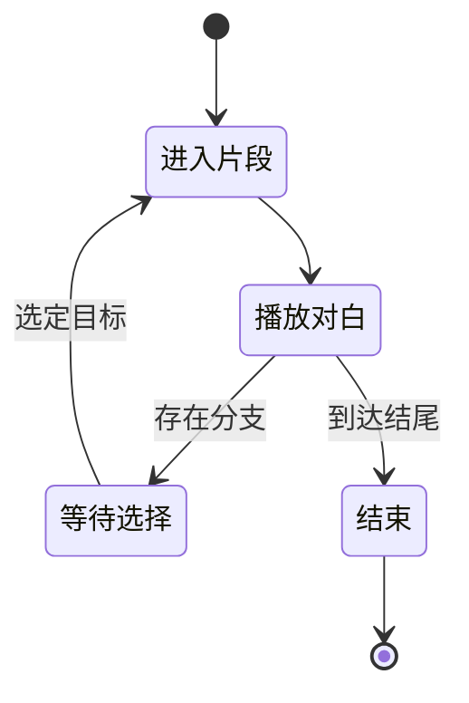

# Galgame 工坊：故事图与路线求值

故事中的一句对白结束后出现两个选项，玩家选择右侧分支。试玩可以等待这个选择，导出的视频却必须已经知道接下来播放哪一段。

Galgame 工坊因此同时处理故事描述和运行时状态。故事保存角色、章节、片段、素材与分支规则；试玩根据输入推进；线性输出消费明确的路线。本文用这个分支点说明校验、求值与交付的边界。

## 同一故事的交互与线性输出

同一份 Story，如何同时服务交互试玩和路线视频？

```fpl-canvas
galgame-workshop
```

图例：菱形表示结构与流程校验，右侧分成试玩和视频两种消费。视频不能保留等待玩家选择的交互语义，所以导出前需要确定路线。

分层校验先确保入口、身份、引用和流程结构可被解释。右侧两种消费方式则有不同前提：试玩接受玩家输入，视频需要确定选择。保存了一个合法分支，并不等于已经选好导出路线。

## 试玩过程的概念状态机

玩家停在选项界面时，故事状态为什么不能继续自动向前？



图例：黑圆点是起点或终点，箭头表示推进条件。等待选择期间不会自动确定分支；图只显示最小对白流程，真实故事还包含变量、条件和更多表现节点。

状态机在等待选择处暂停，选定目标后进入下一片段。图只描述最小对白路径；真实文档还有变量、条件、章节终止与表现节点，求值必须按它们的语义更新状态，不能只按列表索引递增。

## 校验拆层，避免一种错误掩盖另一种

Story 入口处理格式适配并调用纯校验。身份与角色检查确认 ID，素材检查确认引用，国际化检查确认目标字段，时间轴与流程检查确认入口和目标，表现层检查具体显示规则。这样失效角色引用和分支目标错误能保持各自的诊断。

正文操作更新的是故事描述，试玩中的当前角色状态或当前位置属于执行状态。重新播放与修改文档不是同一行为，也不能把某一次试玩结果当作故事所有分支都已经验证。

## 导出前先固定路线与资源

路线视频直接使用公共媒体渲染能力，不依赖视频编辑器内部实现。显式交接到视频剪辑则是另一个业务用例，会产生供继续编辑的目标工程。

遇到缺失素材或无效目标，先修正文档和引用，再重新验证。旧格式按正式适配流程处理，不手工替换内部字段假装升级。交付时检查实际选中路线、字幕、声音与片段衔接；仅试玩其中一条路线不能覆盖其余分支。

> [!NOTE]
> 互动作品保留“等待选择”，线性视频保留“选择后的结果”。向别人描述导出问题时，请同时提供作品版本和所选路线。

## 故事编辑、路线求值和渲染之间的输入输出

编辑操作以稳定角色、章节和片段 ID 修改 Story；纯校验分层验证引用、时间线、分支和表现。试玩求值拥有当前片段、变量和选择，Story 本身拥有全部路线描述。一次选择产生下一运行状态，不意味着把试玩当前位置持久化成工程入口。

路线视频固定文档、所选路线与素材，转换成公共媒体输入。直接导出消费公共渲染能力，显式交接到视频编辑器使用独立公开用例。原生故事继续可编辑，线性视频只表达所选路径，不能从一个成品恢复全部交互分支。

## 分支与素材的异常验证

测试悬空目标、缺失角色、国际化字段、无效时间区间和未确定路线，再核对选中路线的字幕、音频与接缝。保存版本冲突保留草稿，格式兼容经正式适配入口处理；不能手改持久 JSON 或重复播放一条路线就声称所有路径有效。源码入口分别对应 story_validation、story_flow 和 story operations。

## 相关阅读

- [时间线与媒体渲染](/apps/thought-workshop/official-knowledge-bases/technical/documents/rendering)
- [素材上传、引用与预览](/apps/thought-workshop/official-knowledge-bases/technical/documents/assets)
- [Galgame 工坊：导入导出与交付](/apps/thought-workshop/official-knowledge-bases/galgame-workshop/documents/delivery)
- [公共能力复用与应用交接](/apps/thought-workshop/official-knowledge-bases/technical/documents/app-handoffs)

## 代码入口

1. `backend/app/apps/galgame_workshop/schemas/story_validation.py`
2. `backend/app/apps/galgame_workshop/story/story_flow.py`
3. `backend/app/apps/galgame_workshop/story/operations.py`
