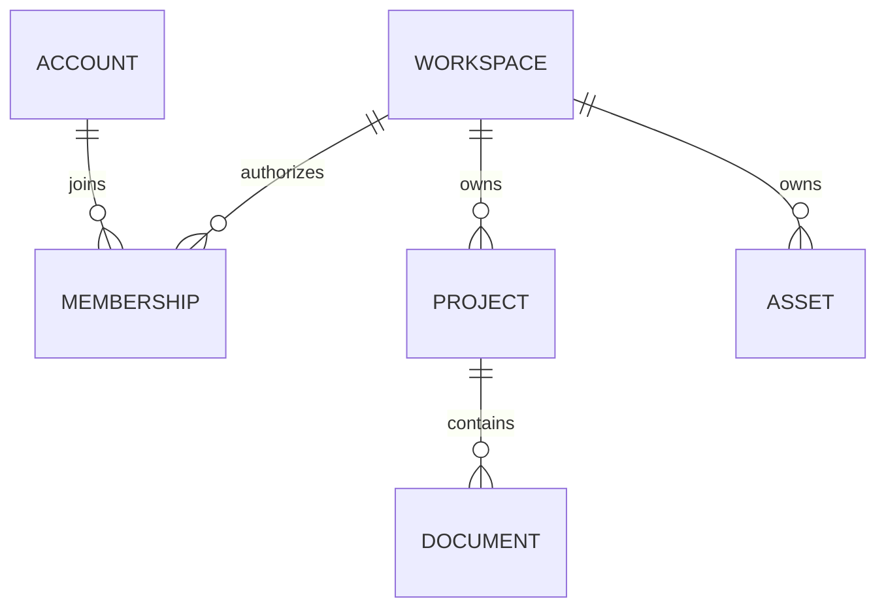

# Workspace 与权限：资源为什么不能串空间

一名成员知道另一个 Workspace 的文档 ID，能不能把它填进地址栏打开？只在页面上隐藏文档还不够；服务端必须在加载资源时检查它属于哪个空间。

以复制官方图为例：任何具有思绪工坊阅读权限的账号都能看图，但创建个人副本还需要写权限与一个可访问的目标知识库。身份认证、有效权限、资源归属分别解决不同问题，三者都通过才允许写入。

## 凭证、权限与资源归属三道检查

同一个资源 ID，为什么会随请求身份产生“可访问”和“不存在”两种结果？

```fpl-canvas
identity
```

图例：左侧是凭证，中间是服务器解析出的身份与空间；右侧两张卡片对比同空间和跨空间资源。权限通过后仍必须检查归属，客户端传入资源 ID 不能改变当前空间。

认证产生 StudioPrincipal，其中包含当前 Workspace 和有效权限。业务用例用这个空间加载根项目，再从已验证的根项目访问子文档。请求正文不能提交另一个 workspace_id 来替换这项上下文；知道 ID 也不能越过归属检查。

## 逻辑资源归属关系

项目、文档与素材的归属如何连接，才能避免每个子记录自行猜测空间？



图例：ER 图中双竖线表示恰好一个，圆圈与叉脚表示零到多个。ACCOUNT、PROJECT、DOCUMENT 是解释归属的概念实体，不代表每个应用都采用同名数据库表；根项目拥有空间，子文档经根项目继承。

项目这样的根资源直接保存空间身份，文档等子资源通过已校验的父资源继承。素材也有自己的空间归属，因此即使文档写权限成立，嵌入另一空间图片仍应失败。图是概念关系，不要求每个应用都有名为 PROJECT 或 DOCUMENT 的表。

## 浏览器和脚本使用同一组有效权限

浏览器 Session 通过 HttpOnly Cookie 识别身份，写请求另带 CSRF 校验信息。Management API Key 的授权范围参与有效权限计算，不能因为持有一个 Key 就默认拥有全部写入能力。前端读取 Principal 的权限控制入口，服务端仍逐次校验。

复制官方图时，官方内容保持静态只读；客户端只是读取场景或源码，然后调用创建个人笔记的正式操作。目标库已删除、权限变更或目录版本过期，都可能让创建失败。管理员也不会获得在线修改官方原文的入口。

## “不存在”是有意保持的边界

跨空间请求按不存在处理，避免暴露另一空间是否拥有某个项目。排查时先核对当前账号、Workspace、Key 授权范围，再核对资源 ID；不要把 404 直接解释为数据已被删除。

后台任务要把空间写进任务记录，恢复时从记录重建上下文。请求结束后仍运行的任务不能借用一个“当前空间”全局变量。

> [!WARNING]
> 不要通过替换请求里的项目 ID 来迁移内容。跨空间迁移应使用正式导入或复制流程，让新资源重新获得归属并重映射引用。

## 相关阅读

- [集成与 Agent/SDK：受控的自动化入口](/apps/thought-workshop/official-knowledge-bases/technical/documents/automation)
- [素材与导出：引用、快照和包有什么不同](/apps/thought-workshop/official-knowledge-bases/technical/documents/assets)
- [Workspace 与账号权限](/apps/thought-workshop/official-knowledge-bases/general/documents/accounts)

## 代码入口

1. `backend/app/capabilities/identity/principal.py`
2. `backend/app/capabilities/identity/permissions.py`
3. `backend/app/capabilities/identity/route_permissions.py`
