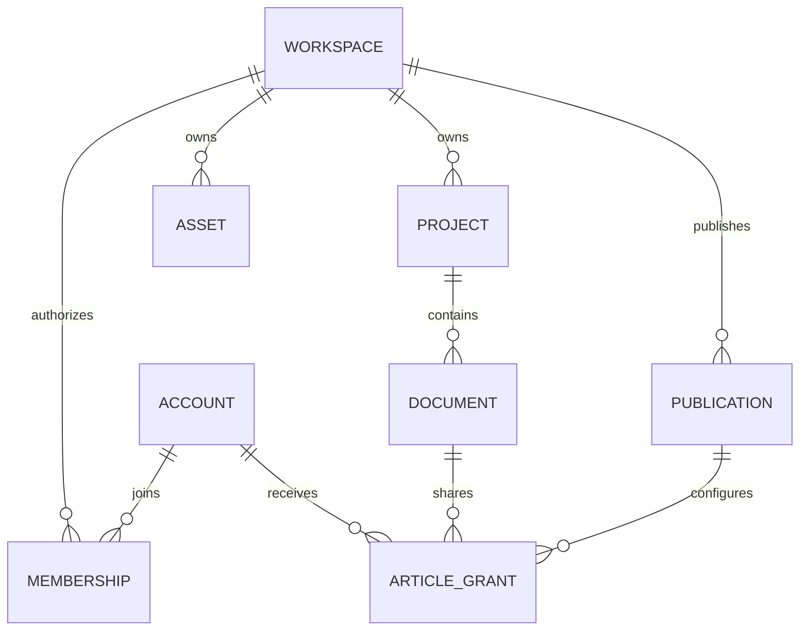

# Workspace 与权限

一名成员知道另一个 Workspace 的文档 ID，能不能把它填进地址栏打开？只在页面上隐藏文档还不够；服务端必须在加载资源时检查它属于哪个空间。

以复制官方图为例：任何登录账号都能阅读官方图，但创建个人副本还需要写权限与一个可访问的目标知识库。身份认证、有效权限、资源归属分别解决不同问题，三者都通过才允许写入。

## 凭证、权限与资源归属三道检查

同一个资源 ID，为什么会随请求身份产生“可访问”和“不存在”两种结果？

```fpl-canvas
identity
```

图例：此图描述普通 Workspace 业务访问，社区还需先检查发布与逐篇角色。左侧是凭证，中间是服务器解析出的身份与空间；右侧两张卡片对比同空间和跨空间资源。权限通过后仍必须检查归属，客户端传入资源 ID 不能改变当前空间。

认证产生 StudioPrincipal，其中包含当前 Workspace 和有效权限。业务用例用这个空间加载根项目，再从已验证的根项目访问子文档。请求正文不能提交另一个 workspace_id 来替换这项上下文；知道 ID 也不能越过归属检查。

## 逻辑资源归属关系

项目、文档与素材的归属如何连接，才能避免每个子记录自行猜测空间？



图例：ER 图中双竖线表示恰好一个，圆圈与叉脚表示零到多个。ACCOUNT、PROJECT、DOCUMENT 是解释归属的概念实体，不代表每个应用都采用同名数据库表；根项目拥有空间，子文档经根项目继承。

项目这样的根资源直接保存空间身份，文档等子资源通过已校验的父资源继承。素材也有自己的空间归属，因此即使文档写权限成立，嵌入另一空间图片仍应失败。图是概念关系，不要求每个应用都有名为 PROJECT 或 DOCUMENT 的表。

## 浏览器和脚本使用同一组有效权限

浏览器 Session 通过 HttpOnly Cookie 识别身份，写请求另带 CSRF 校验信息。Management API Key 的授权范围参与有效权限计算，不能因为持有一个 Key 就默认拥有全部写入能力。前端读取 Principal 的权限控制入口，服务端仍逐次校验。

官方标记只由平台超级管理员／管理员设置，Workspace 管理员身份不等同于平台管理员。官方和普通社区正文使用相同编辑入口：只读发布抑制源空间普通成员的隐式编辑权，逐篇账号授权和角色编辑授权仍独立生效。角色授权不扩大可见范围或管理权限；保存、上传及表格写入在事务中重新校验当前授权。

## 社区授权如何跨越空间而保留隔离

社区只有浏览器 Session 入口，不能使用 Management API Key 或 Agent 通道。`publication/` 的注册表会话先检查发布、未删除的源知识库、当前文章及账号角色，只有通过后才显式绑定源 Workspace。源空间成员的既有读写权限继续有效；逐篇成员授权只增加该文章的能力，不开放其他文档与目录。

目录、计数、搜索、反向链接和导出采用同一可访问投影；隐藏父文档不暴露名称。素材读取必须来自当前可读正文或明确发布的封面。编辑上传先完成文件校验和落盘，再重新检查授权登记；正文保存复用 Notes 的校验、CAS 与历史，权限撤销和保存由 SQLite 短写事务串行化。社区没有历史接口，恢复继续在源 Workspace 中执行。

## “不存在”是有意保持的边界

跨空间请求按不存在处理，避免暴露另一空间是否拥有某个项目。排查时先核对当前账号、Workspace、Key 授权范围，再核对资源 ID；不要把 404 直接解释为数据已被删除。

后台任务要把空间写进任务记录，恢复时从记录重建上下文。请求结束后仍运行的任务不能借用一个“当前空间”全局变量。

> [!WARNING]
> 不要通过替换请求里的项目 ID 来迁移内容。跨空间迁移应使用正式导入或复制流程，让新资源重新获得归属并重映射引用。

## 同一个操作在不同入口保持同一授权

Web 按 Principal 的有效权限显示复制入口，创建个人笔记仍调用正式 API。SDK 的凭证授权和桌面 Agent 白名单也不能代替 Notes 对目标知识库、引用文档和素材的空间检查。前端隐藏写按钮只是反馈，服务端规则才是写入边界。

成员权限可能在页面打开之后改变；后端应以实际请求身份决定结果。异步读取返回前切换 Workspace，前端也必须阻止旧资源更新新页面。后台从任务记录恢复空间，不能延续已结束请求的隐含状态。

## 授权验证要同时检查内容与文件

在隔离账号下检查同空间读取、只读复制拒绝、跨空间笔记 ID、另一空间的图片 ID，以及旧缓存是否随切换失效。即使一个根项目可以访问，仍不能把另一个空间的素材插入正文。404、403 与保存冲突有不同原因，排查记录当前主体、有效权限及资源身份，不输出密码或密钥。

## 相关阅读

- [集成与 Agent/CLI/SDK](/apps/thought-workshop/official-knowledge-bases/technical/documents/automation)
- [素材上传、引用与预览](/apps/thought-workshop/official-knowledge-bases/technical/documents/assets)
- [Workspace 与账号权限](/apps/thought-workshop/official-knowledge-bases/general/documents/accounts)
- [核心对象与数据归属](/apps/thought-workshop/official-knowledge-bases/technical/documents/data-model)

## 代码入口

1. `backend/app/capabilities/identity/principal.py`
2. `backend/app/capabilities/identity/permissions.py`
3. `backend/app/capabilities/identity/route_permissions.py`
4. `backend/app/apps/thought_workshop/publication/access.py`
