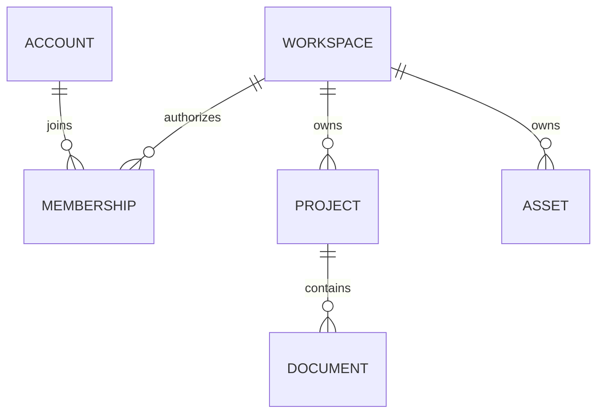

# Workspace 与权限：资源为什么不能串空间

## 先理解它解决什么问题

Workspace 是逻辑租户边界。身份认证回答谁在请求，权限回答能做什么，资源归属回答能访问哪一份数据。三者都要成立，不能只在前端隐藏按钮。业务接口的空间来源是已认证 Principal，而不是客户端提交的 workspace_id。

**贯穿实例：** 只读成员可以浏览官方 UML 图，但不能创建个人副本。复制时目标知识库仍需要位于当前空间，并通过后端写权限与归属检查。

## 图一：凭证、权限与资源归属三道检查

```fpl-canvas
identity
```

图例：左侧是凭证，中间是服务器解析出的身份与空间；右侧两张卡片对比同空间和跨空间资源。权限通过后仍必须检查归属，客户端传入资源 ID 不能改变当前空间。

## 图二：逻辑资源归属关系



图例：ER 图中双竖线表示恰好一个，圆圈与叉脚表示零到多个。ACCOUNT、PROJECT、DOCUMENT 是解释归属的概念实体，不代表每个应用都采用同名数据库表；根项目拥有空间，子文档经根项目继承。

## 实现与设计取舍

根资源直接保存 workspace_id，子资源通过已校验的根资源继承。浏览器 Session 使用 HttpOnly Cookie，写操作携带 CSRF 头；Management API Key 绑定授权范围。固定权限定义和 HTTP/SSE 路由登记构成后端检查基础，Web 消费有效权限控制入口。

## 异常、验证与当前边界

跨空间 ID 按不存在处理，以免泄露另一空间资源。后台任务从任务记录恢复空间，不能读取已结束请求的隐含上下文。测试需分别验证只读写入拒绝、其他空间素材引用拒绝，以及同名资源不会绕过身份。

## 代码入口与阅读顺序

1. `backend/app/capabilities/identity/permissions.py`
2. `backend/app/capabilities/identity/route_permissions.py`
3. `web/src/features/accounts/permissions.ts`

阅读时先定位输入和校验，再跟踪持久化或执行入口，最后对照输出与错误分支。可以把上方图复制到个人知识库加入自己的注释；副本不会随官方文章自动更新。
