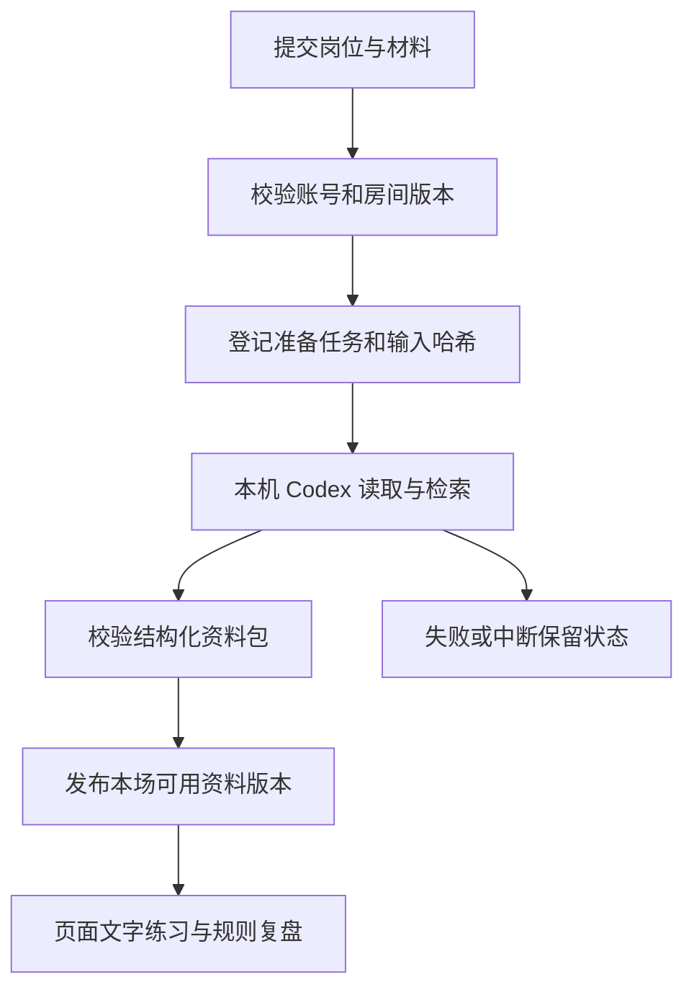

# 面试助手：材料、准备任务与文字练习

面试助手把本场 JD、简历材料和结构化准备结果组织为当前账号的房间。准备由已安装、已登录且获得用途授权的本机 Codex 执行；FPL 维护任务状态、输出校验和资料版本。练习界面消费已经完成的资料包，页面中的文字回答和规则复盘有独立的临时生命周期。

## 房间中的哪些信息需要持久保存

```fpl-canvas
interview-assistant
```

图例：左侧是账号内房间与材料，中间是本机 Codex 准备任务和已校验资料，右侧是页面练习。箭头表示输入或读取，练习结果标注为页面内状态；它不会因准备任务成功而自动成为完整录音或长期回答记录。

上传的简历文件作为本场只读材料保存，房间记录持有岗位、文本、材料标识与 revision。准备任务保存输入哈希与状态，成功资料保存来源、经历、问题和评分要点。当前账号是唯一私人数据归属来源，接口不接受调用方指定另一账号；仅有目标 ID 不能读取别人的材料、任务或导出。

## 从材料提交到可以练习的资料包



图例：方框表示不同阶段，失败分支留下可检查的任务状态。开始任务不代表资料已经可用；只有通过 schema 与来源引用校验的结果才进入完成版本，页面随后展示题目和资料。

准备输入需要明确岗位与 JD，简历可采用文本或上传原件。系统先核对当前账号、房间 revision 和用途授权，再创建本次任务。外部 CLI、文件解析和网络检索不放在 SQLite 长写事务中；任务进入运行、结果交付和终态结算分别使用短事务。输入哈希帮助确认资料对应哪一版材料，不能用另一房间或更晚材料的结果静默替换旧版本。

## Codex 连接与用途授权如何约束执行

部署连接在 TOML 中指定本机可执行文件，账号和用途授权由治理用例维护。面试准备使用自己的任务边界，复用公共连接登记，不直接读取 Amadeus 会话目录或继承其授权。连接可用必须同时满足路径、登录与当前用途授权；页面重新检查显示实际状态，不能把安装了 CLI 等同于本账号可以执行。

CLI 获得任务专用工具和受控执行目录，个人插件、通用 Shell 和任意浏览器会话不会因为提交材料而成为默认任务能力。材料会交给用户选择的本机 Codex，外部检索可能访问网络，因此界面在提交前明确提示数据用途。普通账号不能通过伪造房间 ID、材料 ID 或导出路径取得其他账号的资料。

## 结果校验保留可追溯性和不确定性

准备包包含岗位要求、经历、知识主题、引用来源、问题蓝图、首轮问题及复盘维度。来源有检索时间、可用的发布日期与版本，题目用 ID 连接要求、经历及来源。校验既检查字段结构，也检查引用是否落在当前结果的合法集合，避免页面显示无法追溯的来源或题目。

真实经历不足时应保留不确定性与限制，不生成虚构履历。版本或来源日期缺失时明确显示未提供，不能把检索时间当成发布日期。页面允许核对来源与资料，再开始文字练习；专业内容仍需用户根据实际岗位、材料和有效日期复核。任务失败时保留原因，重新准备是显式新操作，不能在刷新页面后自动重新提交外部请求。

## 练习、导出与中断的生命周期

成功资料与任务可以从房间历史重新读取，离开页面不等于取消后台准备。练习回答、音视频示意与文字规则评分属于当前页面，刷新后不能假定它们已经恢复。导出准备资料的 Markdown/JSON 与导出练习报告解决不同需求，下载前分别核对内容，离开有未保存内容时处理保护提示。

导出接口再次校验房间及任务归属，文件下载不扩大接收者在 FPL 内的权限。用户把导出交给其他人时需要自行核对简历、联系方式和经历信息。实际模型生成质量、外部检索覆盖率、真实音视频通话和招聘结果不是确定性接口测试能证明的能力；测试用合成材料、假 CLI 和隔离数据库验证任务、状态、归属、版本冲突与导出结果。

> [!NOTE]
> 当前文字练习和规则复盘是模拟能力，音视频为示意。已经提交的准备任务需要先查看状态再决定手动重试；不通过复制运行目录、修改 SQLite 或更换账号来恢复任务。

## 相关阅读

- [主要操作流程](/apps/thought-workshop/official-knowledge-bases/interview-assistant/documents/workflow)
- [后台任务与恢复](/apps/thought-workshop/official-knowledge-bases/technical/documents/tasks)

## 代码入口

1. `backend/app/apps/interview_assistant/runner.py`
2. `backend/app/apps/interview_assistant/schemas.py`
3. `web/src/features/interview-assistant/InterviewAssistantPage.tsx`
