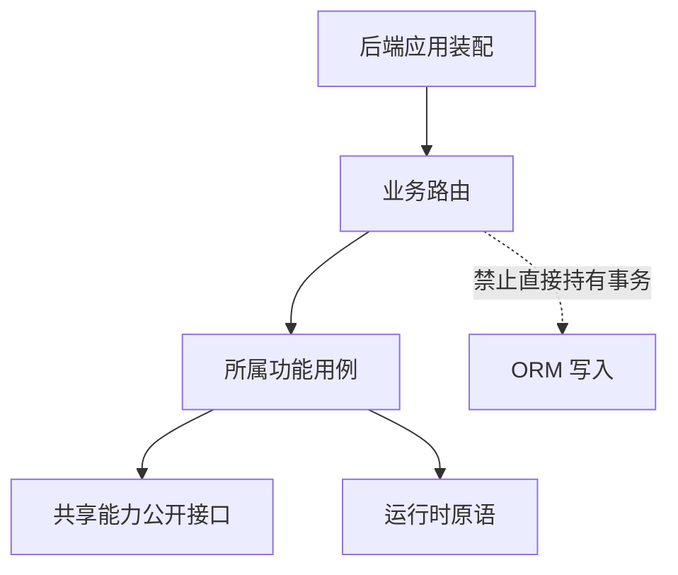

# 模块边界与路由：为什么按功能拆分

## 先理解它解决什么问题

页面、协议和业务规则变化的速度不同。项目用垂直功能切片把一项能力的规则放在一起，让界面重写不必重写存储，让供应商替换不必修改所有工坊。模块边界也限定哪些代码可以读取内部状态。

**贯穿实例：** 增加官方阅读页只需要静态清单和 Web 路由；增加可保存画板则要扩展笔记内容校验和可移植转换。这两种生命周期不会合并成一个数据库项目类型。

## 图一：前后端各自的依赖方向

```fpl-canvas
modules
```

图例：虚线分区区分 Web 与后端，不代表进程隔离。横向箭头表示代码依赖，不是 HTTP 流量；底层不能反向导入上层。ORM 查询属于功能内部存取，不属于 routes。

## 图二：功能调用与禁止的越界



图例：实线表示允许的调用方向；标注“禁止”的虚线表示需要架构测试拒绝的依赖。此图聚焦后端边界，前端页面通过 API 客户端发出请求，不在浏览器内调用后端 Python 用例。

## 实现与设计取舍

后端业务 API 在 /v1 注册，健康探针位于根路径。路由模块不持有 ORM 查询或事务，错误转换发生在协议边界。前端 app 负责壳与路由，features 负责用例，shared 和 platform 不反向依赖业务。应用之间只允许已登记、经目标公开接口完成的交接。

## 异常、验证与当前边界

新增路径必须补响应式覆盖；新增 HTTP 操作必须登记权限。模块名字看起来相似不等于可以相互导入。验证时先跑架构测试，再检查功能行为；遇到依赖环应移动真实业务职责，而不是增加无语义转发层。

## 代码入口与阅读顺序

1. `web/src/app/routes.ts`
2. `backend/app/api.py`
3. `tests/test_architecture.py`

阅读时先定位输入和校验，再跟踪持久化或执行入口，最后对照输出与错误分支。可以把上方图复制到个人知识库加入自己的注释；副本不会随官方文章自动更新。
