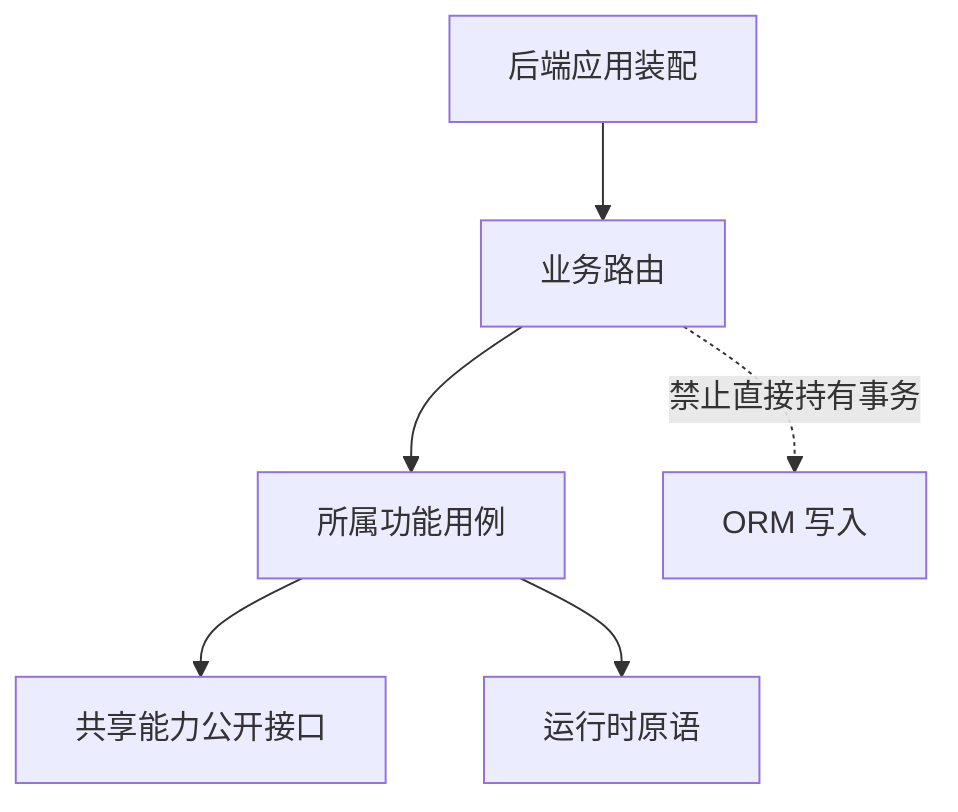

# 代码组织与依赖方向

为发布增加官方徽标，与为笔记增加画板，涉及不同的职责。发布模块负责认证标记、可见范围和有效角色；笔记模块负责正文校验、素材引用追踪、历史和导出。它们通过明确契约协作，官方内容不另开存储或阅读体系。

这篇用这两个改动说明一个定位方法：**先确定数据的生命周期，再找拥有它的功能**。目录名相似不代表可以共享内部状态，写入同一个 SQLite 也不代表路由可以直接查询任何表。

## 前后端各自的依赖方向

前端与后端都有“入口、业务、通用能力”，它们的依赖方向怎样区分？

```fpl-canvas
modules
```

图例：虚线分区区分 Web 与后端，不代表进程隔离。横向箭头表示代码依赖，不是 HTTP 流量；底层不能反向导入上层。ORM 查询属于功能内部存取，不属于 routes。

上排描述 TypeScript 代码依赖：应用壳装配业务页面，业务页面调用请求基础设施与共享 UI。下排描述 Python 依赖：路由把输入交给所属功能，功能使用有契约的公共能力。两排之间通过 HTTP 契约通信，不能把前端页面和后端用例当作同一进程里的函数链。

## 功能调用与禁止的越界

如果为了快一点在路由里直接写 ORM，会绕开哪条边界？



图例：实线表示允许的调用方向；标注“禁止”的虚线表示需要架构测试拒绝的依赖。此图聚焦后端边界，前端页面通过 API 客户端发出请求，不在浏览器内调用后端 Python 用例。

虚线标出的越界会把事务规则、权限与错误处理留在协议入口。其他调用者再做同一操作时容易复制一套不一致逻辑。因此查询与事务放在所属功能内，路由只处理请求校验、依赖注入、调用和响应映射。

## 按生命周期安排一次改动

内置 Markdown 与图形只用来构建可校验的导入包。管理员主动导入后，它们成为普通笔记节点：前端编辑场景，Notes 校验结构与素材并管理版本和历史，publication 校验官方标记与社区权限。包升级不回写已导入记录。

当多个应用都需要确定性媒体渲染时，共享的是明确的渲染文档与求值能力。应用自己的项目默认值、导入政策和导出任务仍留在应用内。边界不是“相同代码尽量合并”，而是让调用方只依赖它需要的公开契约。

## 怎样确认没有扩大耦合

新增业务路由要登记 `/v1` 操作和权限；新增 Web 页面要加入路由与响应式覆盖。架构测试检查依赖方向、路由边界和跨应用交接白名单，行为测试再验证操作结果。

遇到依赖环时，先追查到底哪项业务职责放错了位置。增加一个只转发导入的通用层会隐藏问题，不能让模块真正独立。

> [!NOTE]
> 代码依赖图与运行数据流图回答不同问题。本篇箭头主要表示“谁依赖谁”；具体请求经过哪些校验和事务，见系统全景。

## 从一次改动找到所有者

增加画板属性先检查 CanvasScene、前后端校验和 SVG 几何；调整保存反馈先检查笔记草稿与用例；修改素材访问检查素材能力和归属。目录索引列出实际职责，不能只凭文件名称含有 editor 就把所有规则都放入页面。

Web 的 app 装配入口，features 拥有业务，shared 提供通用 UI，platform 提供 API 与认证，generated 只放生成契约。后端 apps 与 llm、console 等各自拥有模型、schema、路由和具体用例；runtime 不决定文档默认值、历史或导入政策。有明确能力契约才能跨功能复用，不能靠通用层名字掩盖依赖环。

## 模块替换要观察什么

替换图形编辑库应继续输出场景；替换供应商适配器应继续输出公共推理事件；替换文件实现应保持显式账号与受控读写。消费者只依赖公开输入输出。检查失败响应、取消与资源切换，而不是只检查正常路径可编译。架构测试证明依赖边界，行为测试证明边界内实现满足调用方需求。

## 相关阅读

- [系统全景与一次操作的完整路径](/apps/thought-workshop/official-knowledge-bases/technical/documents/system)
- [测试与交付证据](/apps/thought-workshop/official-knowledge-bases/technical/documents/engineering)
- [思绪工坊：富文本、画板与知识库](/apps/thought-workshop/official-knowledge-bases/technical/documents/thought-workshop)
- [后端功能切片与用例边界](/apps/thought-workshop/official-knowledge-bases/technical/documents/backend-design)

## 代码入口

1. `web/src/app/routes.ts`
2. `backend/studio/assembly/website/routes.py`
3. `tests/architecture/test_repository.py`
