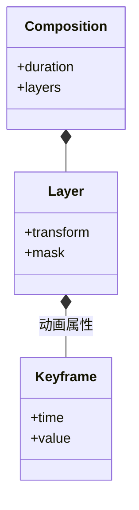

# 特效制作：关键帧与二维合成

## 先理解它解决什么问题

特效工程描述二维图层随时间变化的属性。关键帧决定若干时刻的值，插值决定它们之间怎样变化；遮罩、透明度与图层顺序再决定可见结果。

**贯穿实例：** 制作一个从左侧滑入的标题：位置关键帧控制位移，透明度控制出现过程，路径遮罩控制露出区域。透明成片可以交接到视频剪辑继续组合。

## 图一：关键帧、遮罩与图层顺序共同决定画面

```fpl-canvas
motion-compositor
```

图例：左上决定时间变化，左下决定内容与可见区域，两者在当前时刻汇合。右侧还要应用图层顺序和透明度，只有位置关键帧并不能完整描述成片。

## 图二：合成文档的概念类图



图例：实心菱形表示组合包含。Layer 的 transform 与 mask 是关键概念，不代表所有属性都必须存在；关键帧的值类型随动画属性变化。

## 实现与设计取舍

工程文档和快照由特效应用拥有，确定性画面求值由公共媒体能力拥有。关键帧编辑改变描述，预览在当前时刻计算状态，导出按帧率采样完整区间。向剪辑工坊交接通过公开用例，避免直接修改目标应用内部记录。

## 异常、验证与当前边界

检查同一属性的关键帧顺序、区间端点、遮罩闭合与透明背景。浏览器当前显示的一帧不能证明整个动画区间正确。项目包与透明输出承担不同用途，交付时保存工程并验证目标格式是否保留透明通道。

## 代码入口与阅读顺序

1. `backend/app/apps/motion_compositor/projects.py`
2. `backend/app/apps/motion_compositor/snapshots.py`
3. `backend/app/capabilities/media_rendering/motion_frames.py`

阅读时先定位输入和校验，再跟踪持久化或执行入口，最后对照输出与错误分支。可以把上方图复制到个人知识库加入自己的注释；副本不会随官方文章自动更新。
