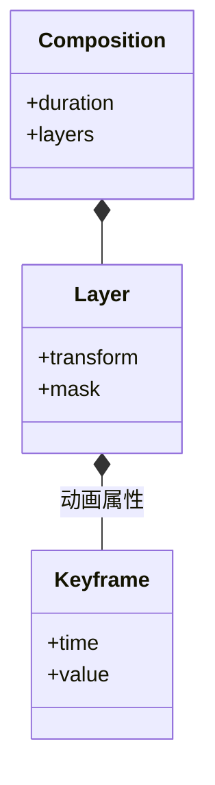

# 特效制作：关键帧与二维合成

制作一个从左侧滑入的标题，需要的不只是两个位置值。标题何时出现、是否被遮罩裁切、压在谁的上面，以及导出是否保留透明背景，都会改变结果。

特效工程把这些信息保存在图层描述中。关键帧规定若干时刻的属性，插值计算中间状态；当前时刻求值后，再结合素材、遮罩、透明度与图层顺序形成画面。

## 关键帧、遮罩与图层顺序共同决定画面

标题已经有位置关键帧，为什么仍可能在预览里看不见？

```fpl-canvas
motion-compositor
```

图例：左上决定时间变化，左下决定内容与可见区域，两者在当前时刻汇合。右侧还要应用图层顺序和透明度，只有位置关键帧并不能完整描述成片。

左上只决定属性怎样随时间改变，左下还控制内容与可见区域。即使位置正确，遮罩、透明度或图层覆盖仍可能让标题不可见。中央求值把这些输入汇合，右侧才得到可合成的图层状态。

## 合成文档的概念类图

关键帧应该属于整份工程，还是属于某个图层的某个属性？



图例：实心菱形表示组合包含。Layer 的 transform 与 mask 是关键概念，不代表所有属性都必须存在；关键帧的值类型随动画属性变化。

它们属于图层的动画属性。两个图层可以在同一时刻拥有各自的位置关键帧，但同一图层的同一属性不能在同一帧出现冲突定义。稳定的关键帧 ID 让编辑和删除操作能够明确命中目标。

## 用局部帧检查动画区间

当前文档以帧描述图层区间和关键帧。图层结束帧必须晚于开始帧，关键帧位置位于图层持续区间内；例如持续 30 帧的图层，其局部关键帧不能写到第 30 帧及之后。不要把时间线秒数直接当作局部帧号。

插值可以表达线性、缓入缓出或保持等不同运动。位置关键帧决定移动方式，透明度关键帧决定出现过程，路径遮罩决定露出区域；这些属性应各自编辑，不能靠复制某一帧截图表达整段动画。

## 工程保存与透明成片承担不同用途

应用拥有工程文档、快照和项目生命周期，公共媒体能力负责确定性帧求值。导出按帧率采样完整区间，向视频剪辑交接则经过公开业务入口，不直接写目标应用的内部记录。

结果出现黑底时先核对输出格式是否保留 Alpha，而不是立即修改所有图层填充。某一帧缺失时先检查图层起止与遮罩。修复后检查开头、关键帧附近和结尾；只看编辑器当前一帧不能覆盖整个区间。

> [!NOTE]
> 透明度、遮罩与透明背景是三件事：前两者影响图层贡献，输出格式决定成片能否保留透明通道。需要继续修改时，同时保留原生工程。

## 图层文档怎样流向帧与剪辑交接

工程拥有图层身份、素材引用、局部帧区间、关键帧、遮罩和混合属性；当前选中图层及预览帧是编辑状态。projects 保存应用工程，snapshots 保留对应结构，exports 组装输出，公共 motion_document 与 motion_frames 解释确定性帧。图层修改不直接写公共渲染器的内部对象。

一次滑入标题先修改属性关键帧并保存，再按输出时刻采样图层、应用遮罩与 Alpha 合成。导出成片与交接视频剪辑都需要明确输出和目标入口；成片中的一个像素不能替代原工程的可编辑属性。

## 关键帧边界与透明交付如何验证

检查起始、关键形附近和末尾，验证局部帧范围、重复属性定义、素材缺失与保存冲突。透明度正确还需输出格式保留 Alpha；对黑底先定位编码和通道，避免把所有图层改成透明来掩盖问题。交接失败保留来源工程，不直接修目标数据库。

## 相关阅读

- [时间线与媒体渲染](/apps/thought-workshop/official-knowledge-bases/technical/documents/rendering)
- [视频剪辑：多轨、速度与接缝](/apps/thought-workshop/official-knowledge-bases/technical/documents/video-editor)
- [特效制作工坊：导入导出与交付](/apps/thought-workshop/official-knowledge-bases/motion-compositor/documents/delivery)
- [公共能力复用与应用交接](/apps/thought-workshop/official-knowledge-bases/technical/documents/app-handoffs)

## 代码入口

1. `backend/app/capabilities/media_rendering/motion_document.py`
2. `backend/app/capabilities/media_rendering/motion_frames.py`
3. `backend/studio/apps/motion_compositor/snapshots.py`
