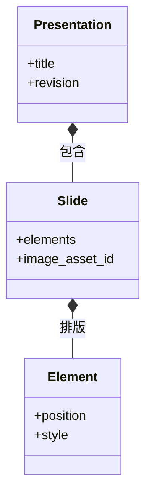

# 演示工坊：文稿树、布局与 PPTX

在演示工坊把封面标题向右移动后，重新打开项目还能继续修改文字；导出 PPTX 后也希望标题保留为文本框。实现这一点的前提是保存语义文稿，而不是只保存页面截图。

本篇沿着这次标题移动，解释页面、元素与归档图像如何组成文稿，编辑操作怎样成为版本化数据，以及为什么导出后仍要检查字体和布局。

## 文稿树的三种消费方式

编辑、放映和 PPTX 导出都使用一份文稿，它们分别消费什么？

```fpl-canvas
presentation-workshop
```

图例：原生文稿同时服务编辑、放映和导出。下方无箭头连线表示放映与 PPTX 共享文稿来源，PPTX 不是对放映画面截图；项目保存位于另一条生命周期路径，包含页面图像版本的素材关联。

编辑器框内的选择和缩放只保留在当前会话。`useSlideViewport` 计算容器适应比例，接收触控板捏合或 Ctrl／⌘＋滚轮，将鼠标下的幻灯片坐标作为锚点，再补偿画布内部滚动位置；底部控件以可视中心为锚点。放大后滚动查看四角，点击“适应页面”恢复完整居中显示。拖动、旋转、框选或裁剪时暂停手势缩放，避免一次操作混用两种坐标比例。缩放不提交项目用例、不增加 revision 或撤销记录，也不改变放映与 PPTX。

自动对齐同样分为预览和提交：`layoutObjects` 按当前组内层级解析同级逻辑对象，完整分组作为整体；`layoutSnapping` 在屏幕 6px 内吸附，已吸附目标在 10px 外释放。例如拖动标题靠近相邻卡片左边缘时显示对齐线，处于同一行的对象可显示等距提示，缩放时可匹配边缘或宽高。旋转缩放保留对侧锚点，图片与矢量图优先保持比例；互相冲突的约束不会强行同时应用。Alt 清除吸附，Escape 取消本次变换，数值输入与方向键微调不吸附。

面板与悬浮菜单共用排列命令和禁用原因，统一尺寸以首个选中的逻辑对象为准。辅助线、吸附目标与尺寸基准只在内存中存在；松手或执行命令后，实际几何变化才经 `updateScene` 更新连接并进入一次草稿历史与原 CAS 保存队列。统一尺寸保留对象中心、旋转与文字字号，不创建持续约束，也不自动修复文字溢出。图中编辑器的临时状态不进入放映或 PPTX，提交后的元素几何则由三种视图共用。

编辑器改变元素的位置与内容，项目用例校验并保存；放映根据文稿呈现页面；PPTX 导出把同一结构转换为目标格式。下方连线表示同源关系，导出器不需要先给每页截图才能得到标题。

例如先在第二页移动标题，再切回第一页修改备注：`usePresentationDraft` 按顺序记录修改前后文稿及页面、元素定位；`usePresentationHistory` 在画布、富文本和普通输入框中统一分发 Ctrl／Cmd+Z，撤销标题移动时切回第二页。连续输入按字段与 800 毫秒窗口合并，失焦或切换对象结束合并；一次手势和一次输入法组合输入保持完整。历史最多 100 步，只存当前会话，保存不清空，重新打开或载入服务器版本后清空。恢复结果作为新草稿经原串行队列与 CAS 保存，不回退服务器 revision；冲突仍保留本地结果并阻止覆盖。未提交的拖拽预览先取消，源码弹窗草稿不穿透文稿，缩放与面板尺寸不进入历史。

## 文稿包含页面与元素

列表同样保存在文字段落中：`bullet` 表示圆点，`numbered` 表示十进制编号，二者不能同时为 true。旧段落缺少 `numbered` 时按 false 读取；迁移 0099 补齐该缺省值而不改变项目 revision。编辑器只把标记传入原生段落，不保存 Tiptap 列表树或显示数字。例如两项连续编号显示 1、2，中间插入普通段落后，下一组重新从 1 开始；Shift+Enter 的软换行仍属于同一项。图中的文稿来源由编辑、放映与导出共用，PPTX 将这些标记转换为原生圆点或 `buAutoNum` 编号，当前没有嵌套层级和自定义起始数字。

文稿为什么要保留页面 ID 和元素 ID，而不是按显示顺序临时编号？



图例：实心菱形表示包含关系：文稿包含页面，页面包含元素。图只展示关键属性，revision 属于保存快照元数据；具体元素类型与约束由 document schema 定义。

元素身份让选择、更新与引用有稳定目标，页面顺序则决定放映先后。移动标题只应改变其几何属性，不能同时意外生成另一个标题或改写其他元素的身份。类图展示包含关系，保存快照的 revision 属于持久化元数据。

## 文稿 schema 把允许的编辑范围写清楚

当前原生文稿使用 1280×720 页面，最多 100 页，每页元素数量受到边界约束。文本元素包含段落与 runs，图片和矢量元素必须引用素材；非文本元素不能携带文本段落。这些限制让编辑器、保存与导出能够使用同一种明确结构。

位置、尺寸、旋转、颜色和裁剪都有各自约束。例如图片裁剪必须保留可见区域，不能通过互相抵消的裁切值得到空图。前端交互完成后，后端仍会验证文稿，不能仅依赖拖动手柄限制输入。

## 导出后的可编辑性需要按目标工具检查

文稿版本 2 另外保存分组、连接、参考图和信息图来源。AntV 在编辑器内解析受支持语法，将内容转换为工坊原生场景；关系图由 ELK 显式布局。转换后仍由同一草稿、撤销和保存队列维护，修改源码先预览，再原子替换对应信息图。

连接调节面板位于画布滚动层之外，面板位置与折叠状态只保存在当前编辑会话。已有连接每次调整都进入统一草稿与历史，文字和粗细连续编辑沿用历史合并；面板读取当前连接，因此撤销、重做和切换连接会直接刷新控件。新建预览仅传给画面渲染，不进入拖动快照、保存或导出；确认“创建连接”后才提交文稿。端点、端口或线型变化会清空旧 waypoints，其他外观修改保留路径；选中高亮也不改变连接的实际粗细。

分组保存成员身份与父级，连接保存两端元素及端口。连接的 `layer` 表示下方元素数量，同层连接按 connections 数组顺序叠放；缺省为 0，登记迁移 `0098_presentation_connection_layers` 为缺失字段补 0，保留原元素顺序、revision 与更新时间。`scene/stacking.ts` 将元素和连接解析为从底到顶的统一顺序，四种层级操作再写回元素顺序、连接层级与连接顺序，经原历史及 CAS 队列保存。画布、缩略图和放映共用这一顺序；层级变化不清空 waypoints。

PPTX 将连线和关系文字作为连续的一组绘制项插入相同顺序。PowerPoint 分组不能与组外对象交错叠放，因此仅在成员连续时保留原生组；遇到交错则展开受影响的导出组，仍保留可编辑成员与画面顺序，不改写原文稿的分组。页面复制会重映射全部相关 ID，片段复制与粘贴会换算局部连接层级，删除节点会清理关联边并换算保留连接的层级。参考图属于素材引用但只用于编辑器对照，不进入放映与导出。图中的“原生文稿树”包含这些关系，导出器不重新执行 AntV 或 ELK。

PPTX 导出把普通连接写成预设连接线，把带显式拐点的折线写成普通自由曲线形状。后者保留路径、样式与分组，但不带端点绑定，移动节点后需单独调整。自由路径不能嵌在连接线对象内：该组合即使通过通用 XML 结构校验，也可能触发 PowerPoint 修复并丢弃整页。应用内的文稿与连接关系保持原样。

例如一组流程节点内还有“背景＋标题”子组，第一次点击标题选中整个流程，再次点击选中子组，第三次选中标题。`scene/selection.ts` 根据命中元素、当前选区与分组层级计算选择；场景工具拥有当前组内层级，画布只在松手且移动不超过屏幕 4px 时请求进入下一层。拖动、缩放和旋转继续操作按下时的选区，文字已单独选中后才允许双击编辑。Escape 返回父级并选中刚退出的组，空白点击退出全部分组；切页、删除或解组使失效层级清空。

图中编辑器包含组内选择状态，这些状态仅存在于内存，不提交项目用例，也不进入文稿历史或 PPTX。只有实际位置、样式或文字修改沿原保存链路提交。锁定和只读校验仍独立执行，进入分组不会获得额外编辑权限。

例如先生成了一张流程图，再用原生节点重建这一页，可以把原图保存在本页的 `image_asset_id`。每页最多关联一张图，和编辑对照用的 `reference` 独立。项目用例校验图片属于当前 Workspace 公共文件库，随文稿 CAS 保存并同步引用保护；替换、清空或删除页面只解除相应关联，不删除源文件。登记迁移 `0097_presentation_image_version` 仅为缺失字段补 null，保留已有图像 ID、页面顺序、revision 和更新时间。

编辑器页面面板可以预览和下载归档图。放映、缩略图与 PPTX 只消费原生页面元素，导出在复制与转换素材前排除仅归档的图像，因此不会因归档大图额外占用导出预算。归档不产生自动截图，也不保存多份历史图像。

原生保存保留本应用的编辑结构；PPTX 负责格式转换，字体与复杂表现可能受接收工具影响。交付封面时，检查标题是否仍可选中文字、换行是否改变、图片裁剪是否对应。

若某张图缺失，先查看素材引用；若文字溢出，比较文本框尺寸和字体替代；若保存冲突，处理当前版本而不是反复导出旧快照。预览看起来正确只验证了一个显示环境。

> [!TIP]
> 验证一页文稿时同时检查三个对象：原生项目中的元素、放映中的页面、接收工具中的 PPTX 页面。它们分别暴露保存、呈现和转换问题。

## 风格预览为何不立即保存

打开“应用蓝青风格”时，前端读取当前页并在弹窗内维护颜色替换表。纯函数只产出预览页面，保留元素身份、字号、几何与场景关系，跳过锁定元素及其关联连接和媒体。未知颜色默认保持原色，用户可逐项调整；这不是按颜色猜测文字角色或自动重排布局。

点击应用后，整页样式变化作为一次操作进入已有草稿历史，随后由相同的保存队列与 revision/CAS 契约提交。取消不进入历史。AntV 的图形区域按实际浏览器几何转换，标题单独构造为固定页面位置的原生文本框，避免渲染后的字号覆盖改变原布局测量。模板和信息图在生成对象时写入统一色板，渲染器不根据界面主题覆盖文稿样式，因此旧数据、放映和 PPTX 均继续消费实际保存的颜色。重新应用信息图源码仍会替换该信息图的手动调整，包括后续换肤。

图中编辑器的工具栏组织与换肤预览属于界面；应用后的颜色属于原生文稿树。两者共用原生数据，但界面状态不持久化到文稿。无需新增字段或迁移，也不对已有文稿执行自动回填。

## 一次标题移动怎样成为可交付文稿

前端编辑器产出元素几何变化，应用项目与 operations 用例验证页面、元素和素材，再按版本前提保存文稿。选择框、当前页和放映进度属于界面，页面顺序、文本 runs 与元素几何属于工程。API 返回成功版本后重新读取应得到相同标题位置；服务器快照不是编辑器的共享可变对象。

PPTX 导出器消费语义结构与可读取素材，原生工程仍由项目管理保存。格式转换不自动保证目标工具字体和布局完全相同。预览失效、素材缺失、保存冲突和 PPTX 转换失败分别反馈，不能用再次导出覆盖原生保存问题。

## 文稿组件的职责与验证入口

projects 拥有项目归属和文稿保存，operations 拥有细粒度编辑，exports 拥有目标格式交付。测试移动前后元素 ID 不变、非法裁剪拒绝、只读请求失败及原生数据重新打开，再在接收工具核对文本可编辑性与图像布局。实际实现从项目、document schema 和导出用例追踪，完整交付方法见演示工坊使用指南。

## 相关阅读

- [素材上传、引用与预览](/apps/thought-workshop/official-knowledge-bases/technical/documents/assets)
- [编辑、保存、历史与并发](/apps/thought-workshop/official-knowledge-bases/technical/documents/revision)
- [演示工坊：导入导出与交付](/apps/thought-workshop/official-knowledge-bases/presentation-workshop/documents/delivery)
- [导入、备份与导出](/apps/thought-workshop/official-knowledge-bases/technical/documents/data-exchange)

## 代码入口

1. `backend/app/apps/presentation_workshop/projects.py`
2. `backend/app/apps/presentation_workshop/schemas/document.py`
3. `web/src/features/presentation-workshop`
