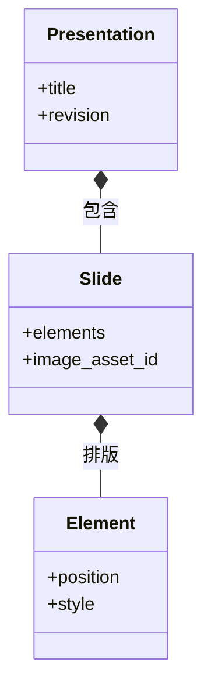

# 演示工坊：文稿树、布局与 PPTX

在演示工坊把封面标题向右移动后，重新打开项目还能继续修改文字；导出 PPTX 后也希望标题保留为文本框。实现这一点的前提是保存语义文稿，而不是只保存页面截图。

本篇沿着这次标题移动，解释页面、元素与归档图像如何组成文稿，编辑操作怎样成为版本化数据，以及为什么导出后仍要检查字体和布局。

## 文稿树的三种消费方式

编辑、放映和 PPTX 导出都使用一份文稿，它们分别消费什么？

```fpl-canvas
presentation-workshop
```

图例：原生文稿同时服务编辑、放映和导出。下方无箭头连线表示放映与 PPTX 共享文稿来源，PPTX 不是对放映画面截图；项目保存位于另一条生命周期路径，包含页面图像版本的素材关联。

编辑器框内的选择和缩放只保留在当前会话。`useSlideViewport` 计算容器适应比例，接收触控板捏合或 Ctrl／⌘＋滚轮，将鼠标下的幻灯片坐标作为锚点，再补偿画布内部滚动位置；底部控件以可视中心为锚点。放大后滚动查看四角，点击“适应页面”恢复完整居中显示。拖动、旋转、框选或裁剪时暂停手势缩放，避免一次操作混用两种坐标比例。缩放不提交项目用例、不增加 revision 或撤销记录，也不改变放映与 PPTX。

框选使用同一画布坐标：从页面或页外留白启动时，指针捕获到画布，按当前比例和滚动位置换算选框。工具栏“框选”临时覆盖对象命中区，允许从背景元素上启动；完成或取消后退出。`scene/selection.marqueeSelection` 按当前分组层级检查完整逻辑对象的旋转外界，隐藏目标不单独命中，分组内隐藏成员沿用整组选择；锁定目标及含锁定成员的分组不新加入；修饰键基于手势前的选择追加。选择仅在会话更新，Escape、指针取消或窗口失焦恢复手势前选择，不向草稿提交几何。图中的编辑器会话包含这一临时选框，文稿、放映及 PPTX 不包含选框。

自动对齐同样分为预览和提交：`layoutObjects` 按当前组内层级解析同级逻辑对象，完整分组作为整体；`layoutSnapping` 在屏幕 6px 内吸附，已吸附目标在 10px 外释放。例如拖动标题靠近相邻卡片左边缘时显示对齐线，处于同一行的对象可显示等距提示，缩放时可匹配边缘或宽高。旋转缩放保留对侧锚点，图片与矢量图优先保持比例；互相冲突的约束不会强行同时应用。Alt 清除吸附，Escape 取消本次变换，数值输入与方向键微调不吸附。

面板与悬浮菜单共用排列命令和禁用原因，统一尺寸以首个选中的逻辑对象为准。辅助线、吸附目标与尺寸基准只在内存中存在；松手或执行命令后，实际几何变化才经 `updateScene` 更新连接并进入一次草稿历史与原 CAS 保存队列。统一尺寸保留对象中心、旋转与文字字号，不创建持续约束，也不自动修复文字溢出。图中编辑器的临时状态不进入放映或 PPTX，提交后的元素几何则由三种视图共用。

编辑器改变元素的位置与内容，项目用例校验并保存；放映根据文稿呈现页面；PPTX 导出把同一结构转换为目标格式。下方连线表示同源关系，导出器不需要先给每页截图才能得到标题。

例如先在第二页移动标题，再切回第一页修改备注：`usePresentationDraft` 按顺序记录修改前后文稿及页面、元素定位；`usePresentationHistory` 在画布、富文本和普通输入框中统一分发 Ctrl／Cmd+Z，撤销标题移动时切回第二页。连续输入按字段与 800 毫秒窗口合并，失焦或切换对象结束合并；一次手势和一次输入法组合输入保持完整。历史最多 100 步，只存当前会话，保存不清空，重新打开或载入服务器版本后清空。恢复结果作为新草稿经原串行队列与 CAS 保存，不回退服务器 revision；冲突仍保留本地结果并阻止覆盖。未提交的拖拽预览先取消，源码弹窗草稿不穿透文稿，缩放与面板尺寸不进入历史。

## 模板规范与文稿快照

模板库与完整示例属于演示工坊当前账号。模板定义字体颜色、五种页型布局、标题与页码槽位、背景及固定元素；文稿保存所用模板快照和独立覆盖，不查询最新模板来决定历史外观。模板资源删除后，文稿仍可打开和导出。示例保存完整文稿，复用只创建独立项目。

v4 页面显式保存页型、页标题、稳定章节身份与隐藏元素；章节改名不会改身份。目录根据章节首次出场页生成，页码从物理顺序计算，封面隐藏仍计数。目录容量固定，溢出必须补续页。后端与 Web 纯解析器使用共享测试样例，先展开独立模板层，再由画布、缩略图、放映、图片与 PPTX 消费；正文编辑仍基于源页面，不把模板解析结果回写成重复正文。

绑定预览校验文稿与目标模板 revision，展示差异、实际受影响页和标题区域冲突，应用时再次校验同一请求摘要并在一个写事务中固定模板版本和文稿 CAS。正文、素材、备注与文稿覆盖保留。首次绑定只转换显式勾选的旧标题，解除绑定则将当前外观实体化为普通对象。迁移 `r0111_presentation_templates` 仅追加资源与素材引用表，不自动转换旧稿；旧客户端覆盖 v4 数据会被拒绝。

图中文稿节点包含正文和模板快照；编辑、放映与导出均消费解析后的模板层，项目保存仍保留源定义。模板和示例素材引用与文稿一样接受账号校验和删除保护。

## 文稿包含页面与元素

列表同样保存在文字段落中：`bullet` 表示圆点，`numbered` 表示十进制编号，二者不能同时为 true。旧段落缺少 `numbered` 时按 false 读取；迁移 0099 补齐该缺省值而不改变项目 revision。编辑器只把标记传入原生段落，不保存 Tiptap 列表树或显示数字。例如两项连续编号显示 1、2，中间插入普通段落后，下一组重新从 1 开始；Shift+Enter 的软换行仍属于同一项。图中的文稿来源由编辑、放映与导出共用，PPTX 将这些标记转换为原生圆点或 `buAutoNum` 编号，当前没有嵌套层级和自定义起始数字。

文稿为什么要保留页面 ID 和元素 ID，而不是按显示顺序临时编号？



图例：实心菱形表示包含关系：文稿包含页面，页面包含元素。图只展示关键属性，revision 属于保存快照元数据；具体元素类型与约束由 document schema 定义。

元素身份让选择、更新与引用有稳定目标，页面顺序则决定放映先后。移动标题只应改变其几何属性，不能同时意外生成另一个标题或改写其他元素的身份。类图展示包含关系，保存快照的 revision 属于持久化元数据。

## 文稿 schema 把允许的编辑范围写清楚

原生文稿 v4 默认 1280×720，支持宽度 320–4096、高度 240–4096 的自定义页面，最多 100 页、每页 200 元素。文本和可含文字的形状保存段落与 runs，媒体引用受管素材；表格、图表、路径、公式与音视频保存专属结构。这些限制让编辑器、保存与导出能够使用同一种明确结构。

位置、尺寸、旋转、颜色和裁剪都有各自约束。例如图片裁剪必须保留可见区域，不能通过互相抵消的裁切值得到空图。前端交互完成后，后端仍会验证文稿，不能仅依赖拖动手柄限制输入。

## 导出后的可编辑性需要按目标工具检查

文稿版本 3 保留分组、连接、参考图和信息图来源。AntV 在编辑器内解析受支持语法，将内容转换为工坊原生场景；关系图由 ELK 显式布局。转换后仍由同一草稿、撤销和保存队列维护，修改源码先预览，再原子替换对应信息图。

连接属性复用右侧“元素”面板，选中连接切换到对应属性，选择普通元素、空白或切页会清除连接选择。没有覆盖画布的属性浮层；折叠状态只保存在当前编辑会话。已有连接每次调整都进入统一草稿与历史，文字和粗细连续编辑沿用历史合并；面板读取当前连接，因此撤销、重做和切换连接会直接刷新控件。新建预览仅传给画面渲染，不进入拖动快照、保存或导出；确认“创建连接”后才提交文稿。端点、端口或线型变化会清空旧 waypoints，其他外观修改保留路径；选中高亮也不改变连接的实际粗细。

画布连接编辑把几何与手势分开：`connectionGeometry` 计算旋转后的端点、屏幕阈值内的边缘投影及折线路径；`ConnectionHandles` 只展示选中连接的端点、拐点和线段中点；`useConnectionDrag` 持有起始快照和临时预览。手柄覆盖在元素上方，连线自身继续遵循 layer，因此被标题覆盖的 panel 背板也能作为端点目标。只读、缩略图、放映与导出不渲染手柄。临时状态不会提交或自动保存，松手才进入一次草稿历史；Escape、捕获丢失、切页、权限变化与撤销优先取消预览。

例如连到 panel 左侧 20% 的位置后，panel 高度由 200 变成 300，端点距顶部从 40 变成 60。旋转围绕元素中心计算；拖拽不会切换线型，直线中点拖动只投影调整两个已绑定端点的位置，折线才提供拐点与段编辑。`updateScene` 在节点预览与提交时保持内部路径、调整端部，两端等量平移则整体平移。后端 `connection_routes` 使用相同测试向量；operations 在整批完成后调整路径，显式提交的路径优先，不因同批两个节点依次更新而丢失走线。路径点上限仍为 32，非法调整整体拒绝。

分组保存成员身份与父级。连接的每端保存元素 ID、边与沿边位置比例，或保存独立的 `source_point` / `target_point`；绑定与自由坐标互斥。拖动线身会解除两端绑定并平移全部路径点，Shift 按主轴锁定整体位移；自由端点在 8 屏幕像素内对齐另一端的 X／Y，元素边缘吸附优先，端点单独拖动到空白处成为自由端点，靠近元素边缘可重新绑定。迁移 `0104_presentation_free_connections` 仅为历史连接补齐 null 坐标，保留内容与 revision。`source_offset`、`target_offset` 为 0–1，左右边从上到下，上下边从左到右，缺省 0.5 表示中点。迁移 `0100_presentation_connection_offsets` 仅补齐旧连接缺失的中点值，保留路径、顺序与 revision；关系仍指向元素，不把分组运行状态作为连接目标。连接的 `layer` 表示下方元素数量，同层连接按 connections 数组顺序叠放；缺省为 0，登记迁移 `0098_presentation_connection_layers` 为缺失字段补 0，保留原元素顺序、revision 与更新时间。`scene/stacking.ts` 将元素和连接解析为从底到顶的统一顺序，四种层级操作再写回元素顺序、连接层级与连接顺序，经原历史及 CAS 队列保存。画布、缩略图和放映共用这一顺序；层级变化不清空 waypoints。

PPTX 将连线和关系文字作为连续的一组绘制项插入相同顺序。PowerPoint 分组不能与组外对象交错叠放，因此仅在成员连续时保留原生组；遇到交错则展开受影响的导出组，仍保留可编辑成员与画面顺序，不改写原文稿的分组。页面复制会重映射全部相关 ID，片段复制与粘贴会换算局部连接层级，删除节点会清理关联边并换算保留连接的层级。参考图属于素材引用但只用于编辑器对照，不进入放映与导出。图中的“原生文稿树”包含这些关系，导出器不重新执行 AntV 或 ELK。

PPTX 导出把中点绑定且没有手调路径的普通连接写成预设连接线，把带显式拐点的折线或任一端偏离边缘中点的连接写成普通自由曲线形状。后者保留路径、样式与分组，但不带端点绑定，移动节点后需单独调整。自由路径不能嵌在连接线对象内：该组合即使通过通用 XML 结构校验，也可能触发 PowerPoint 修复并丢弃整页。应用内的文稿与连接关系保持原样。自由直线或无手调折点的自由折线可用预设连接线导出，自由端不写入节点绑定；显式路径保持可编辑自由曲线。

例如一组流程节点内还有“背景＋标题”子组，第一次点击标题选中整个流程，再次点击选中子组，第三次选中标题。`scene/selection.ts` 根据命中元素、当前选区与分组层级计算选择；场景工具拥有当前组内层级，画布只在松手且移动不超过屏幕 4px 时请求进入下一层。拖动、缩放和旋转继续操作按下时的选区，文字已单独选中后才允许双击编辑。Escape 返回父级并选中刚退出的组，空白点击退出全部分组；切页、删除或解组使失效层级清空。

图中编辑器包含组内选择状态，这些状态仅存在于内存，不提交项目用例，也不进入文稿历史或 PPTX。只有实际位置、样式或文字修改沿原保存链路提交。锁定和只读校验仍独立执行，进入分组不会获得额外编辑权限。

例如先生成了一张流程图，再用原生节点重建这一页，可以把原图保存在本页的 `image_asset_id`。每页最多关联一张图，和编辑对照用的 `reference` 独立。项目用例校验图片属于当前账号公共文件库，随文稿 CAS 保存并同步引用保护；替换、清空或删除页面只解除相应关联，不删除源文件。登记迁移 `0097_presentation_image_version` 仅为缺失字段补 null，保留已有图像 ID、页面顺序、revision 和更新时间。

编辑器页面面板可以预览和下载归档图。放映、缩略图与 PPTX 只消费原生页面元素，导出在复制与转换素材前排除仅归档的图像，因此不会因归档大图额外占用导出预算。归档不产生自动截图，也不保存多份历史图像。

原生保存保留本应用的编辑结构；PPTX 负责格式转换，字体与复杂表现可能受接收工具影响。交付封面时，检查标题是否仍可选中文字、换行是否改变、图片裁剪是否对应。

若某张图缺失，先查看素材引用；若文字溢出，比较文本框尺寸和字体替代；若保存冲突，处理当前版本而不是反复导出旧快照。预览看起来正确只验证了一个显示环境。

> [!TIP]
> 验证一页文稿时同时检查三个对象：原生项目中的元素、放映中的页面、接收工具中的 PPTX 页面。它们分别暴露保存、呈现和转换问题。

## 风格预览为何不立即保存

打开“应用蓝青风格”时，前端读取当前页并在弹窗内维护颜色替换表。纯函数只产出预览页面，保留元素身份、字号、几何与场景关系，跳过锁定元素及其关联连接和媒体。未知颜色默认保持原色，用户可逐项调整；这不是按颜色猜测文字角色或自动重排布局。

点击应用后，整页样式变化作为一次操作进入已有草稿历史，随后由相同的保存队列与 revision/CAS 契约提交。取消不进入历史。AntV 的图形区域按实际浏览器几何转换，标题单独构造为固定页面位置的原生文本框，避免渲染后的字号覆盖改变原布局测量。模板和信息图在生成对象时写入统一色板，渲染器不根据界面主题覆盖文稿样式，因此旧数据、放映和 PPTX 均继续消费实际保存的颜色。重新应用信息图源码仍会替换该信息图的手动调整，包括后续换肤。

图中编辑器的工具栏组织与换肤预览属于界面；应用后的颜色属于原生文稿树。两者共用原生数据，但界面状态不持久化到文稿。无需新增字段或迁移，也不对已有文稿执行自动回填。

## 一次标题移动怎样成为可交付文稿

前端编辑器产出元素几何变化，应用项目与 operations 用例验证页面、元素和素材，再按版本前提保存文稿。选择框、当前页和放映进度属于界面，页面顺序、文本 runs 与元素几何属于工程。API 返回成功版本后重新读取应得到相同标题位置；服务器快照不是编辑器的共享可变对象。

PPTX 导出器消费语义结构与可读取素材，原生工程仍由项目管理保存。格式转换不自动保证目标工具字体和布局完全相同。预览失效、素材缺失、保存冲突和 PPTX 转换失败分别反馈，不能用再次导出覆盖原生保存问题。

## v3 如何兼容旧稿与文件转换

迁移 `0101_presentation_editor_v3` 仅确定性提升文稿版本，并为元素补名称与隐藏状态，保留内容、ID、坐标、引用、revision 与更新时间。读取 v1/v2 仍通过确定性适配；已有 v3 能力的文稿拒绝旧格式覆盖，避免看不见的字段被降级保存。

`editor/usePresentationSession` 装配唯一草稿，`commands` 为菜单、键盘和图层操作提供共同可用状态；`objects/` 拥有内容弹窗和原生对象渲染。ECharts 仅在需要图表时加载 SVG 渲染；公式的模板、预览与提交共用 MathJax 和本地 TeX 字形，不请求网络字体。构建时字形轮廓作为本地 JSON 数据资源，代码模块继续受现有预算约束。

以余弦相似度为例：`objects/formula/` 持有模板和弹窗草稿，停止输入 200ms 后将 LaTeX、颜色和字号送入同一矢量渲染器，过期结果不会替换新预览。只有当前输入成功渲染才允许提交；上传的 SVG 就是当前预览使用的内容。素材登记完成后，原对象编辑会话将源码、素材引用和自然尺寸一次提交到文稿历史，再由原 CAS 保存链路持久化。取消、权限丢失或切页卸载后，迟到的上传结果不能回写文稿。新公式适应页面，编辑则从原自然尺寸恢复已有等比缩放，使字号调整可见；位置和旋转继续属于文稿。公式源码和素材仍沿用 v3 契约，不新增数据库结构。

例如导入一份带流程图和视频的 PPTX：`exchange/` 先检查 ZIP 与 XML，再解析常用对象和素材，产生逐页文稿与转换报告；预检不写持久数据。确认后在短事务外准备文件，项目用例校验账号、登记新素材并重映射页面、对象、连接、批注与素材身份。失败回滚并清理本次准备文件。未知对象、母版装饰与样式近似逐项报告，不静默改成整页截图。

`.fplppt` 包含文稿、清单和引用素材，适合跨账号交接。JSON 仅携带结构。PPTX 继续使用 python-pptx 生成可编辑表格、图表、媒体、形状、路径与文本；公式写 SVG 和 PNG 兼容图，动画和批注差异在导出预检中明确列出。浏览器 PNG/JPEG 与打印 PDF 共用页面渲染器并等待字体、素材完成，视频取封面。

## 放映状态为何独立

`playback/` 根据动画声明构造点击组，同时与上一项之后触发共享组内时序。Web Animations 只作用于元素内容层，取消时清理定时器与播放实例。编辑画布、缩略图和静态导出仍消费普通页面，没有动画进度字段。

例如演讲者点击下一步，观众窗口通过同源 BroadcastChannel 接收页面与步骤；窗口先经项目 API 确认当前账号和账号的访问权，再接收带随机会话身份的快照。心跳过期、退出登录、切换账号和主放映卸载均结束同步。桌面 IPC 校验可信发送者与有界项目、会话参数，只能打开固定应用路径。黑板与标注在放映内存中同步，备注、计时和播放进度不进入文稿 CAS。

图中的“放映视图”包括独立观众窗口；它们共享语义来源，各自呈现当前步骤。该边界不承诺将工坊动画转换为 PowerPoint 动画。

## 文稿组件的职责与验证入口

projects 拥有项目归属和文稿保存，operations 拥有细粒度编辑，exports 拥有目标格式交付。测试移动前后元素 ID 不变、非法裁剪拒绝、只读请求失败及原生数据重新打开，再在接收工具核对文本可编辑性与图像布局。实际实现从项目、document schema 和导出用例追踪，完整交付方法见演示工坊使用指南。

## 相关阅读

- [素材上传、引用与预览](/apps/thought-workshop/official-knowledge-bases/technical/documents/assets)
- [编辑、保存、历史与并发](/apps/thought-workshop/official-knowledge-bases/technical/documents/revision)
- [演示工坊：导入导出与交付](/apps/thought-workshop/official-knowledge-bases/presentation-workshop/documents/delivery)
- [导入、备份与导出](/apps/thought-workshop/official-knowledge-bases/technical/documents/data-exchange)

## 代码入口

1. `backend/app/apps/presentation_workshop/projects.py`
2. `backend/app/apps/presentation_workshop/schemas/document.py`
3. `web/src/features/presentation-workshop`
