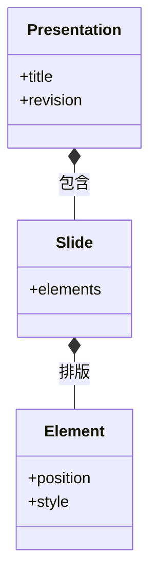

# 演示工坊：文稿树、布局与 PPTX

## 先理解它解决什么问题

演示文稿是页面、元素与素材引用组成的结构，不是一组截图。文字、形状和图片有各自的位置和样式；编辑器修改这些语义数据，放映与导出再将它们转换成目标表现形式。

**贯穿实例：** 把封面标题移到右侧时，保存的是标题元素的位置。导出 PPTX 后应检查文本是否仍可编辑、字体是否替换，以及布局是否与编辑器一致。

## 图一：文稿树的三种消费方式

```fpl-canvas
presentation-workshop
```

图例：原生文稿同时服务编辑、放映和导出。下方无箭头连线表示放映与 PPTX 共享文稿来源，PPTX 不是对放映画面截图；项目保存位于另一条生命周期路径。

## 图二：文稿包含页面与元素



图例：实心菱形表示包含关系：文稿包含页面，页面包含元素。图只展示关键属性，revision 属于保存快照元数据；具体元素类型与约束由 document schema 定义。

## 实现与设计取舍

项目用例拥有文稿默认值和持久化，document schema 约束页面与元素。前端将拖拽、文字编辑等操作写回文稿，导出器消费已保存的结构与素材。修改多个元素时要保留元素身份，以便选择、引用和历史行为保持一致。

## 异常、验证与当前边界

空文本、缺失图片和超出画布位置应分别检查，不能仅凭一张预览图判断完整文稿有效。输出 PPTX 与保留原生项目不同；复杂视觉效果和字体存在格式边界，交付时用实际接收工具验证关键页面。

## 代码入口与阅读顺序

1. `backend/app/apps/presentation_workshop/projects.py`
2. `backend/app/apps/presentation_workshop/schemas/document.py`
3. `web/src/features/presentation-workshop`

阅读时先定位输入和校验，再跟踪持久化或执行入口，最后对照输出与错误分支。可以把上方图复制到个人知识库加入自己的注释；副本不会随官方文章自动更新。
