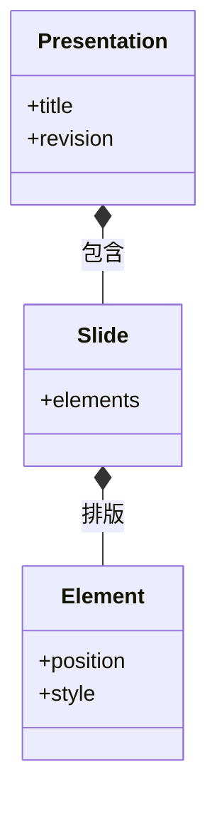

# 演示工坊：文稿树、布局与 PPTX

在演示工坊把封面标题向右移动后，重新打开项目还能继续修改文字；导出 PPTX 后也希望标题保留为文本框。实现这一点的前提是保存语义文稿，而不是只保存页面截图。

本篇沿着这次标题移动，解释页面、元素与素材如何组成文稿，编辑操作怎样成为版本化数据，以及为什么导出后仍要检查字体和布局。

## 文稿树的三种消费方式

编辑、放映和 PPTX 导出都使用一份文稿，它们分别消费什么？

```fpl-canvas
presentation-workshop
```

图例：原生文稿同时服务编辑、放映和导出。下方无箭头连线表示放映与 PPTX 共享文稿来源，PPTX 不是对放映画面截图；项目保存位于另一条生命周期路径。

编辑器改变元素的位置与内容，项目用例校验并保存；放映根据文稿呈现页面；PPTX 导出把同一结构转换为目标格式。下方连线表示同源关系，导出器不需要先给每页截图才能得到标题。

## 文稿包含页面与元素

文稿为什么要保留页面 ID 和元素 ID，而不是按显示顺序临时编号？



图例：实心菱形表示包含关系：文稿包含页面，页面包含元素。图只展示关键属性，revision 属于保存快照元数据；具体元素类型与约束由 document schema 定义。

元素身份让选择、更新与引用有稳定目标，页面顺序则决定放映先后。移动标题只应改变其几何属性，不能同时意外生成另一个标题或改写其他元素的身份。类图展示包含关系，保存快照的 revision 属于持久化元数据。

## 文稿 schema 把允许的编辑范围写清楚

当前原生文稿使用 1280×720 页面，最多 100 页，每页元素数量受到边界约束。文本元素包含段落与 runs，图片和矢量元素必须引用素材；非文本元素不能携带文本段落。这些限制让编辑器、保存与导出能够使用同一种明确结构。

位置、尺寸、旋转、颜色和裁剪都有各自约束。例如图片裁剪必须保留可见区域，不能通过互相抵消的裁切值得到空图。前端交互完成后，后端仍会验证文稿，不能仅依赖拖动手柄限制输入。

## 导出后的可编辑性需要按目标工具检查

原生保存保留本应用的编辑结构；PPTX 负责格式转换，字体与复杂表现可能受接收工具影响。交付封面时，检查标题是否仍可选中文字、换行是否改变、图片裁剪是否对应。

若某张图缺失，先查看素材引用；若文字溢出，比较文本框尺寸和字体替代；若保存冲突，处理当前版本而不是反复导出旧快照。预览看起来正确只验证了一个显示环境。

> [!TIP]
> 验证一页文稿时同时检查三个对象：原生项目中的元素、放映中的页面、接收工具中的 PPTX 页面。它们分别暴露保存、呈现和转换问题。

## 相关阅读

- [素材与导出：引用、快照和包有什么不同](/apps/thought-workshop/official-knowledge-bases/technical/documents/assets)
- [保存、历史与并发：防止静默覆盖](/apps/thought-workshop/official-knowledge-bases/technical/documents/revision)
- [演示工坊：导入导出与交付](/apps/thought-workshop/official-knowledge-bases/presentation-workshop/documents/delivery)

## 代码入口

1. `backend/app/apps/presentation_workshop/projects.py`
2. `backend/app/apps/presentation_workshop/schemas/document.py`
3. `web/src/features/presentation-workshop`
