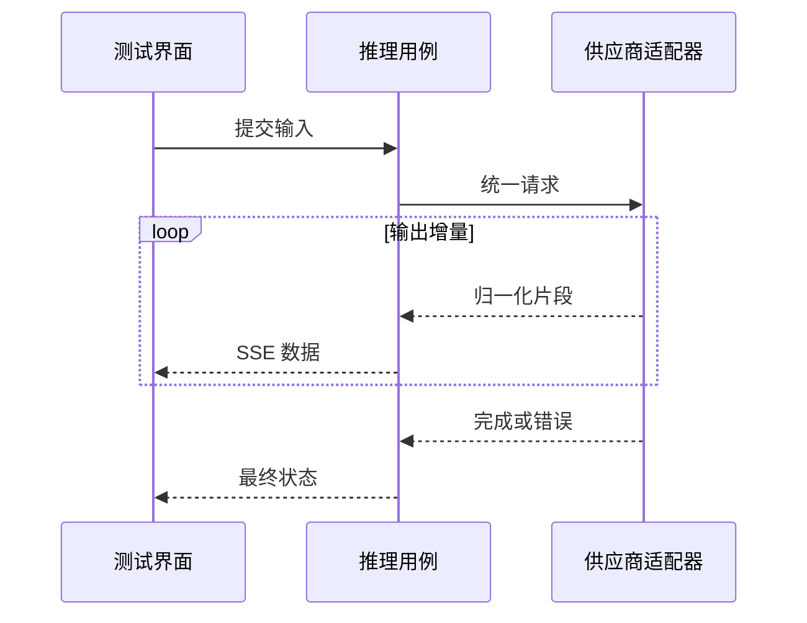

# 供应商适配与流式推理

测试台已经显示半段回答，随后连接断开，这次调用算成功吗？只看到文字并不足以判断。流式响应还会传递终止状态、错误和用量，调用日志也需要正确记录这些结果。

供应商适配器把不同厂商的请求参数和响应事件转成项目的统一语义。以这次中断的回答为例，业务层需要知道“已经产生内容，但没有正常完成”，而不是要求每个页面理解供应商原始字段。

## 请求适配与响应归一化

同一个适配器边界，怎样分别处理向外请求与向内响应？

```fpl-canvas
providers
```

图例：上排是向外发送请求，下排是返回响应的数据方向；下排从左重新开始阅读。云图标表示外部供应商，蓝色卡片表示适配边界，避免把请求和返回误读成同一条处理链。

上排把模型、输入和统一能力映射成供应商请求，下排解析返回流并归一化。它们是两个方向：请求成功发出不证明响应完整，响应包含增量也不证明结束事件有效。蓝色边界让页面与业务功能只消费公共结果。

## 增量流与最终状态

一次回答可能产生多少事件，哪个事件能够结束界面的等待？



图例：loop 框内事件可能发生多次，虚线是增量或结束返回。完成与错误都属于需要处理的终止反馈；收到一段文字不能推断整个流已经成功。

循环中的增量可以到达多次，终止反馈只能根据适配后的完成或错误语义处理。连接在循环中断开时，应传播失败或中断信息，保留已有文字用于诊断；不能凭最后一次增量自行补一个成功结束。

## 配置可以体现厂商差异，运行流程保持统一

供应商管理需要填写厂商特定的地址、鉴权和参数，这是配置入口的职责。公共推理接口、测试页面和日志消费端则不应依赖某厂商的私有事件名称。替换适配器时，其他工坊仍依赖相同的调用语义。

模型条目还描述能力约束。文字、图片、视频或实时语音不是可以随意互换的请求；输入组装应先确认目标模型具备所需能力，再调用适配器。

## 断流后的判断顺序

先区分无效输入、认证失败、额度限制、主动取消和传输中断，再查看是否已有供应商任务身份或部分结果。外部服务可能已经执行，即使本地没有收到完整响应，也不能默认重新提交。

确定性测试应覆盖只有增量没有正常结尾、明确错误事件和连接异常等分支。真实供应商请求受网络、凭证与费用影响，不能替代这些稳定的错误语义测试。当前实时语音用于模型测试，不构成电话接入或 Bot 平台。

> [!WARNING]
> 不要把自动重连等同于安全重试。模型请求中断时，先检查原调用或任务状态，再决定是否由用户显式创建新请求。

## 请求、增量与调用日志由不同组件处理

业务层组装模型输入与能力，providers 把统一请求映射成供应商协议；适配后的片段进入公共流式消费，结束语义交给推理用例结算日志。文字模型调用、测试会话与独立推理有各自的数据所有者，不能把供应商原始事件直接保存成全部页面依赖的共享契约。

部分文字已显示而连接中断时，草稿输出仍可供诊断，但不能将这次调用结算为正常完成。调用日志应保留实际错误与可获得的用量信息，不能根据界面的最后一句话猜测供应商结果。

## 替换供应商后的验证范围

用确定性事件测试重复增量、正常结束、空输出、错误结束和流中断，检查公共消费者与日志一致。模型能力不足在输入阶段明确拒绝；需要真实凭证的网络测试另行说明未执行范围。界面显示出内容只能证明部分响应已经到达，不能证明后续结算和结果保存成功。

## 相关阅读

- [后台任务与恢复](/apps/thought-workshop/official-knowledge-bases/technical/documents/tasks)
- [模型测试与后台任务](/apps/thought-workshop/official-knowledge-bases/general/documents/testing)
- [调用日志与排查](/apps/thought-workshop/official-knowledge-bases/general/documents/logs)
- [OpenAPI、Web 与 SDK 契约](/apps/thought-workshop/official-knowledge-bases/technical/documents/contracts)

## 代码入口

1. `backend/app/llm/providers/streaming.py`
2. `backend/app/llm/providers`
3. `backend/app/llm/inference`
