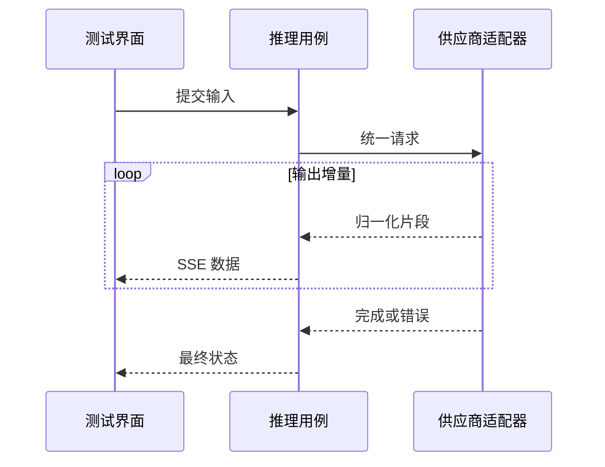

# 供应商适配与流式推理

测试台已经显示半段回答，随后连接断开，这次调用算成功吗？只看到文字并不足以判断。流式响应还会传递终止状态、错误和用量，调用日志也需要正确记录这些结果。

供应商适配器把不同厂商的请求参数和响应事件转成项目的统一语义。以这次中断的回答为例，业务层需要知道“已经产生内容，但没有正常完成”，而不是要求每个页面理解供应商原始字段。

## 请求适配与响应归一化

同一个适配器边界，怎样分别处理向外请求与向内响应？

```fpl-canvas
providers
```

图例：上排是向外发送请求，下排是返回响应的数据方向；下排从左重新开始阅读。云图标表示外部供应商，蓝色卡片表示适配边界，避免把请求和返回误读成同一条处理链。

上排把模型、输入和统一能力映射成供应商请求，下排解析返回流并归一化。它们是两个方向：请求成功发出不证明响应完整，响应包含增量也不证明结束事件有效。蓝色边界让页面与业务功能只消费公共结果。

## DeepSeek：同一协议下的明确默认行为

DeepSeek 官方连接使用独立的 `deepseek` 类型，默认根地址为 `https://api.deepseek.com`。
适配器复用 OpenAI Chat Completions 的 Bearer 鉴权、消息、工具和流式用量格式；诊断、普通推理、
Agent 工具后续轮次和日志复现都显式发送 `thinking: {type: "disabled"}`。
这避免上游默认开启思考后要求工具调用回传额外上下文，而公共模型请求仍只表达现有对话能力。

例如 Flash 的图像输入由业务层先校验 `vision` 能力，再由适配器编码成图片消息。
V4 Pro 预设仅声明对话与工具能力，不能因供应商共享同一协议就接受图片。
模型目录、测试、独立推理和工坊共用这一供应商边界，页面不解析 DeepSeek 私有事件。

工具流在收到用量时提供本轮最新快照，正常结束后才交付工具调用结果。遇到错误或提前 EOF，
测试消息与日志结算为失败，保留已收到的正文与用量；取消也有独立结算，不自动再次调用供应商。
按轮次覆盖用量快照再求和，避免重复到达的用量事件造成重复计数。

## 增量流与最终状态

一次回答可能产生多少事件，哪个事件能够结束界面的等待？



图例：loop 框内事件可能发生多次，虚线是增量或结束返回。完成与错误都属于需要处理的终止反馈；收到一段文字不能推断整个流已经成功。

循环中的增量可以到达多次，终止反馈只能根据适配后的完成或错误语义处理。连接在循环中断开时，应传播失败或中断信息，保留已有文字用于诊断；不能凭最后一次增量自行补一个成功结束。

## 配置可以体现厂商差异，运行流程保持统一

供应商管理需要填写厂商特定的地址、鉴权和参数，这是配置入口的职责。公共推理接口、测试页面和日志消费端则不应依赖某厂商的私有事件名称。替换适配器时，其他工坊仍依赖相同的调用语义。

模型条目还描述能力约束。文字、图片、视频或实时语音不是可以随意互换的请求；输入组装应先确认目标模型具备所需能力，再调用适配器。

## 以 Seedance 两个版本说明视频边界

同样是视频生成，Seedance 2.0 的上限是 15 秒、9 图／3 音频／3 视频；2.5 是 30 秒、30 图／10 音频／10 视频，并允许纯音频参考。三个入口共用模型能力描述和参数校验，不能只扩大界面选项而让测试台、独立推理与画布草稿仍使用旧上限。

请求向外经过方舟视频适配器时，统一的素材角色转成官方 `content` 对象；图片、音频编码后直接发送，视频先经已配置的临时上传服务取得公网地址。归属、文件规格、累计时长与编码后的请求大小先在本地检查。响应方向把官方任务状态归一化，再由共享任务驱动器查询、保存结果与恢复；方舟不返回真实百分比时不编造采样进度。

这仍遵守上图的两个方向：参数转换归供应商边界，输入文件与任务记录归各入口，前端只使用统一能力和任务状态。已拿到任务 ID 的恢复继续查询，提交中断安全失败，不自动创建可能重复计费的任务。

## 断流后的判断顺序

先区分无效输入、认证失败、额度限制、主动取消和传输中断，再查看是否已有供应商任务身份或部分结果。外部服务可能已经执行，即使本地没有收到完整响应，也不能默认重新提交。

确定性测试应覆盖只有增量没有正常结尾、明确错误事件和连接异常等分支。真实供应商请求受网络、凭证与费用影响，不能替代这些稳定的错误语义测试。当前实时语音用于模型测试，不构成电话接入或 Bot 平台。

> [!WARNING]
> 不要把自动重连等同于安全重试。模型请求中断时，先检查原调用或任务状态，再决定是否由用户显式创建新请求。

## 请求、增量与调用日志由不同组件处理

业务层组装模型输入与能力，providers 把统一请求映射成供应商协议；适配后的片段进入公共流式消费，结束语义交给推理用例结算日志。文字模型调用、测试会话与独立推理有各自的数据所有者，不能把供应商原始事件直接保存成全部页面依赖的共享契约。

部分文字已显示而连接中断时，草稿输出仍可供诊断，但不能将这次调用结算为正常完成。调用日志应保留实际错误与可获得的用量信息，不能根据界面的最后一句话猜测供应商结果。

## 替换供应商后的验证范围

用确定性事件测试重复增量、正常结束、空输出、错误结束和流中断，检查公共消费者与日志一致。模型能力不足在输入阶段明确拒绝；需要真实凭证的网络测试另行说明未执行范围。界面显示出内容只能证明部分响应已经到达，不能证明后续结算和结果保存成功。

## 相关阅读

- [后台任务与恢复](/apps/thought-workshop/official-knowledge-bases/technical/documents/tasks)
- [模型测试与后台任务](/apps/thought-workshop/official-knowledge-bases/general/documents/testing)
- [调用日志与排查](/apps/thought-workshop/official-knowledge-bases/general/documents/logs)
- [OpenAPI、Web 与 SDK 契约](/apps/thought-workshop/official-knowledge-bases/technical/documents/contracts)

## 代码入口

1. `backend/app/llm/providers/streaming.py`
2. `backend/app/llm/providers`
3. `backend/app/llm/inference`

## 按需安装本地语音模型

1. 在「模型服务」切换到「本地模型」，左侧选择 Qwen3-TTS 0.6B 或 1.7B Base。
   右侧显示安装、本机服务与当前账号接入三个步骤，并展示下载量、安装空间要求及许可。
   首次打开不会开始下载；不兼容的设备会显示 Apple Silicon Mac 和 macOS 15 的要求。
2. 平台管理员选择「下载安装」，等待右侧步骤显示「已安装」和「服务已启用」。安装完成会自动启用服务，
   首次安装还需要下载独立运行环境。安装期间可查看进度或「取消安装」。取消或失败后可以主动重试，
   应用重新启动不会自行继续下载。普通应用安装也不会预装这些环境和模型。
3. 在要使用的账号点击「添加到当前账号」。右侧步骤变为「已添加到当前账号」，
   并出现「去测试」；模型目录会出现「本地 Qwen 语音」连接，不需要地址或 API Key，原有默认模型不变。
   其他账号需要分别主动添加。已有接入不会重复添加；接入被停用时，通过「前往接入管理」启用连接和模型。
4. 点击「去测试」进入「模型测试 → 语音合成」。在右侧参数面板的「配音文稿」填写要朗读的文字，
   在字数下方选择合成语言；「参考音色」上传或从文件库选择一段 3–30 秒、20 MiB 以内的清晰单人录音。
   文件行显示名称和已上传状态后，填写「录音对应文字」；较长内容可用「展开编辑」加大编辑区。
5. 点击「生成语音」，中间「合成结果」显示本次任务状态，左侧「生成记录」保留任务列表。
   完成后点击播放按钮试听、拖动播放位置，或选择「下载 WAV」「保存到文件库」。保存成功后按钮显示
   「已保存到文件库」。点击左侧记录可切换试听，当前只播放一条记录；窄屏使用「测试结果」「参数与资源」
   「历史记录」切换面板，文稿与录音对应文字保留。提交成功和选择历史记录后自动显示结果面板。
6. 提交成功后文稿和录音对应文字保留，参考录音已归属该任务；再次生成前需重新选择录音。
   提交失败时输入保留；若提示任务已提交但记录刷新失败，先「刷新生成记录」核对，不要重复提交。
   切换账号或账号会清空当前草稿。首版不自动识别录音文字，也不提供音色训练。

权重在本机共享，录音、生成音频和调用记录按账号隔离。停止或卸载共享模型由平台管理员
操作，进行中的生成必须先完成；「停止服务」后通过「启用服务」恢复，无需重新下载。
网站迁移后若运行环境仍引用旧目录，平台管理员可在已安装模型详情点击「修复运行环境」。
修复会核验并保留已下载权重，重建当前目录下的 Python 环境；期间暂停本地推理，完成后恢复原来的服务开关。
失败或取消会恢复旧环境，确认错误原因后可主动重试。
「更多操作 → 卸载模型」需确认，影响所有空间的该模型调用，但保留历史音频；失败或取消的下载也可从更多操作清理。
内存空闲不代表服务停止。空闲五分钟释放模型内存，
再次调用会重新加载，首次响应可能较慢。这里的本地语音合成是独立的文本配音能力，不是实时语音会话。
