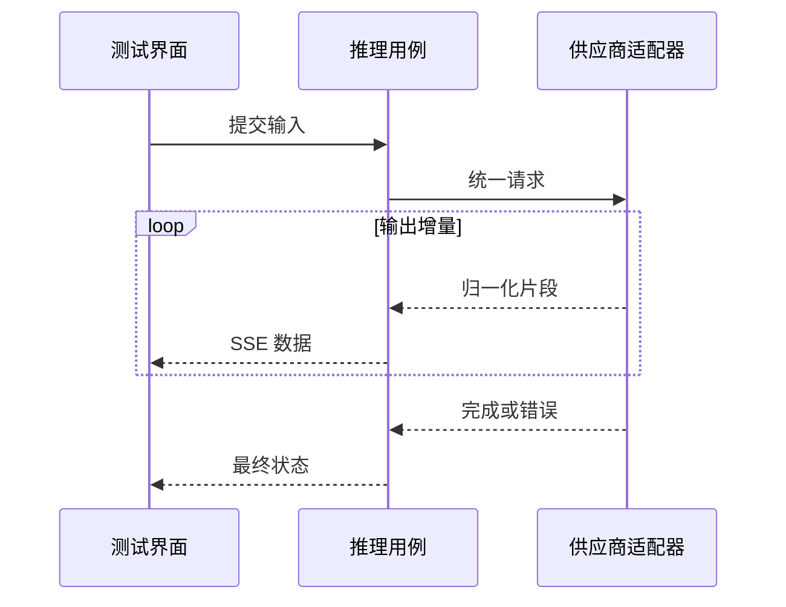

# 供应商适配与流式推理

## 先理解它解决什么问题

不同模型供应商的鉴权、参数和流事件并不相同。适配器将这些差异限制在边界内，业务用例处理统一的能力和事件，而不是到处判断某家供应商的原始字段。

**贯穿实例：** 一次文字回答可能先返回多段增量，再报告用量和结束状态。收到部分文字不等于调用成功，界面必须继续观察终止事件与错误。

## 图一：请求适配与响应归一化

```fpl-canvas
providers
```

图例：上排是向外发送请求，下排是返回响应的数据方向；下排从左重新开始阅读。云图标表示外部供应商，蓝色卡片表示适配边界，避免把请求和返回误读成同一条处理链。

## 图二：增量流与最终状态



图例：loop 框内事件可能发生多次，虚线是增量或结束返回。完成与错误都属于需要处理的终止反馈；收到一段文字不能推断整个流已经成功。

## 实现与设计取舍

模型条目描述能力和供应商映射，配置管理可展示供应商特定参数，公共推理协议保持供应商无关。调用日志记录必要的状态和诊断信息，凭证只在请求边界使用，不能把密钥写进可见图表或错误输出。

## 异常、验证与当前边界

取消、连接断开、限额与无效输入是不同情况。流式断开可能发生在供应商已经执行之后，不能默认重试。验证使用确定性适配器测试，不用真实收费请求代替测试。实时语音仅用于模型测试，没有电话或 Bot 接入。

## 代码入口与阅读顺序

1. `backend/app/llm/providers/streaming.py`
2. `backend/app/llm/providers`
3. `backend/app/llm/inference`

阅读时先定位输入和校验，再跟踪持久化或执行入口，最后对照输出与错误分支。可以把上方图复制到个人知识库加入自己的注释；副本不会随官方文章自动更新。
