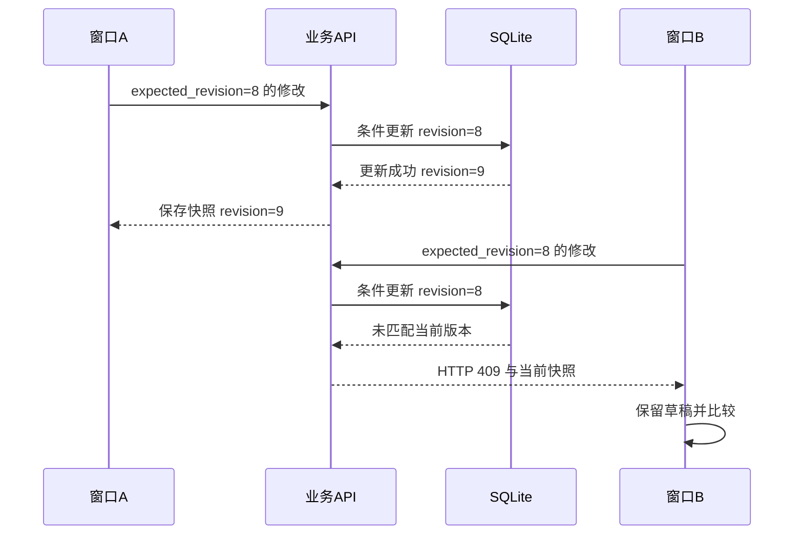

# 保存、历史与并发：防止静默覆盖

## 先理解它解决什么问题

自动保存解决操作频率，版本检查解决并发正确性，两者不能互相替代。客户端持有一份基于某个 revision 的草稿，提交时声明这一前提，服务器只在前提仍成立时更新。历史记录保存已经成功提交的内容。

**贯穿实例：** 两个窗口都读取 revision 8。窗口 A 先保存成 9，窗口 B 的旧版本提交应得到 409，界面保留 B 的本地修改以供比较或另存。

## 图一：两个草稿竞争同一个版本

```fpl-canvas
revision
```

图例：两名用户图标表示两个编辑窗口，不要求是两个账号。菱形表示数据库中的版本前提检查；右侧为这个到达顺序下的两种结果。若 B 先成功，A 同样需要处理冲突。

## 图二：经业务 API 完成版本比较



图例：实线是调用，虚线是响应。API 将 expected_revision 交给数据库 CAS，HTTP 409 由 API 返回，数据库不会直接向浏览器返回 HTTP 状态。

## 实现与设计取舍

更新条件把 ID、空间与版本放在同一个数据库比较交换操作中，避免先读后写的竞争窗口。画板的拖动结束和属性修改进入笔记正文；视图缩放与选中状态不修改文档。画板复用笔记的保存队列与历史，不另开第二条覆盖通道。

## 异常、验证与当前边界

缺少 revision 返回 422；冲突不做静默覆盖。保存失败与提交结果不明都应保留本地内容，避免自动重复业务动作。离开编辑器前仍走未保存保护，恢复历史也要基于当前版本再次提交。

## 代码入口与阅读顺序

1. `backend/app/runtime/project_records.py`
2. `backend/app/apps/thought_workshop/history.py`
3. `web/src/features/thought-workshop/historyDiff.ts`

阅读时先定位输入和校验，再跟踪持久化或执行入口，最后对照输出与错误分支。可以把上方图复制到个人知识库加入自己的注释；副本不会随官方文章自动更新。
