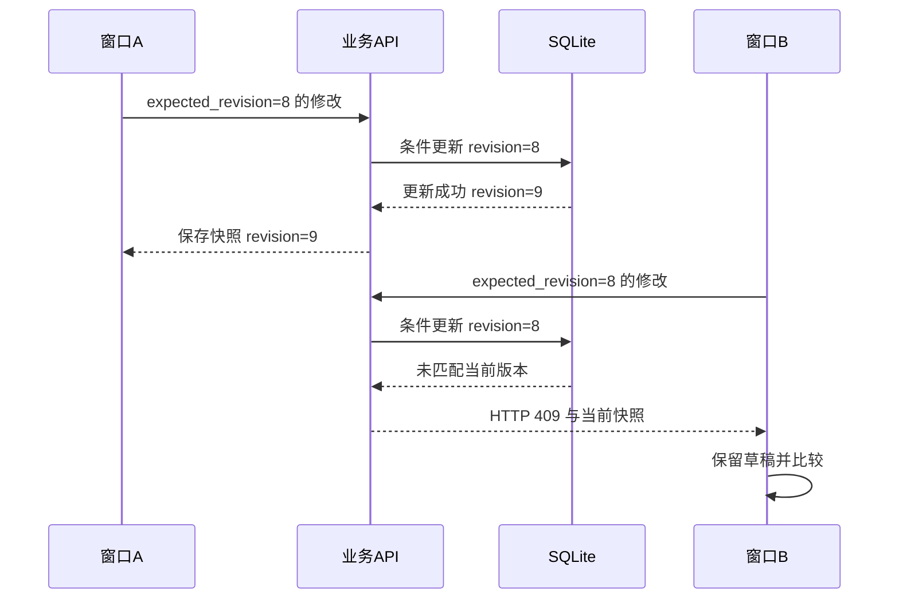

# 编辑、保存、历史与并发

两个窗口都打开了同一篇笔记。窗口 A 修改标题，窗口 B 修改画板；如果 B 保存时直接覆盖整个文档，A 的标题就可能消失。自动保存越快，并不会自动解决这个问题。

系统用 revision 表示“这份草稿基于哪个已保存版本”。假设两个窗口都读取版本 8，A 先保存为 9，B 仍以 8 为前提提交时就应产生冲突，让用户保留并处理两边的修改。

## 两个草稿竞争同一个版本

同样提交 revision 8，为什么只有先到达的一次能成功？

```fpl-canvas
revision
```

图例：两名用户图标表示两个编辑窗口，不要求是两个账号。菱形表示数据库中的版本前提检查；右侧为这个到达顺序下的两种结果。若 B 先成功，A 同样需要处理冲突。

数据库更新条件同时包含资源 ID、账号和预期版本。版本比较与写入在同一次条件更新中完成，这就是 CAS。它避免了“先读到 8，随后不再检查就覆盖”的竞争窗口。

## 经业务 API 完成版本比较

数据库发现版本不匹配以后，冲突怎样到达编辑器？



图例：实线是调用，虚线是响应。API 将 expected_revision 交给数据库 CAS，HTTP 409 由 API 返回，数据库不会直接向浏览器返回 HTTP 状态。

数据库只报告条件更新没有匹配记录，业务层读取当前快照并形成冲突，API 再返回 HTTP 409。B 窗口应保留本地草稿供比较，不能用最新 revision 重发同一整份旧正文，把版本检查变成形式。

## 自动保存安排时机，CAS 决定是否接受

画板拖动结束或属性修改会写回笔记；视图缩放、平移和选择不会改变正文。笔记保存流程收集这些内容变化，携带当前版本提交。一次请求在途时出现新的输入，后续保存仍需要基于已确认结果继续，不能让旧响应覆盖较新的本地草稿。

保存失败表示服务器没有确认这次草稿。连接断开则可能连提交结果都不确定，需要先确认服务器状态。离开页面、切换文档或进入官方库时，未保存保护仍然有效。

## 历史不是第二条写入捷径

成功提交的正文、标题与相关内容形成历史快照。查看历史是读取过去；恢复历史是把旧内容作为新的修改提交，因此仍需当前版本前提，并形成新的恢复记录。

应分别验证连续编辑、两个窗口冲突、失败后保留草稿、恢复历史这几种场景。只验证“点保存后提示成功”，无法证明并发写入不会丢内容。

> [!TIP]
> 收到 409 后先比较当前快照，再决定采用服务器内容或另存本地副本。缺少 revision 的 422 是请求缺项，不应通过无版本写入绕过。

## 本机恢复副本与服务器历史的不同责任

useNoteDraft 按账号、账号、笔记和标签页保存本机草稿，提供未确认输入的恢复机会。服务器历史记录已接受内容，两者不互相替代。本机草稿不是另一个可跳过 CAS 的写入入口；加载到恢复候选时先由用户恢复或丢弃，再继续保存。

一次 flush 克隆当前草稿，记录发送代次；响应只确认这次发送并推进 revision。若用户继续输入，较新的草稿仍需提交。输入法组合期间延后保存，组件关闭后旧响应不得更新新资源。目录移动有目录版本前提，不能借正文保存偷偷更改父节点或知识库。

## 用故障场景验证保存队列

检查两个窗口从相同 revision 出发只有一次成功、409 保留两份内容、网络错误保留草稿、旧成功响应不覆盖新输入，以及恢复历史生成新版本。离开编辑页或打开官方阅读仍走未保存保护。响应丢失时先读取状态确认，不机械地改 revision 后重发同一旧正文。

## 相关阅读

- [思绪工坊：富文本、画板与知识库](/apps/thought-workshop/official-knowledge-bases/technical/documents/thought-workshop)
- [SQLite、事务与迁移](/apps/thought-workshop/official-knowledge-bases/technical/documents/sqlite)
- [思绪工坊：保存与素材管理](/apps/thought-workshop/official-knowledge-bases/thought-workshop/documents/storage)
- [前端组件与状态分工](/apps/thought-workshop/official-knowledge-bases/technical/documents/frontend-design)

## 代码入口

1. `backend/app/runtime/project_records.py`
2. `backend/app/apps/thought_workshop/history.py`
3. `web/src/features/thought-workshop/historyDiff.ts`
