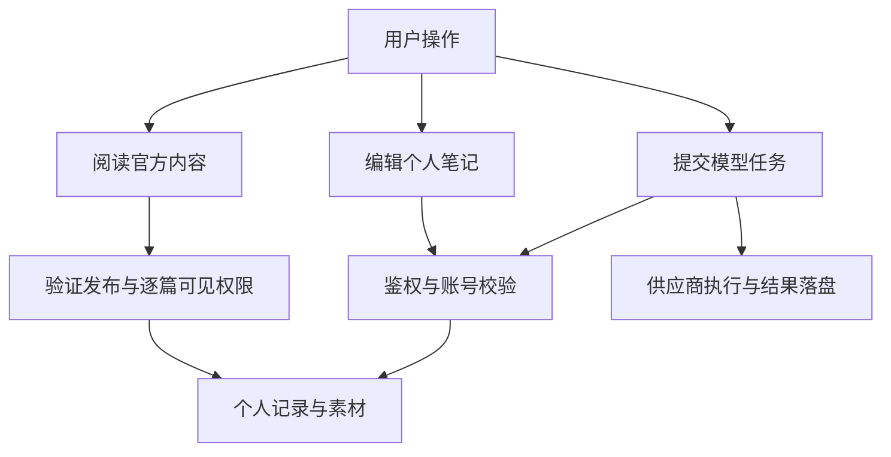

# 项目定位与系统边界

打开思绪工坊阅读官方文档、保存一篇私人笔记和生成一张图片，都发生在同一个应用里，但它们使用的资源与执行前提不同。官方阅读使用经过发布授权的数据库笔记；私人笔记写入当前账号；生成图片还要访问配置好的供应商。

本篇先建立系统边界，再给出阅读路线。理解这个边界后，可以判断一次失败应该检查本机服务、权限、数据版本还是外部网络，也能避免把单机部署理解成所有功能都离线执行。

## 图一：本机系统与外部依赖

哪些参与者在本机，哪些调用跨越网络？

```fpl-canvas
scope
```

图例：卡片区分用户、Web、桌面宿主、后端、存储与供应商。箭头表示运行调用或启动关系；存储卡片汇总两个持久化目标，不表示数据库负责读取图片。

Electron 托管桌面生命周期，Web 提供业务界面，正式写入经过 /v1。SQLite 保存结构化记录，素材目录保存二进制。供应商在本机边界之外；后端运行在本机并不会消除模型调用的网络、费用和失败条件。普通 Web 部署的启动方式不同，但业务规则仍由同一后端功能执行。

## 图二：先按操作分清执行前提

同一界面里，阅读、编辑和模型执行为何有不同的失败条件？



图例：方框表示操作及必要处理。多条分支说明资源前提不同，不表示所有操作一定串行或同时发生。官方阅读读取已存在的笔记记录，并可另行保存个人阅读偏好。主动导入才创建新笔记。

官方与普通发布共用笔记和图形组件；只读设置决定社区读者是否继承原有编辑权，显式逐篇授权仍可提供编辑能力。模型任务则还拥有独立任务身份与输出素材，不能从“画布上已有节点”推断外部工作已经完成。

## 单机部署仍需要隔离规则

项目面向单机模型基础设施管理与创作应用，同一服务进程、同一 SQLite 中支持多账号和逻辑多账号。逻辑隔离靠 Principal、资源归属和用例校验落实；它不是每个账号单独运行一个后端或数据库。普通业务接口中的跨账号 ID 按不存在处理，即使两个空间的项目标题相同，也不能相互读取。知识社区是显式的发布边界：登录账号先通过发布记录和逐篇授权，服务端再恢复源账号调用同一正文用例；它不放宽普通文档与文件接口。

实时语音属于模型测试能力。思绪工坊知识库是文档项目容器；本项目边界不包含模型检索知识库、电话接入、Bot、多实例部署或分布式写入。解释当前架构时，只把源码和测试已支持的路径画进运行图。

## 按问题选择阅读路径

| 你想理解的问题     | 建议顺序                          | 应得到的认识                 |
| ------------------ | --------------------------------- | ---------------------------- |
| 整体怎样组成       | 系统全景 → 代码组织               | 进程、存储与模块之间的关系   |
| 组件怎样拆分       | 前后端设计 → 组件契约 → 应用交接  | 输入输出、所有权与依赖边界   |
| 修改如何可靠保存   | 核心对象 → 权限 → 保存并发 → 素材 | 草稿、版本、事务与文件的区别 |
| 模型或视频如何执行 | 供应商 → 后台任务 → 媒体渲染      | 输入快照、外部执行与结果结算 |
| 怎样维护与交付     | 契约 → 测试 → 桌面 → 设计决策     | 版本一致和验收证据           |

## 如何判断理解是否准确

尝试描述一次带图片笔记保存：哪些数据由前端暂存，哪些进入数据库，哪些文件已经另行上传，成功响应确认什么。再把模型提交加入同一描述，指出外部等待没有占用数据库长写事务。能区分这两条路径，就建立了后续文章所需的系统认识。隔离测试可以验证业务行为；实际外部调用的结果还依赖所选供应商。

> [!NOTE]
> 先按对象和阶段定位问题。单机说明部署位置，账号说明数据归属，二者不能互相替代。

## 相关阅读

- [系统全景与一次操作的完整路径](/apps/thought-workshop/official-knowledge-bases/technical/documents/system)
- [代码组织与依赖方向](/apps/thought-workshop/official-knowledge-bases/technical/documents/modules)
- [关键设计决策与当前限制](/apps/thought-workshop/official-knowledge-bases/technical/documents/decisions)

## 代码入口

1. `backend/app/main.py`
2. `backend/app/api.py`
3. `docs/architecture/project-layout.md`
