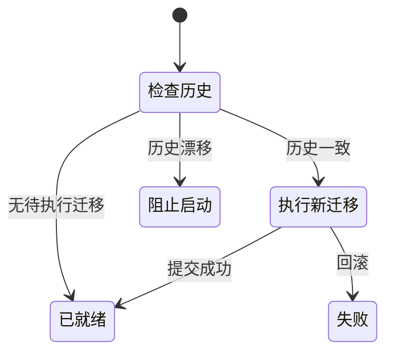

# SQLite 与迁移：单机数据如何可靠演进

升级应用时发现“迁移历史不一致”，与导入笔记时发生“内容校验失败”，需要完全不同的处理方式。前者涉及数据库结构与代码版本，后者涉及一份用户数据能否被当前业务接受。

假设新版本需要增加一个字段：这个结构变化通过登记的新 migration 完成。用户随后恢复一份知识库，则应调用正式导入 API。**迁移管结构演进，用例管运行期数据**，二者不能互相替代。

## 结构升级和运行数据的两条入口

升级和日常操作都写 SQLite，为什么需要两条入口？

```fpl-canvas
sqlite
```

图例：上方是版本升级，下方是日常业务操作，两条路径共同访问 SQLite。迁移不能替代用户导入、恢复和修复 API；箭头不表示两个执行器可以无条件并发写入。

上路由不可变的迁移注册表驱动，下路由具体业务请求驱动。把用户恢复操作塞进启动迁移，会失去用户选择、版本前提和错误反馈；反过来，让普通路由临时建表，也会让数据库状态无法通过版本记录复现。

## 迁移检查的启动状态

启动时如何知道数据库真的执行过当前代码声明的那组迁移？



图例：黑圆点表示起点，带条件的箭头表示状态转换。“阻止启动”与“失败”都不是就绪状态；失败后应排查并重新运行正式启动流程，不能改写迁移记录掩盖错误。

执行器按实际登记顺序读取已应用记录，验证每个 ID 和 checksum，并要求历史恰好是注册表的有序前缀。只有这个前提成立，剩余项才被视为待执行迁移。未知 ID、校验和漂移或顺序缺口都不能当作“已经升级”。

## WAL 不能消除长事务的代价

连接启用外键、WAL 和忙等待：外键守住引用，WAL 改善读写并行，忙等待容忍短暂锁竞争。SQLite 仍有写入协调成本，外部模型请求和大文件处理不能占着已经开始写入的事务。

一个可靠的生成任务会先用短事务准备状态，释放连接后等待供应商，再用另一短事务结算结果。AsyncSession 是单任务资源，不能让多个并行分支共享它并各自提交。

## 遇到漂移时保留现场

新结构只能追加迁移版本，不改写已经登记的 SQL、顺序或校验和。迁移应先在临时隔离数据库验证，再接触真实数据。正式数据的桌面热加载会阻止待执行或漂移迁移，不在热更新过程中偷偷升级。

恢复前先确认应用停止和备份完整。只复制 SQLite 主文件而遗漏素材、配置或相关运行目录，不能得到完整的应用备份。遇到校验失败应定位版本与备份来源，不删除数据库来绕过启动检查。

> [!WARNING]
> 不要手工修改 schema_migrations、migration checksum 或真实数据库结构。这会抹掉诊断依据，也不能证明旧数据符合新 schema。

## 相关阅读

- [保存、历史与并发：防止静默覆盖](/apps/thought-workshop/official-knowledge-bases/technical/documents/revision)
- [Electron 桌面：本机服务与私有边界](/apps/thought-workshop/official-knowledge-bases/technical/documents/desktop)
- [素材与导出：引用、快照和包有什么不同](/apps/thought-workshop/official-knowledge-bases/technical/documents/assets)

## 代码入口

1. `db/migrations/registry.py`
2. `db/migrations/runner.py`
3. `tests/test_sqlite_migration_history.py`
