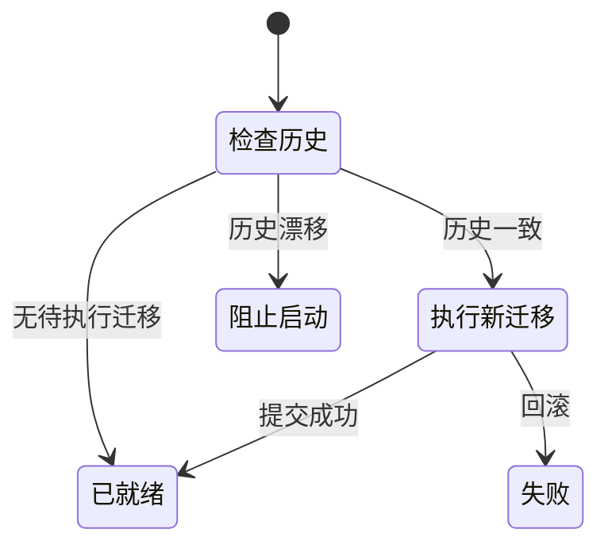

# SQLite 与迁移：单机数据如何可靠演进

## 先理解它解决什么问题

SQLite 保存项目、版本与任务记录。外键约束保持归属完整，WAL 改善读写并发，忙等待应对短暂写锁；这些机制不会把 SQLite 变成任意并发写入的分布式数据库。迁移记录用于判断当前结构是否符合运行代码。

**贯穿实例：** 升级后新增一列应通过已登记的新 migration 完成；恢复一份用户笔记则是运行期业务操作，应走正式 API，不通过临时 SQL 脚本完成。

## 图一：结构升级和运行数据的两条入口

```fpl-canvas
sqlite
```

图例：上方是版本升级，下方是日常业务操作，两条路径共同访问 SQLite。迁移不能替代用户导入、恢复和修复 API；箭头不表示两个执行器可以无条件并发写入。

## 图二：迁移检查的启动状态



图例：黑圆点表示起点，带条件的箭头表示状态转换。“阻止启动”与“失败”都不是就绪状态；失败后应排查并重新运行正式启动流程，不能改写迁移记录掩盖错误。

## 实现与设计取舍

迁移代码不能依赖运行时 app。已登记 ID、顺序与 SQL 不改写；修复通过追加版本表达。AsyncSession 是单任务资源，并行分支不能共享。长网络等待和大文件工作安排在写事务之外，在准备与结算时采用短事务。

## 异常、验证与当前边界

正式桌面热加载不自动接受新增或漂移迁移。迁移首次接触真实数据前必须在临时数据库验证。完整备份还包含素材和配置，不能只复制 SQLite 主文件；禁止通过篡改迁移 checksum 假装升级完成。

## 代码入口与阅读顺序

1. `db/migrations/registry.py`
2. `backend/app/runtime/project_records.py`
3. `tests/test_sqlite_migration_history.py`

阅读时先定位输入和校验，再跟踪持久化或执行入口，最后对照输出与错误分支。可以把上方图复制到个人知识库加入自己的注释；副本不会随官方文章自动更新。
