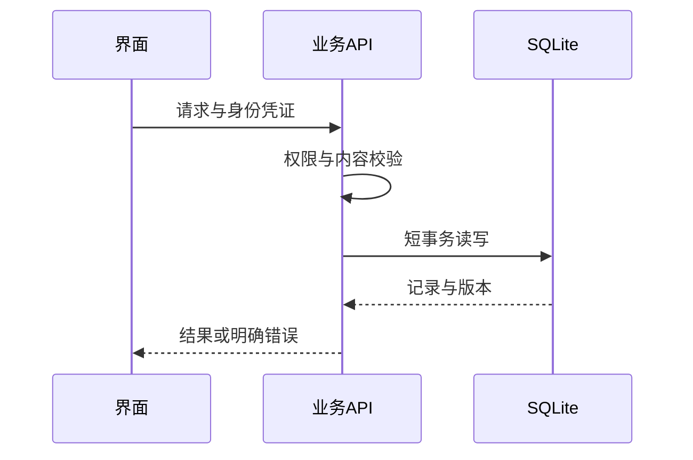

# 系统全景：一份操作如何穿过应用

## 先理解它解决什么问题

Future Props Lab 是单机运行的模型基础设施与创作应用集合。Web 或 Electron 界面表达用户意图，FastAPI 承接正式业务操作，SQLite 保存结构化记录，素材存放在受管理的文件目录。单机并不等于单账号：同一进程内仍按 Workspace 隔离内容。

**贯穿实例：** 在思绪工坊保存一张画板时，画板元素进入笔记 JSON；上传的图片通过素材 ID 引用。保存成功既不等于导出了 PNG，也不等于提交了模型任务。

## 图一：应用调用与两类持久数据

```fpl-canvas
system
```

图例：用户图标代表界面，服务器代表正式业务入口；黄色数据库和紫色文件卡片是两个并列的持久化目标。箭头表示用例发起的调用，SQLite 不负责读写素材目录。画板结构进入数据库，画板图片由素材能力管理。

## 图二：一次业务请求的时序



图例：竖线表示参与者，实线箭头是请求，虚线是返回。校验位于事务之前；响应中的版本用于下一次保存。图中省略鉴权中间件和素材 I/O，具体分工见图一。

## 实现与设计取舍

系统按业务能力拆分，而不是让全部应用共享一个通用可变对象。路由负责协议转换；所属功能拥有默认文档、业务规则与事务。素材内容与结构化记录分别存储，降低大文件挤占数据库事务的风险。Web 生产请求通过生成契约访问后端，桌面壳负责本机启动和连接边界。

## 异常、验证与当前边界

界面刷新会丢失未保存的内存状态，因此必须检查保存反馈。网络等待不应占着已经写入的长事务；供应商不可用不会成为绕过校验或直接改数据库的理由。当前不提供多实例分布式部署，也没有模型检索知识库：思绪工坊的知识库是文档容器。

## 代码入口与阅读顺序

1. `backend/app/main.py`
2. `backend/app/api.py`
3. `docs/architecture/project-layout.md`

阅读时先定位输入和校验，再跟踪持久化或执行入口，最后对照输出与错误分支。可以把上方图复制到个人知识库加入自己的注释；副本不会随官方文章自动更新。
